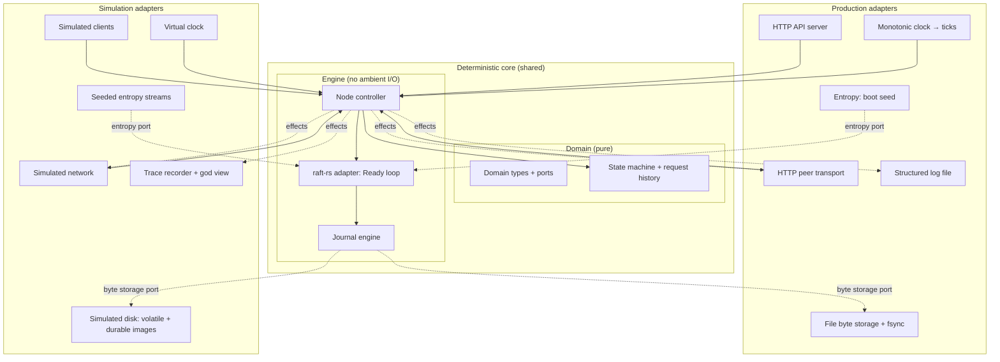
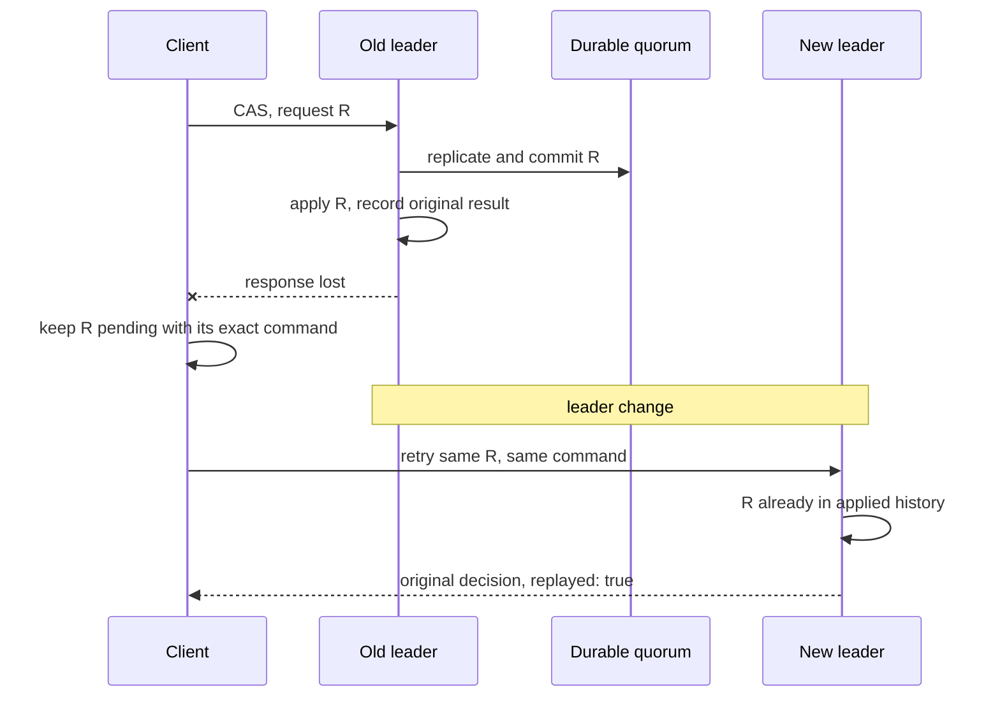
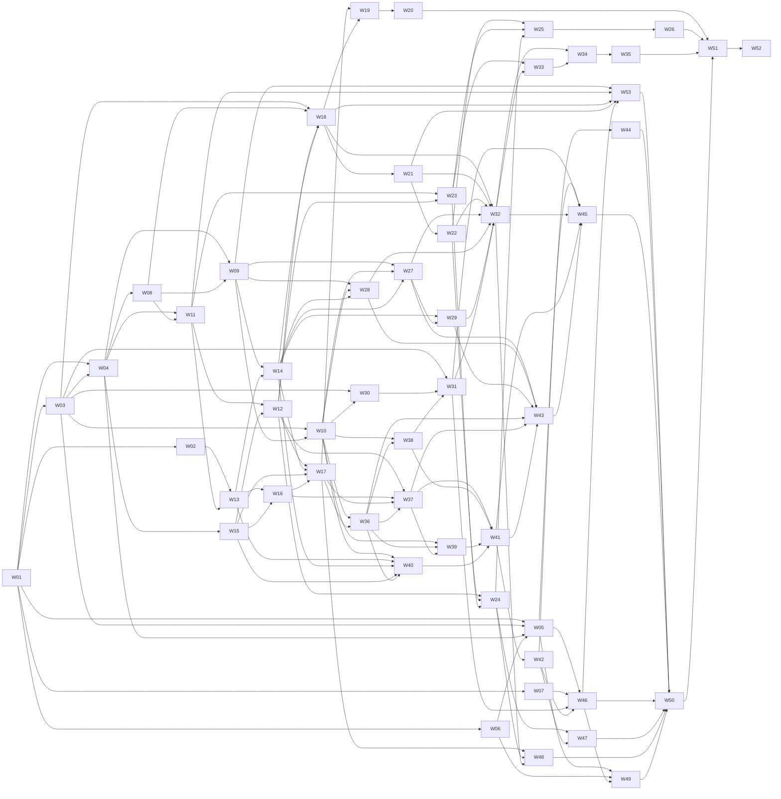

# keyval — Project Plan

| Field | Value |
|---|---|
| Document version | 1.10 |
| Status | **Active** — approved by the owner on 2026-10-01 after five independent review rounds and a fix-verification pass (D-43…D-76, §16); all §15 dispositions accepted at their defaults. Change control per §0.5 and §16. |
| Last revised | 2026-10-03 |
| Owner | Project owner (the human running the swarm) |
| Project name | `keyval` |
| Delivery shape | Rust; one five-voter Raft group; HTTP/JSON; local development and verification |

---

## Table of Contents

- 0. Reading Contract
- 1. Summary
- 2. Goals & Non-Goals
- 3. Background Primer
- 4. Scope
- 5. Principles
  - 5.1 Project principles
  - 5.2 Code design principles
- 6. Requirements
- 7. Architecture
- 8. API Contract
- 9. Failure Model and Behaviour Walk-throughs
- 10. Verification & Conformance
- 11. Development Process
- 12. Work Graph
- 13. Definition of Done (v1)
- 14. Risks
- 15. Open Questions and Owner Dispositions
- 16. Decision Log
- 17. Immediate Next Steps
- 18. Glossary
- Appendix A. Proposed Repository Layout
- Appendix B. Further Reading (optional)

---

## 0. Reading Contract

### 0.1 What this document is

- The single source of truth for **what** we build, **why**, **how it is verified**, and **how the work is organised**.
- **Self-contained.** A capable engineer or coding agent who reads only this document has everything needed to start. Links in Appendix B are optional background.
- A **plan**, not an implementation report. Nothing here claims that code exists.

### 0.2 Normative language

- `MUST`, `MUST NOT`, `SHOULD`, `SHOULD NOT`, `MAY` are normative when capitalised (RFC 2119 meaning).
- Lower-case "must", "should" etc. are ordinary English.

### 0.3 Status labels

| Label | Meaning |
|---|---|
| **Decided** | Settled. Change only via the Decision Log (§16) with owner approval. |
| **Proposed** | Recommended default; applies unless the owner overrides. |
| **Open** | Not yet decided; has a decision procedure (§15). |
| **Rejected** | Considered and ruled out, with a reason and a condition for reopening (§16.2). |

### 0.4 Precedence

When two sources disagree, the higher one wins:

1. Explicit owner instruction (chat, or a bead comment written by the owner)
2. This `PLAN.md` (and `registry/workgraph.toml`, which mirrors §12.2's ids, dependencies, reqs and areas, §11.11)
3. `api/openapi.yaml`
4. Checkers, invariants, the reference model and the verification registry (§10.5, §10.13, §10.14)
5. Tests
6. Beads (task descriptions)
7. Code

Rules:

- A disagreement between any two of these is a **defect**.
- Agents MUST NOT resolve a disagreement by quietly choosing the convenient side. They MUST:
  - file a bead labelled `conflict` that cites both locations;
  - carry on with other work.
- Lower items are corrected to match higher items, never the reverse, unless the owner changes the higher item.
- **Oracles can be wrong too.** A suspected checker or model bug is handled as a `conflict` with an independent counterexample, never by editing the expected answer until the test passes (§11.5, rule 3).

### 0.5 Changing this document

- §2, §4, §5, §6, §7.4–§7.11, §8, §9, §10.2 (run phases, heal and the disk/crash model), §10.5, §10.6, §10.8, §10.11, §10.13, §10.16, §11.10 and §13 are **normative** and owner-owned. Agents MUST NOT change their meaning.
- To propose such a change, an agent files a bead labelled `plan-change`.
- Agents MAY fix typos and clarify non-normative text, bumping the patch version (e.g. 1.4 → 1.4.1).
- Every decision, including rejected options, is recorded in §16.

### 0.6 Execution status

- No server, checker, bead or gate exists yet (the repository holding this plan does). Commands shown here (`./dev …`, `keyval …`) define **interfaces the work graph must implement**.
- **A missing command, a missing check, a test selection that ran zero tests, or an incomplete campaign never counts as a pass** (P10).

---

## 1. Summary

keyval is a hobby-scale, **5-node key-value store with a strongly consistent (CP) write path** — linearizable mutations through Raft — and local, committed-prefix reads that may be stale (§3.3). It is written in Rust and accessed over an HTTP/JSON API described by an OpenAPI spec.

**Operations**

- `PUT`, `GET`, `DELETE`, `SCAN`, `COMPARE_SWAP`, plus a read-only **request status** lookup.
- Writes are replicated through **Raft** and are linearizable.
- Reads are served locally by any ready node and **may be stale**, but never show uncommitted data.

**Where the effort goes**

- **Correctness under node and network failure.**
- Evidence comes from a FoundationDB-style **deterministic simulator**. It runs the real node logic, the real Raft library and the real persistence code against a simulated network, disk and clock, injects faults from a seed, and judges every run with independent automated checkers.
- Every failure is replayable from its seed, and automatically packaged for diagnosis.
- A small set of **real-file process-crash probes** checks that the production storage adapter recovers real files correctly; power-loss durability rests on stated assumptions (§10.15, §10.17).

**Three decisions shape everything else:**

1. **Prove the deterministic consensus boundary first.** Vendor and pin the Raft library, inject every source of randomness it uses, and prove that identical seeds give byte-identical traces in fresh processes, before building on it (W02).
2. **One conservative persistence protocol, shared by both environments.** An append-only journal is the durable authority. Entries and votes are synced before any dependent message leaves the node; the state machine is rebuilt by replaying the committed log. No snapshots, no pipelining in v1 (§7.4–§7.7).
3. **Retry safety never expires.** Every write carries a client-generated request ID. Its first execution and result are part of replicated state for the life of the cluster. Retrying can never apply a write twice, however late the retry arrives (§7.5).

**Delivery shape.** The first runnable slice is deliberately thin: durable PUT/GET on a real node and on a simulated five-node cluster (M1). It widens to a real five-process cluster (M2), then the full API (M3), then the full evidence suite (M4), then release (M5). Verification work runs in parallel from M1 onwards rather than being bolted on at the end.

**The real subject is the development process.** The project is deliberately "moderate": too much for one engineer by hand in a short time, but tractable for a swarm of AI coding agents. It exists to exercise the **Agentic Coding Flywheel** toolkit (§11) end to end:

- plan → task graph
- parallel agents on one shared `main`
- mechanical quality gates with exact-tree evidence
- human review of running outputs, not of code

**Speed over sophistication.** Wherever a choice is not central to those aims, we pick the **simplest correct option** and move on.

---

## 2. Goals & Non-Goals

### 2.1 Goals

| ID | Goal |
|---|---|
| **G1** | *(Primary)* Exercise the agentic development flow on a non-trivial project, from this plan through beads, parallel agents, mechanical gates and human output review. |
| **G2** | Deliver a working 5-node key-value store with a CP write path and the API in §8. |
| **G3** | Produce *evidence*, not claims, that the store behaves correctly under the failures in §9, and state exactly how far that evidence reaches (§10.15). |
| **G4** | Stand up v1 quickly. Prefer the simplest correct option whenever a choice is not central to G1–G3. |

### 2.2 Non-Goals (v1)

| Non-goal | Why |
|---|---|
| Authentication, authorisation, TLS | Not relevant to G1–G3. Endpoints default to loopback (O-9); this is not an internet-facing service. |
| Performance tuning / benchmarks | Deferred. Correctness first. No latency or throughput target is claimed. |
| Multi-key transactions, batch operations, TTL | Adds complexity without serving the aims. |
| SQL, secondary indexes | Out of domain. |
| Sharding / multiple Raft groups | v1 is one Raft group. Sharding is a possible v2+. |
| Dynamic membership, replacing a lost voter | v1 has five fixed voters (D-08). |
| Snapshots, log compaction | v2 (§4.2). v1 keeps the whole log, within a stated capacity (DM-7). |
| Multi-datacenter | Out of domain. |
| Byzantine (malicious) faults | Raft does not tolerate them. |
| Writing Raft from scratch | We borrow a library (D-05); the aim is the dev process, not consensus research. |
| Traditional human code review | The owner reviews running outputs; mechanical gates replace code review (§11.6). |
| A general real-process fault framework | v2. v1 has only fixed real-file crash probes and a lifecycle smoke test (T-14). |

---

## 3. Background Primer

This section gives just enough theory to follow the rest of the plan.

### 3.1 CAP, and why this project is CP

- **CAP.** During a network *partition* (P), a replicated system must choose between:
  - **Consistency (C):** every read sees the latest write, and writes never conflict;
  - **Availability (A):** every node keeps answering.
- **An AP system** stays writable on both sides of a partition and reconciles conflicts later.
- **A CP system** refuses writes on the minority side so that it never has conflicts.
- **We chose CP (D-01).** The project's effort goes into consensus, `COMPARE_SWAP` needs a single agreed order of writes, and linearizability is a crisp property that checkers can verify.
- **Reads are the one AP-ish relaxation.** Any ready node answers them, even in a minority partition, at the cost of possible staleness (D-06).

### 3.2 Raft in one page

- **Cluster.** 5 nodes. At most one is **leader** per **term**, where a term is a monotonically increasing election epoch. The others are **followers**.
- **Log.** Clients' writes become **entries** appended to the leader's log. The leader replicates entries to followers.
- **Commit.** A leader treats an entry as **committed** once an entry *from its current term* at or after that index is durably stored on a **majority** (3 of 5). Entries from earlier terms become committed only indirectly, when a later current-term entry commits. (Counting replicas of an old-term entry is *not* enough: a later leader could still overwrite it.) This is why a new leader appends an empty "no-op" entry at the start of its term. Committed entries are then **applied**, in log order, to each node's **state machine** (for us, the key-value map).
- **Elections.**
  - A follower that hears nothing from a leader for an **election timeout** becomes a **candidate** and requests votes.
  - A node grants at most one vote per term, and only to a candidate whose log is at least as up-to-date as its own.
  - A majority of votes makes the candidate leader.
  - **Pre-vote** lets a node check it could win before disrupting the cluster with a new term. **Check-quorum** makes a leader step down when it can no longer hear a majority.
- **Safety guarantees** (the invariants we check, K-8):
  - **Election safety:** at most one leader per term. (Two nodes can *believe* they lead at the same time, in different terms. That alone is not a violation.)
  - **Log matching:** if two logs contain an entry with the same index and term, the logs are identical up to that index.
  - **Leader completeness:** a committed entry is present in the logs of all future leaders.
  - **State machine safety:** no two nodes apply different entries at the same index.
- **Fault tolerance.** 5 nodes tolerate **2** simultaneous failures. With 3 or more nodes down or cut off, writes stop and **nothing already committed is lost**.

### 3.3 Linearizability vs stale reads

- **Linearizable** means each operation appears to take effect atomically at some instant between its invocation and its response. As a consequence, all clients agree on one total order of operations.
- **Our writes are linearizable.** The Raft log order *is* that total order, and a successful PUT or CAS gets the log index of its execution as its **version** (DM-3).
- **Our reads are not linearizable.** A node answers from its own applied state, which may lag the leader.
  - We guarantee a read reflects **some committed prefix** of the log that the node had actually applied when it answered. We report which prefix (`applied_index`), so staleness is visible and checkable (C-3, K-5).

### 3.4 Idempotency and ambiguous outcomes

- **Ambiguity.** A client that times out on a write cannot know whether it was applied. The entry may still commit after the leader failed to answer.
- **Unknown outcome.** We never pretend to know: the server returns an explicit `unknown_outcome` error (§8.4).
- **Request ID.** Clients attach an `Idempotency-Key` (a random 128-bit request ID) to every write. Retrying with the same ID and the same command is always safe:
  - if the original was applied, the retry returns the original result;
  - if it was not, the retry applies it once.
- **Reuse is detected.** The same ID with a *different* command is refused (`request_id_conflict`) and never changes data.
- **No expiry.** The record of every executed request is part of replicated state for the life of the cluster (DM-5), so a retry is safe however late it arrives.

### 3.5 Deterministic simulation testing

- **Deterministic core.** All node logic (the key-value state machine, request handling, the Raft library and the persistence engine) runs without touching real time, random numbers, threads or the OS directly. It reaches the outside world only through **ports**.
- **Two sets of adapters.** In hexagonal (ports-and-adapters) terms, the core is the hexagon (§7).
  - The **production adapters** connect those ports to real sockets, files and clocks.
  - The **simulation adapters** run 5 nodes in one thread. They drive them with seeded random choices against a *simulated* network, disk and clock, which can drop, delay, duplicate, reorder, partition, pause and crash.
- **Reproducibility.** The same seed gives exactly the same execution, so any bug found can be replayed indefinitely.
- **Speed.** Virtual time runs much faster than real time, so very large numbers of fault scenarios are feasible on one machine. This is the approach FoundationDB made famous.

### 3.6 fsync and durability

- A write to a file sits in the OS cache until `fsync` forces it to disk. A crash can lose anything not yet synced. It can also keep **part** of an unsynced append: none of it, some prefix of it, or all of it. (Treating what survives as a *prefix* of the append is itself an assumption about the filesystem, stated in §10.2 and §10.15; recovery fails closed on damage outside that model.)
- Creating a file is only durable once its **directory** is synced as well.
- A sync can complete on disk and the process can crash before learning that it did.
- Raft is only safe if log entries and votes are synced **before** the node acts on them, e.g. before acknowledging an append or granting a vote.
- The simulated disk models all of these cases (§10.2); real-file probes check the production adapter against them (§10.17).

### 3.7 How a Raft library is driven

- The library we use (`raft-rs`, D-05) is a **consensus module only**. It does not own storage, networking or time. The application drives it:
  - feed it inputs: `tick`, a peer message (`step`), or a new proposal (`propose`);
  - ask whether it has work ready; if so, take one **Ready** bundle containing new entries and hard state to persist, messages to send, and newly committed entries to apply;
  - persist, send and apply in the right order (§7.4), then tell the library the Ready is done (`advance`), which can yield a smaller **LightReady** with further messages and committed entries.
- Getting this order wrong is the classic way to lose acknowledged data. §7.4 fixes it precisely.

---

## 4. Scope

### 4.1 v1 in scope

- Single Raft group, **5 nodes**, static membership (D-08).
- Operations: `PUT`, `GET`, `DELETE`, `SCAN` (range), `COMPARE_SWAP` (on version), and read-only request status lookup.
- HTTP/JSON API, specified first in OpenAPI (D-12).
- Append-only durable journal with fsync, plus crash-restart recovery.
- Permanent, replicated retry safety via required request IDs.
- Explicit, named resource limits with typed overload and capacity outcomes (§7.11).
- Health (live and ready) and cluster-status endpoints; a CLI that persists pending requests; one-command local 5-node launcher.
- **Deterministic simulator:**
  - simulated network, disk (including partial unsynced survival) and clock;
  - nemesis (fault injector), swarm configurations and a coverage matrix;
  - workload generator;
  - independent checkers, including a black-box linearizability witness;
  - seed and scenario replay, crash packs, shrinking and a regression corpus.
- Checker self-test via deliberately injected bugs.
- Independent black-box API conformance suite, validated against a reference model server.
- Real-file crash probes and a five-process lifecycle smoke test (T-14).
- Staged verification gates (T0–T3) with exact-tree receipts.
- Measurements of behaviour under failure.

### 4.2 Later (v2+), rough priority order

1. Log compaction and snapshots, with snapshot install for lagging nodes. Snapshots MUST carry the request history (DM-5); a state-only snapshot would break retry safety.
2. General real-process fault injection (random kill -9, network partitions between OS processes), reusing the black-box checker K-10.
3. Opt-in linearizable reads (ReadIndex).
4. Dynamic membership (add/remove node, replace a lost voter).
5. Deferred faults: clock drift, torn synced sectors, fsync lies, disk full, corruption.
6. Swap in an alternative consensus library behind the same Consensus port.
7. Performance work (e.g. pipelined persistence, a disk-resident state machine).
8. Sharding (multiple Raft groups).

### 4.3 Out of scope

Everything in §2.2.

---

## 5. Principles

These are the project's non-negotiables. Each one is enforced by a gate, lint, type or rule, not by goodwill.

### 5.1 Project principles

| ID | Principle | Enforced by |
|---|---|---|
| **P1** | **Simplest correct option wins.** If it isn't central to G1–G3, don't gold-plate it. | Plan review; §16 |
| **P2** | **Correctness before performance.** | Non-goals (§2.2) |
| **P3** | **One deterministic core, two sets of adapters.** All domain logic, the Raft adapter and the persistence engine are shared by production and simulation (hexagonal, CD-1). No logic that runs only in one environment. | Crate layout (App. A); dependency-rule check; parity check (W48); T-2 |
| **P4** | **Determinism is a hard requirement.** Same seed + same build ⇒ byte-identical execution trace, including across fresh OS processes. | Determinism lint + fresh-process replay (§7.14, §10.7) |
| **P5** | **Evidence over claims.** Every MUST requirement has at least one traced, executed check, and every claim states its class (§10.15). | Verification registry gate (§10.13) |
| **P6** | **Real slices only.** No stand-in presented as the real thing. An in-memory store is never called durable; no empty placeholder crates; no stub that "passes"; a simulated slice is never presented as a real server. | Agent rules (§11.5) |
| **P7** | **Local verification is the authority.** Every gate is a repo-owned command that runs on the dev machine. | `./dev gate …` (§10.10) |
| **P8** | **Ambiguity is explicit.** "Unknown outcome" is a first-class result, never a guess. A missing record is never evidence that a write did not happen. | API (§8.4); K-12 |
| **P9** | **Oracles are sacred.** Never weaken a checker, invariant, test, fixture or seed corpus to make something pass. | Rule (§11.5); checker self-test (§10.6); oracle protection |
| **P10** | **No vacuous passes.** A missing check, a zero-test selection, an unexercised fault, an exhausted budget or an incomplete campaign is a failure, not a pass. | K-13; gate runner (§10.10) |
| **P11** | **Exact-tree evidence.** A gate receipt describes exactly the tree that was committed, not a shared checkout that other agents were editing. | Commit wrapper (§11.10) |

### 5.2 Code design principles

These govern how code is shaped. They matter more than usual here: agents write the code, nobody reviews it by hand (D-17), and the next reader is an agent with no context. Where a lint enforces a principle, the lint is configured in W01/W04 and MUST NOT be disabled (§11.5). Lints are pinned to the project's toolchain and tested (a probe file must be rejected) rather than assumed from documentation.

"Deterministic crates" means the pure domain crates (`types`, `statemachine`) plus the deterministic engine crates (`node`, `journal`, `raft_adapter`) (§7.1, Appendix A).

| ID | Principle | Example in keyval | Enforced by | Limit of the mechanism |
|---|---|---|---|---|
| **CD-1** | **Hexagonal architecture (ports and adapters).** The deterministic core has no ambient I/O. It defines **ports** in its own types; **adapters** implement them for production or simulation; one **composition root** per environment wires them together. Dependencies point inward only. | Deterministic crates never depend on HTTP, sockets, the filesystem API, an async runtime or simulator types; no library type crosses the Consensus port. | Dependency-rule check in T0 (§10.10); banned-import check on public APIs | Dependency direction does not prove semantic purity; the parity check (W48) covers the rest |
| **CD-2** | **Make invalid states unrepresentable.** Model state so that impossible combinations cannot be constructed, rather than checking for them at runtime. | Node lifecycle is `Starting → Recovering → Ready → Failed`; an attempt is `NotSubmitted`, `Submitted` or `Terminal(result)`, never independent booleans (an *unknown outcome* is a response about a `Submitted` attempt, not a fourth state — §7.8); CAS expectation is `Absent` or `Version(v)`. | Types; compile-fail fixtures | Persisted bytes still need parsing (CD-3) |
| **CD-3** | **Parse, don't validate.** Raw input is converted once, at a boundary, into domain types whose constructors enforce the rules. The core never re-checks. Each boundary (HTTP, peer messages, disk) has its own parser. | `Key::parse` enforces DM-1; `Value::parse` enforces DM-2; the journal decoder rejects malformed frames; config is parsed into a validated `Config`. | Private fields + smart constructors | — |
| **CD-4** | **A distinct type for each kind of quantity.** No bare integers or strings cross a module boundary for identifiers, indices or counts. Arithmetic is checked. | `NodeId`, `ClusterId`, `Term`, `LogIndex`, `Version`, `Tick`, `RequestId`, `ByteCount`, `PageSize` are separate types; comparing a `Version` with an applied `LogIndex` requires an explicit conversion. | Types; public-API audit | — |
| **CD-5** | **Exhaustive matching.** No catch-all arms on domain enums, so adding a variant forces every handler to be updated. | Adding a new command or error code breaks the build until every `match` handles it. | Lint: wildcard enum match arms denied in deterministic crates; AST check for catch-all identifier arms | — |
| **CD-6** | **Expected failures are values; broken invariants crash.** Anticipated outcomes are typed results. A violated invariant means the code is wrong: panic immediately with context. | `version_mismatch`, `not_leader`, `busy`, `capacity_exceeded`, I/O errors are result values; "applied index went backwards" is a panic. In simulation a panic is a failing seed. | Typed error enums (no string errors); CD-7 | — |
| **CD-7** | **Assert invariants in the deterministic core.** State each type's invariants and check them at the point of change, in all builds (performance is not a v1 concern). Assertion messages carry node, index and invariant ID. | `applied_index ≤ commit_index`; a key's version never decreases; a suffix replacement never touches the committed prefix; bounded collections never exceed their limit. | Assertions; test-only corrupt-state fixtures must fire them; bug-injection self-test (§10.6) | — |
| **CD-8** | **No `unwrap`, `expect`, `panic!`, `todo!`, `unimplemented!` or `unsafe` in first-party production code**, including our patch to the vendored Raft library. Tests may use them. Deliberate invariant assertions (CD-7) are the only sanctioned panics, written with the project's `invariant!` macro (built on `assert!`, which the lints allow) — so bare `panic!` stays denied and no `allow` attribute is ever needed. | — | Lints: `unsafe_code` forbidden; `unwrap_used` / `expect_used` / `panic` / `todo` / `unimplemented` denied outside tests | Third-party internals are pinned and audited, not claimed compliant (§15, Q5) |
| **CD-9** | **Put a limit on everything.** Every queue, map, buffer, cache and retry loop has a named, configured maximum in one limits registry. Hitting it is a typed outcome, not silent growth. | See the limits table (§7.11). The on-disk journal is the one explicitly bounded-by-capacity growth (DM-7). | Limits module; bounded wrapper types; N−1/N/N+1 property tests; assertions (CD-7) | — |
| **CD-10** | **One source of truth for each fact.** Store each fact in exactly one place; derive it everywhere else. | The journal is the durable authority; the key-value map and request history are derived by replay; term, leader and commit index come from the Consensus port; static config owns every setting. | Recovery and cache-eviction tests; agent rule (§11.5) | Caches must be labelled as derived |
| **CD-11** | **Boring over clever.** Small modules, plain names, no macro or type-level tricks without need. Every public domain type has a doc comment stating its invariants. | — | Lint: missing docs denied on public items in deterministic crates | Clarity itself is judged by audits (§11.9) |
| **CD-12** | **Every dependency is justified.** Deterministic crates start with the standard library plus the vendored Raft library. Each direct dependency anywhere is listed in `DEPENDENCIES.md` with purpose, scope, version, licence and source. | A new crate that pulls in its own RNG or clock threatens determinism (P4). | T0 check: direct dependencies ⊆ `DEPENDENCIES.md`; lockfile committed | — |

---

## 6. Requirements

These are user-facing requirements. Each has an ID; beads and tests cite these IDs (§10.13). "Level" uses §0.2 language.

### 6.1 Personas

- **Client developer.** Calls the HTTP API; needs clear semantics, especially for errors and retries.
- **Operator.** In practice the owner, running a local 5-node cluster. Needs to start, stop, kill and inspect nodes safely.
- **Test harness.** The simulator and conformance suite; needs deterministic, observable behaviour.

### 6.2 Data model

| ID | Level | Requirement |
|---|---|---|
| DM-1 | MUST | A **key** is a UTF-8 string of 1–256 bytes, measured after decoding (not characters, not JSON-escaped length). Keys are stored exactly: no case or Unicode normalisation, so composed and decomposed forms are different keys. |
| DM-2 | MUST | A **value** is a UTF-8 string of 0–65,536 bytes (64 KiB), measured after decoding. |
| DM-3 | MUST | **Versions.** A successful PUT or COMPARE_SWAP executed at log index *i* gives the key version *i*. Consequences:<br>• a key's version strictly increases over time, including across delete and re-create;<br>• a same-value PUT still gets a new version;<br>• DELETE and failed CAS assign no version;<br>• a replayed request returns its **original** version, never the index of a duplicate entry;<br>• versions have gaps (no-ops, deletes, failures); clients must not assume continuity;<br>• versions are scoped to one cluster identity (DUR-8). |
| DM-4 | MUST | Keys are ordered by byte-wise lexicographic order of their UTF-8 encoding (used by SCAN). |
| DM-5 | MUST | **Request history.** The replicated state includes, for every executed request ID: the log index of its first execution, a digest of its canonical command, and its terminal result. It is **never expired or evicted** for the life of the cluster; only derived caches are bounded. |
| DM-6 | MUST | **Live-state capacity.** The live key-value state is bounded (default 10,000 keys and 64 MiB of key+value bytes, identical on all nodes). A write that would exceed it gets the deterministic terminal result `capacity_exceeded`; PUT and a matching CAS are checked identically (§7.5). DELETE and shrinking overwrites always remain possible within the history capacity (they still append log entries, so DM-7 bounds them too). *(Owner-accepted default, §15 Q2.)* |
| DM-7 | MUST | **History capacity.** Admission is limited by two quantities of committed replicated state: the leader refuses new mutations before proposal with `history_full` once its **commit index** reaches `max_log_entries` (default 1,000,000) **or** cumulative first-execution command bytes (tracked by the state machine and read at the leader's applied index, §7.5) reach `max_history_bytes` (default 3 GiB). Reads, status lookups and retries of already-executed requests keep working. Protocol entries (election no-ops) are never refused, and the bounded in-flight window (§7.11) can overshoot slightly, so both are soft ceilings, not exact ones. Separately, each node has a **local journal-byte hard stop** `max_journal_bytes` (default 4 GiB, validated by the margin formula in §7.10): a node whose journal file reaches it stops appending and moves to `failed` (visible in health) — never a replicated decision. A `failed` node stops feeding Raft entirely (peer messages dropped and counted) and answers clients `recovering` (A-2); after a restart it recovers normally and re-enters `failed` at the first append that would exceed the stop. The margin makes exhaustion *unlikely, not impossible*: repeated suffix replacements, term/vote frames and election no-ops consume journal bytes without admission control, so a fault-heavy history can drive nodes to the hard stop below the advertised capacity. That is an explicitly accepted v1 failure mode: a node at the stop is `failed`; if a quorum ever reaches it, writes stop until v2 compaction. The healthy envelope (§9.4) excludes journal exhaustion, and a dedicated scenario tests the failure mode (W43). `max_log_entries` and `max_history_bytes` are semantic (fingerprinted); `max_journal_bytes` is local and not part of the fingerprint. *(Owner-accepted default, §15 Q3.)* |

### 6.3 Operations

| ID | Level | Requirement |
|---|---|---|
| F-1 | MUST | **PUT** `(key, value)` sets the key and returns the new version and the execution index. |
| F-2 | MUST | **GET** `(key)` returns `(value, version)`, or `not_found`. The response includes `served_by` = `(node_id, applied_index)`. |
| F-3 | MUST | **DELETE** `(key)` removes the key and returns whether it existed. Deleting an absent key succeeds (`existed = false`). |
| F-4 | MUST | **SCAN** `(start?, end?, after?, limit?)`<br>• Returns keys in `[start, end)` in key order, with values and versions.<br>• `after` is an exclusive continuation key; the client passes back the previous page's `next_after`.<br>• A page holds at most `limit` items (1–128, default 32) and at most 1 MiB of **decoded** key+value bytes (a bound chosen so the worst-case encoded response stays bounded; one formula, specified in §7.11 and implemented independently by the core, the reference model and K-5); one maximum-size item always fits.<br>• Returns `has_more` and `next_after`, and includes `served_by`.<br>• There is no server-side cursor state. |
| F-5 | MUST | **COMPARE_SWAP** `(key, expected, value)` where `expected` is either **absent** or **version *v***. It sets the key only if the current state matches, and returns the new version.<br>• On mismatch it changes nothing and returns `version_mismatch` with the current version (or absence).<br>• A mismatch is a **committed, terminal** result: it consumes the request ID. Retrying the same request returns the same mismatch; comparing again against newer state needs a new request ID.<br>• A matching CAS is then subject to the DM-6 live-state check exactly like PUT: mismatch is evaluated first, and a matching CAS over quota gets the committed terminal result `capacity_exceeded` (§7.5). |
| F-6 | MUST | **Request IDs.** Every write (PUT, DELETE, COMPARE_SWAP) MUST carry an `Idempotency-Key` of 32 lowercase hex characters (128 bits). A repeated ID with the same canonical command returns the original terminal result without re-executing (`replayed: true`). A repeated ID with a different command returns `request_id_conflict` and changes nothing. There is no retention window (DM-5). |
| F-7 | MUST | **Routing.** Any node accepts any request.<br>• Reads are served locally.<br>• The decision order for a write is fixed on every node: parse and validate (F-8) → lifecycle (a non-Ready node answers `recovering`) → local admission bounds (`busy`, §7.11) → **short-circuit from the local applied history** (F-6: any Ready node answers a known request ID locally, without redirecting) → attach to a pending same-ID proposal (§7.8) → leader check (no leader known → `unavailable`; non-leader → 307) → history admission (`history_full`, DM-7) → uncommitted-bytes bound (`busy`) → propose. Short-circuits, reads and status lookups are answered even while a Ready's sync is outstanding; attach and propose queue behind it (§7.4 step 3).<br>• A write sent to a non-leader (that passes no earlier step) is answered with HTTP 307 to the believed leader (same path and query) and a typed `not_leader` body.<br>• With no leader known, the node answers `unavailable` with the configured node addresses. |
| F-8 | MUST | Invalid input (bad key, oversized value, malformed JSON, unknown or duplicate JSON fields, bad request ID, bad range) is rejected with `invalid_request` / `too_large` before proposal, with no side effect. |
| F-9 | MUST | **Request status.** `GET /v1/requests/{id}` returns the original terminal result if the serving node has applied it, or `unknown` otherwise. It never proposes anything, and `unknown` never means "did not happen". |
| F-10 | MUST | The client can distinguish every outcome in §8.4, including **unknown outcome**, and can tell a terminal decision (success, mismatch, capacity) from a non-terminal refusal (not leader, busy, unavailable, recovering). |

### 6.4 Consistency

| ID | Level | Requirement |
|---|---|---|
| C-1 | MUST | All writes are **linearizable**, and the linearization order is the order of first execution in the log. |
| C-2 | MUST | A write acknowledged as successful is **never lost**, under any fault combination in §9.1. |
| C-3 | MUST | A read (GET, or one SCAN page) reflects exactly the state after applying the committed log prefix `[1..applied_index]`, where `applied_index` is the value reported in `served_by`, and the serving node had actually applied that prefix when it answered. It never shows uncommitted, speculative or partially applied data. |
| C-4 | MUST | Reads served by one node **never go backwards** within that node's process lifetime: its reported applied index is monotonic per incarnation, judged in the controller's response-**generation** order (which the trace records) — network reordering of in-flight responses is not a violation. After a restart it may briefly report an older prefix until it catches up. |
| C-5 | MUST | COMPARE_SWAP is evaluated against the key's state at the moment its log entry is applied, never at request admission. |
| C-6 | MUST | Each request ID takes effect **at most once**, for the lifetime of the cluster, whatever the number, timing or target of retries. |
| C-7 | SHOULD | Reads have no staleness bound in v1. A node cut off from the cluster may serve arbitrarily old (but committed, per C-3) data. There is no cross-node monotonic-read or read-your-writes guarantee. This is documented behaviour, not a bug. |
| C-8 | MUST | Each SCAN page is computed from **one** applied prefix. Different pages may come from different prefixes or nodes; a normally continued traversal never returns the same key twice. |

### 6.5 Availability & fault tolerance

These requirements are stated relative to the **healthy envelope** defined in §9.4. Outside it (arbitrary delays, continuous elections, a dead majority) the system stays *safe* but promises no progress.

| ID | Level | Requirement |
|---|---|---|
| A-1 | MUST | Within the healthy envelope, valid writes within capacity eventually succeed. An individual attempt may still return `not_leader`, `busy`, `unavailable` or `unknown_outcome`; the CLI resolves these by bounded retries with the same request ID. |
| A-2 | MUST | Reads succeed on any **ready** node, regardless of partitions, subject to local admission bounds (§7.11): an overloaded ready node may answer `429 busy`. A node that is starting, recovering from its journal, paused or failed answers `recovering` (or not at all); it never serves an invented or partial state. |
| A-3 | MUST | After the leader fails, the remaining majority elects a new leader without operator action. |
| A-4 | MUST | Within the healthy envelope, after all faults heal, every **recoverable** node (at most two may be permanently lost) reaches the same applied state, and writes succeed again, within the scenario's heal budget (default 30 virtual seconds — an acceptance criterion for test profiles that respect §9.4's workload and scheduling bounds, not a universal real-time bound; measured, §10.12). "Succeed" means a terminal decision per §8.4. |
| A-5 | MUST | Once a write attempt has been submitted to consensus, any failure to confirm its commit (deadline, leadership loss, disconnect) returns `unknown_outcome`, never a guessed success or failure. Only an attempt that was never submitted may be reported as `not_submitted`, and that says nothing about earlier attempts with the same ID. A synchronous rejection by the consensus library with nothing appended counts as never submitted (§7.8); an attempt that attached to a same-ID, same-digest proposal counts as submitted. |

### 6.6 Durability

| ID | Level | Requirement |
|---|---|---|
| DUR-1 | MUST | A node acknowledges a write only after its entry is committed and applied. |
| DUR-2 | MUST | A node persists and syncs log entries, **term and vote** — but not the commit index — **before** sending any message that depends on them, including vote grants and append acknowledgements (§7.4). The commit index is volatile in Raft: it may be persisted opportunistically as part of a hard-state frame, no message ordering depends on its durability, and recovery may restart from an older persisted commit index (which is why C-4 is per incarnation). |
| DUR-3 | MUST | A restarted node recovers its log and Raft state from disk, rebuilds its state machine by replay, and rejoins without operator action. |
| DUR-4 | MUST | There is no log compaction in v1. The journal grows until the history capacity (DM-7). |
| DUR-5 | MUST | The on-disk format carries a format version and is pinned by **golden vectors** (§7.6): committed byte files that tests decode and re-encode byte-for-byte. |
| DUR-6 | MUST | A damaged **tail** — everything after the last complete, checksum-valid frame with the expected sequence, when no valid continuation follows it (§7.6) — is a **torn tail**: discarded on recovery. Damage that a valid continuation follows is treated as corruption (out of scope, §9.2): the node refuses to start and reports it. It never silently repairs or erases synced data, **within the stated crash model** (§10.2, §10.15): a corrupted previously-synced final frame is indistinguishable from a torn tail and would also be discarded — a stated limit of the model, not a detected case. |
| DUR-7 | MUST | File and directory creation is made durable (directory sync) before any action that depends on it. |
| DUR-8 | MUST | **Genesis binding.** Each data directory is bound, at creation, to the cluster **instance ID** (§7.7 step 0), the display cluster ID, a node ID, the voter set and a fingerprint of the semantic configuration (limits that affect results). Starting with a conflicting identity or configuration fails without modifying the directory. Two processes can never use one data directory (exclusive lock). |
| DUR-9 | MUST | Recovery is correct under the stated crash model — a **prefix** of the unsynced append survives (none, some or all), optionally followed by zero or garbage bytes up to the append's extent and never longer than one maximum frame (the single definition lives in §10.2) — and whether or not a completed sync was reported to the process before it crashed. The model is a stated filesystem assumption (§10.15); recovery fails closed (DUR-6) on detectable damage outside it. |

### 6.7 Operability

| ID | Level | Requirement |
|---|---|---|
| O-1 | MUST | `GET /v1/health/live` reports that the process can answer and its lifecycle state (`starting`, `recovering`, `ready`, `failed`). `GET /v1/health/ready` returns 200 only when a complete committed read view is available. `GET /v1/cluster` reports node id, cluster id, role, term, leader id (if known), durable last index, commit index, applied index, and the peer list with replication progress where known. |
| O-2 | MUST | `./dev cluster init` initialises the five data directories once (§7.7 step 0); `./dev cluster up` starts a local 5-node cluster from the static config and refuses uninitialised directories. `status`, `kill --node N`, `restart --node N` and `down` manage it. The launcher records PID receipts and only signals processes it started; it never kills by port, never uses broad `pkill`, and never deletes data. Destructive re-initialisation is a separate, explicit owner action outside every gate. |
| O-3 | MUST | Nodes write structured logs (JSON lines), one file per node, including role changes, elections, recovery and errors. The log queue is bounded; dropped diagnostic records are counted and reported. |
| O-4 | SHOULD | A CLI (`keyval`) supports every API operation, request status and cluster status. For writes it **atomically and durably** persists the request ID and exact command locally before sending — write a temp file, `fsync` the temp file, rename it into place, then `fsync` the containing directory, all before transmission (the directory sync must follow the rename, or the final name is not durable) — never generates a new ID for a retry, follows redirects and retries within bounds (§7.11), and can list and resume unresolved requests. `pending` and `resume` also recover leftover temp files from an interrupted persist. A CLI crash or power loss between persist and response must never lose a pending record. |
| O-5 | MUST | Cluster ID, membership, addresses, data directories, semantic limits and timing parameters come from one static config file. It is parsed into a validated configuration type (CD-3); inconsistent values are rejected at startup with a specific error (§7.10). No built-in default may silently override a configured semantic parameter. |
| O-6 | MUST | **Robot mode.** Every tool (CLI, `sim`, `./dev` commands, `doctor`, report generators) supports `--json`: machine-readable output with a versioned schema identifier (e.g. `"schema": "keyval.sim.run/v1"`). Schemas live in `schemas/`; tests validate real outputs against them; a breaking change bumps the version. |
| O-7 | MUST | **`keyval doctor <data-dir>`** verifies a node's data directory offline: genesis record, frame checksums, sequence and index contiguity, term monotonicity, hard-state consistency (commit ≤ last index). It probes the data-directory lock first and refuses a live (locked) directory, rather than misreading in-flight appends as damage. It reports what startup recovery would do (e.g. "discard 37-byte incomplete final frame") without modifying anything. |
| O-8 | MUST | **`./dev status`** shows, in one view: current milestone, ready and blocked beads, each check's status (planned / implemented / passed / failed) with its last receipt, the last gate results, and any scheduled-gate failure not yet delivered to the tracker. `./dev doctor` checks the development environment (toolchain, `br`, `bv`, NTM, UBS, DCG, Agent Mail) and fails on a missing capability. |
| O-9 | MUST | Default client and peer addresses are loopback. Configuring a non-loopback address logs a prominent warning that the API is unauthenticated. |

### 6.8 Testability

| ID | Level | Requirement |
|---|---|---|
| T-1 | MUST | All deterministic-crate logic reaches time, randomness, network and disk only through ports (§7.2). |
| T-2 | MUST | The simulator runs the **same** state machine, node controller, Raft adapter, journal engine and command codec as production. No `cfg`-gated or environment-specific branch may change admission, deduplication, CAS, application, recovery, acknowledgement or read publication. The sanctioned exceptions are exactly two test-only features proven absent from production builds (T-6): the registered bug-variant mechanism of §10.6 (switch sites registered and allowlisted by the parity check, §10.18) and the `failpoints` feature confined to the `fs_storage` adapter crate (§10.17). |
| T-3 | MUST | Same seed + same build ⇒ byte-identical canonical event trace. "Same build" covers toolchain, target, lockfile, vendored-library patch, generated-code provenance (pinned `protoc`, W02), configuration, scenario version and PRNG implementation. |
| T-4 | MUST | Every simulation failure prints its seed and scenario and is replayable with one command. |
| T-5 | MUST | The simulator exposes a global ("god") view of all nodes' Raft state, journal state and applied state after every step, for invariant checks. |
| T-6 | MUST | Deliberate bug variants (§10.6) can be enabled only in test builds, never in a distributable production build. |
| T-7 | MUST | A **reference model** (§10.14), independent of the production state machine, defines the expected semantics of §6.2–§6.4. Checkers and differential tests judge the system against it. |
| T-8 | MUST | Every simulation failure produces a **crash pack** (§10.9) containing everything needed to reproduce and diagnose it. |
| T-9 | SHOULD | Failing runs are automatically **shrunk** to a minimal reproducing scenario (§10.9). |
| T-10 | MUST | The simulator can run from an explicit **scenario file** (fault schedule + client operation plan) as well as from a seed. A seed deterministically generates a scenario. |
| T-11 | MUST | Replay identity is checked in **fresh OS processes** (not only within one process), comparing complete canonical traces. A mismatch reports the first differing event and keeps both traces. |
| T-12 | MUST | **Oracle independence.** The reference model and checkers depend on no production crate; they consume a documented observation schema. The conformance suite depends on no production crate and talks only HTTP to the system under test (its topology tests may additionally drive `./dev cluster` lifecycle commands to create their preconditions, §10.8). |
| T-13 | MUST | **Non-vacuity.** A simulation run passes only if it did meaningful work (§10.16). |
| T-14 | MUST | **Real-file process-crash probes.** Fixed tests kill real node processes at defined write/sync boundaries and restart them from their real data directories, and a lifecycle smoke test kills and restarts real cluster members, showing acknowledged data survives process crashes; a sync-order check verifies the sync obligations were actually issued, and power-loss durability is a stated assumption (§10.17, §10.15). |

---

## 7. Architecture

This section describes the shape of the system. Names are indicative. §7.4–§7.7 and §7.11 are normative and owner-owned (§0.5), as are all rules marked MUST.

### 7.1 Hexagonal structure

The system follows a hexagonal (ports-and-adapters) architecture (CD-1), with a deterministic core shared by both environments.

- **Domain (pure):** domain types, the key-value state machine and the request history. No I/O of any kind.
- **Engine (deterministic, no ambient I/O):** the node controller (request lifecycle, reads, effects), the `raft-rs` adapter (the Ready loop, §7.4) and the journal engine (frames, recovery, offset index). The engine reaches disk, network, time and randomness only through ports. Given deterministic adapters it is fully deterministic.
- **Ports:** interfaces defined by the core, in its own types (§7.2).
- **Adapters:** implementations of ports for one environment. Production and simulation each supply a complete set.
- **Composition root:** the one place per environment that wires adapters to the core: the server binary (§7.12) and the simulator (§7.13).
- **Dependency rule:** dependencies point inward only. Adapters depend on the core; the core depends on nothing environmental.

Domain and engine together are "the deterministic core". Simulation therefore exercises the same state machine, request handling, Raft integration and persistence code that production runs; only the adapters differ.



### 7.2 Ports

Ports come in three kinds:

- **Inbound port (driving).** A single entry point: `step(input) → effects`. Adapters turn outside events (requests, peer messages, ticks, I/O completions) into inputs.
- **Effect ports (driven).** The core **returns effects as values** (send, append-and-sync, respond, log), and the composition root executes them with its adapters. Completions come back as inputs (e.g. `SyncDone`).
- **In-process ports (driven, synchronous).** Called directly by the engine because the call is deterministic given the adapter: entropy, and bounded **reads** from byte storage (the Raft library's storage callbacks are synchronous).

| Port | Kind | Inputs / effects / calls | Production adapter | Simulation adapter |
|---|---|---|---|---|
| Client API | inbound + effect | `ClientRequest(attempt_id, parsed op)` → `Respond(attempt_id, outcome)` | HTTP API server | Simulated clients (§10.3) |
| Peer transport | inbound + effect | `PeerMessage(from, bytes)` / `Send(peer, bytes)` | HTTP peer transport (bounded queues) | Simulated network |
| Clock | inbound | `Tick` (one logical step) | Monotonic clock → ticks (§7.10) | Virtual clock |
| Byte storage | effect + in-process reads | `Append(frame)`, `Truncate(len)`, `Sync(seq)` → `SyncDone(seq, incarnation)` (a truncation is only relied on after its own sync completes); `read_at(offset, len)` (bounded); create file + sync directory; exclusive lock | Real files | Simulated disk (volatile and durable byte images) |
| Entropy | in-process | `next_u64(stream)` | Seeded once at boot; the seed is logged | Streams derived from scenario seed, node ID and incarnation |
| Telemetry | effect | `Log(event)`, `Observe(event)` (structured) | Structured log file | Trace recorder (canonical trace, god view, observations) |
| Consensus | in-process (engine-internal) | propose, step, tick, ready, advance (§7.3) | `raft-rs` adapter | `raft-rs` adapter (the same one) |

Rules:

- Effects are emitted in a deterministic order.
- Port types are owned by the core. An adapter translates between its outside representation (JSON, bytes on disk, library structs) and core types; nothing outside an adapter sees the outside representation.
- The Raft library runs inside the core in **both** environments. Only the I/O adapters differ, which is what makes simulation results meaningful for production (P3).
- Every I/O completion carries the node **incarnation** that issued it. A completion from a previous incarnation (before a crash) is ignored.

### 7.3 Consensus port and the `raft-rs` adapter

- A narrow **Consensus** port isolates the Raft library so it can be swapped later (D-05). It covers:
  - propose a command;
  - step a peer message;
  - tick;
  - collect ready work (entries and hard state to persist, messages, newly committed entries);
  - advance past persisted work;
  - query role, term, leader and indices.
- **Library:** `raft` and `raft-proto` 0.7.0 (TiKV `raft-rs`), driven through `RawNode`. The source is **vendored and pinned** (`vendor/raft/`) with recorded checksums, enabled features and toolchain.
- **Determinism patch.** A minimal patch (`third_party/raft.patch`) routes every source of randomness the library uses, notably randomised election timeouts at construction and on every reset, through a **mandatory, self-contained entropy trait the patch defines inside the vendored crate** (upstream tests supply a seeded source; there is no ambient default). The core's entropy port adapts to that trait in W13, so the vendored crate never depends on a first-party crate. The patch MUST NOT touch vote, log-matching, quorum or commit rules. Setting a timeout from outside after construction is not sufficient.
- **Audit.** W02 enumerates every path reachable from construction, campaign, tick, step and timeout reset that could introduce nondeterminism: entropy, ambient clocks, threads, unordered collection iteration, randomly seeded hashers, pointer formatting, logging side effects. It also enumerates unbounded entry fetches on election and commit paths (e.g. `maybe_commit_by_vote` materialising entries with no size limit); each finding gets a bounded-handling policy and W13 adds a large-log election/commit test. Findings are recorded; unproven "probably fine" items get a test.
- **Configuration:** pre-vote on, check-quorum on, explicit logger (no background logging thread), batch and in-flight limits from §7.11, including a bound on committed entries materialised per Ready (`max_committed_size_per_ready`, which raft-rs leaves unlimited by default).
- **Replacement boundary.** Nothing outside the adapter depends on the library's types (CD-1). Replacing the library must not change the state machine, API, CLI or checkers; it may need a journal/peer-codec migration. This is source-level isolation, not live mixed-library compatibility.
- **Fallback.** If W02 fails, its evidence is kept and dependent work stays blocked. The fallback to evaluate is OpenRaft 0.9.x behind the same port, with a fully controlled runtime and entropy. Switching is a recorded plan revision, not a quiet change inside a task. We never write our own Raft.

### 7.4 The Ready loop — the critical persistence protocol (normative)

Each node has **one serial controller**. It handles one input at a time and keeps **at most one outstanding Ready**; there is no persistence pipelining in v1.

1. **Input.** Feed one input to the library: a tick, a peer message, or a proposal. (Reads and status lookups never touch the library.)
2. **Take Ready.** If the library has work ready, take one Ready. A Ready containing a snapshot is an invariant violation (v1 never compacts, so a snapshot can never be needed).
3. **Persist.** Encode any new entries and hard-state change into **one** journal frame, append it, and sync it. A Ready with **nothing to persist** — no new entries and no hard-state change beyond the commit index (the library's `must_sync` is false) — writes no frame and proceeds directly to step 4; the commit index alone is never worth a frame (it is volatile, DUR-2, and is persisted only when a frame is being written anyway). This rule is fixed so frame streams, golden vectors, K-11 obligations and journal-byte accounting are identical everywhere. Otherwise, until `SyncDone` arrives for this frame, the node feeds no further input to the library. It keeps serving reads from its current published view, and queues other inputs within their bounds; ticks accumulate in a pending-tick counter and are fed afterwards, and controller deadline bookkeeping still advances (§7.12), so write deadlines fire even while Raft inputs are deferred. A `SyncDone` is an I/O completion, never dropped by admission bounds (§7.11).
4. **Release messages.** After `SyncDone`: make the new entries visible to the library's storage view (offset index and cache), then release **all** of the Ready's outgoing messages, in their recorded order. v1 is deliberately conservative: it holds even messages the library would allow before persistence.
5. **Apply.** Apply the Ready's committed entries in index order (§7.5). The published view advances one complete entry at a time. Waiting client attempts complete when their entry is applied.
6. **Advance.** Tell the library the Ready is done. Handle the returned LightReady: send its messages (their persistence obligations are already met) and apply its committed entries the same way. If the library reports further ready work immediately (`has_ready` — e.g. committed entries held back by the per-Ready bound, or fresh leader messages), loop back to step 2 and drain it **before** feeding the next input: committed work never waits on an idle input queue.
7. **Report applied progress** to the library only for entries actually applied.

Rules:

- Never release a vote grant or an append acknowledgement based on unsynced state.
- Never turn "queued", "proposed", "stored locally" or "sent to peers" into client success.
- The library's commit rule is authoritative. No home-grown majority counting.
- A commit-index advance learned from a LightReady need not be persisted before applying. The state machine is rebuilt by replay, and recovery restarts from the persisted commit index; this is why C-4 is per incarnation.
- A `SyncDone` from a previous incarnation is ignored (§7.2).
- At most one input is fed between Readys (step 1), so one Ready persists at most one append batch (≤ 256 KiB) or one proposal (≤ 66 KiB) plus hard state — this is what keeps every frame inside the 1 MiB cap and a torn tail inside one frame (§7.6), and the frame encoder asserts it. Journal read chunking (§7.11) applies to reads only; a Ready is never split across frames.
- The exact library calls (`advance`, `advance_append`, `advance_apply`, the ordinary and persisted message lists) are verified against the pinned 0.7.0 API in W13, with adversarial ordering tests.

### 7.5 State machine and request history

- **Contents:**
  - an ordered map `key → (value, version)`;
  - the **request history**: `request_id → (first_index, command_digest, terminal_result)` (DM-5);
  - live-state counters (keys, bytes) for DM-6;
  - the **committed-command-bytes counter** for DM-7: at each first execution (apply step 4), the canonical encoded length of the command is added, whatever its terminal result — mismatch and capacity results consume journal bytes too. Replays and conflicts add nothing; empty (no-op) entries add nothing. Replay reproduces the counter exactly, and a test proves identical accounting after recovery;
  - `applied_index`.
- **Commands** (log-entry payloads, with one canonical, versioned byte encoding, at most 66 KiB):
  - `Put{request_id, key, value}`
  - `Delete{request_id, key}`
  - `Cas{request_id, key, expected: Absent | Version(v), value}`
  - Empty entries (the leader's no-op) carry no command.
- **Apply** is a pure, deterministic function of (state, index, entry). It is the only place writes change state.
  1. Empty entry: advance `applied_index` only.
  2. Decode the command. A committed entry that fails to decode is an invariant violation (the leader validated it before proposing).
  3. **Seen before?** If `request_id` is in the history:
     - same `command_digest` → the result is the stored one; nothing changes (a replay);
     - different digest → nothing changes; waiters for this entry get `request_id_conflict`. The original result stays authoritative.
  4. **First execution:** evaluate against the current state.
     - PUT: if it would create a key or grow bytes beyond DM-6 → `capacity_exceeded`; otherwise set the key with `version = index`.
     - DELETE: remove if present; result `existed`.
     - CAS: if the expectation does not match → `version_mismatch(current)`. If it matches but the write would create a key or grow bytes beyond DM-6 → `capacity_exceeded`. Otherwise set with `version = index`. (Mismatch is checked strictly before capacity; both are committed terminal results. The reference model implements the same order.)
     - Record `(index, digest, result)` in the history, **including** mismatch and capacity results: they are terminal.
  5. Set `applied_index = index`.
- **Digest.** `command_digest` is SHA-256 over the canonical command bytes, implemented **in-crate** like CRC-32C and tested against the FIPS 180-4 vectors (no new dependency, CD-12). Conflict detection therefore relies on SHA-256 collision resistance; this is a stated assumption, not a proof (§10.15). Comparing full commands would need disk reads inside apply, breaking purity (R-17).
- **Memory.** Each history record costs roughly 120 bytes including map overhead, so the history is bounded by DM-7 (about 120 MB at 1,000,000 entries). This is the price of never-expiring retry safety at hobby scale; compaction in v2 must carry the history.
- **No persistence of state-machine state in v1.** It is rebuilt by replaying the committed log on restart (D-10). Replay recomputes every result, including replays and conflicts, identically, because apply is deterministic.

### 7.6 Journal

- **One append-only file per node** (`journal.log`), plus a `LOCK` file giving exclusive ownership of the data directory (DUR-8).
- **Frame layout** (all integers little-endian):

| Field | Size | Notes |
|---|---|---|
| magic | 4 B | `KVJ1` |
| format version | 2 B | DUR-5 |
| kind | 1 B | `Genesis` or `RaftBatch` |
| reserved | 1 B | zero |
| payload length | 4 B | ≤ 1 MiB (§7.11) |
| frame sequence | 8 B | strictly increasing |
| header checksum | 4 B | CRC-32C over the fixed header fields above; lets the resync scan trust an intact header's length (see Fail closed) |
| payload | variable | canonical encoding |
| checksum | 4 B | CRC-32C over header + payload |
| trailing length | 4 B | equals payload length; detects incomplete final frames |

- **Record kinds:**
  - `Genesis{format_version, instance_id, cluster_id, node_id, voters, semantic_config_fingerprint}`: always the first frame. `instance_id` is the random 128-bit cluster instance ID stamped at init (§7.7 step 0); `cluster_id` is the display name.
  - `RaftBatch{entries[], hard_state?}`: one per persisted Ready (§7.4, step 3).
- **Logical truncation.** Raft sometimes replaces an uncommitted suffix of a follower's log. A `RaftBatch` whose first entry index is ≤ the current last index replaces the logical log from that index. Old bytes stay in the file (append-only). Replacing at or below the persisted commit index is an invariant violation.
- **Offset index.** In memory: `LogIndex → (file offset, term)` for the current logical log, about 16 bytes per entry, bounded by DM-7.
- **Entry cache.** A bounded cache of recent entries (§7.11). Cache misses read the journal through the byte-storage port in bounded chunks. Eviction changes cost, never results.
- **Checksum.** CRC-32C is implemented in-crate and tested against standard vectors (no dependency, CD-12). It detects accidental damage; it is not an authentication mechanism.
- **Directory durability.** Creating the data directory and journal syncs the parent directory before anything depends on it (DUR-7).
- **Fail closed.** The recovery scan reads frames sequentially; the first frame that fails validation (bad magic, bad checksum, impossible length, wrong sequence) ends the durable prefix at the last valid frame N. The scanner then performs a **resync scan** over the entire remainder of the file, read in bounded chunks (the bound is on memory, never on how far it looks), searching at every byte offset for a complete, checksum-valid frame with correct magic and version whose sequence is **greater than N**: if any is found, the damage sits inside the durable prefix — corruption, refuse (this covers both a corrupted mid-journal frame with a valid N+2 after it and a sequence gap with any valid continuation); if none is found, everything after the prefix is a **torn tail**, discarded and physically truncated through the byte-storage port's `Truncate`, then synced, before the next append. Length fields inside a damaged tail are untrusted (zeroed, garbage or over-length headers all mark the tail's start) **unless the header checksum validates**: an intact torn frame's header gives a trustworthy length, and the resync scan skips its payload range — so client-supplied bytes inside a torn payload cannot masquerade as a later frame. The residual case (a damaged header followed by payload bytes that happen to form a complete valid frame with both checksums) is a stated Assumption-class limit (§10.15): CRC-32C is not adversarial-proof, and malicious clients are out of scope (§2.2). Because §7.4 keeps at most one Ready's frame unsynced, a legitimate torn tail is at most one maximum frame long; a longer trailing region is outside the crash model — corruption, refuse. An impossible index relationship or a genesis mismatch also stops the node with a specific error (DUR-6, DUR-8).
- **Golden vectors** in `crates/journal/golden/`, each with a short README line stating what it represents:
  - encoded genesis (including the instance ID) and `RaftBatch` frames (decode → expected value; encode expected value → identical bytes);
  - recovery cases: empty journal, clean journal, incomplete final frame cut mid-header, mid-payload and mid-trailer (must discard the torn tail), bad checksum on the final complete frame (must discard as a torn tail), a zero-filled tail and a garbage/bad-magic tail (must discard), bad checksum mid-journal with a valid continuation (must refuse via the resync scan), a corrupted frame N+1 followed by a valid frame N+2 (must refuse), sequence gap with a valid continuation (must refuse), a trailing region longer than one maximum frame (must refuse), a logical truncation followed by replacement entries, a truncation attempt below commit (must refuse), a crash during physical tail truncation (partially truncated tail; recovery must converge), and an incomplete genesis-only journal (recoverable only by explicit `init`, §7.7 step 0).
- Golden files are oracles (P9). A format change is deliberate: bump the format version, add new golden files, record it in §16. Never regenerate goldens to make a test pass.

### 7.7 Recovery

0. **Initialisation** happens only through an explicit `init` command (`keyval-server init --config <file> --node <id> --instance <hex>` per node; `./dev cluster init` generates one random 128-bit **cluster instance ID** and stamps all five directories with it), never on an ordinary start. Gates and tests MAY run `init` automatically on **fresh per-run directories**; only *re*-initialisation of a directory that ever held data is owner-only. Sequence: create the data directory; sync its parent (DUR-7); take the exclusive lock; create `journal.log` and sync the data directory; write and sync the genesis frame from the validated config. The instance ID is stored in every genesis frame and carried in every peer envelope (§8.2), so two independently initialised clusters can never interoperate even with identical configured names — the configured `cluster_id` is a display name only. `init` may be re-run only while the journal holds no complete genesis frame and nothing after it (a crash interrupted creation); a journal with any content beyond that is never re-initialised (DUR-6 applies). An ordinary start **refuses** a missing directory or a journal without a valid genesis: a node that lost its data directory silently rejoining as a blank voter is Raft amnesia — it could grant a second vote in a term it already voted in and help elect a leader missing committed entries. Relative `data_dir` paths resolve against the config file's directory, and a refused blank start is a tested case.
1. Acquire the data-directory lock; refuse if held.
2. Read the genesis frame. Verify node ID, voter set and semantic-config fingerprint against the current configuration, and load the **instance ID** from genesis as the node's identity for peer envelopes (§8.2). Any mismatch → refuse, modifying nothing.
3. Scan frames in order, verifying each. Discard a torn tail (DUR-6). Any other damage → refuse.
4. Rebuild the logical log (applying logical truncations), the offset index and the latest hard state.
5. Replay entries `1..hard_state.commit` through the ordinary apply function (§7.5) to rebuild the key-value map and the request history.
6. Construct the Raft node with its applied index set to the replayed position. The Consensus adapter's `initial_state` (the raft-rs `Storage` contract) reports the recovered hard state plus a `ConfState` holding the configured static voter set — membership never comes from the log in v1.
7. Move the lifecycle to `Ready`. Only now are reads served and `/v1/health/ready` true. Remaining committed entries arrive through the normal Ready loop.

Recovery time grows with history. It is measured (§10.12), and it is visible to the operator through `/v1/health/live` (`recovering`).

### 7.8 Write path and request lifecycle

```mermaid
sequenceDiagram
    participant C as Client
    participant F as Any node
    participant L as Leader
    participant P as Followers
    C->>F: PUT k=v (Idempotency-Key R)
    alt F is not leader
        F-->>C: 307 not_leader (Location: leader)
        C->>L: same request, same R
    end
    L->>L: parse, admit; R not in history → attempt = Submitted; propose
    L->>L: journal append + sync (entry, hard state)
    L->>P: AppendEntries (only after sync)
    P->>P: journal append + sync
    P-->>L: ack (only after sync)
    L->>L: library commits (current-term rule) → apply → publish
    L-->>C: 200 {request_id R, index, version, replayed: false}
    Note over L,C: If commit is not observed before the deadline,<br/>or leadership is lost → 504 unknown_outcome (attempt_state: submitted)
```

Each **attempt** (one HTTP request) moves through explicit states (CD-2):

| State | Entered when | Possible responses |
|---|---|---|
| `NotSubmitted` | parsed and admitted | `307 not_leader`, `503 unavailable`, `503 recovering`, `429 busy`, `507 history_full` — all non-terminal, and they say nothing about earlier attempts |
| (short-circuit) | request ID already in the local history | same digest → original terminal result (`replayed: true`); different digest → `409 request_id_conflict` |
| (attach) | an attempt with the same ID **and the same command digest** is already pending on this node | waits on the existing proposal (bounded, §7.11); no second proposal. A matching waiter shares the proposal's fate: the terminal result on apply, or `504 unknown_outcome` (`attempt_state: "submitted"` — a proposal for this ID and digest was submitted, A-5) on the proposal's failure or the waiter's own deadline. A same-ID attempt with a **different** digest never attaches: it waits for the pending proposal to resolve, then is evaluated against the committed history (replay on a matching digest, `request_id_conflict` otherwise, per §7.5 step 3) — never with the other command's result; if the pending proposal fails without applying, the waiter re-enters the F-7 decision order and may propose (whichever command commits first is the original); if its wait bound or deadline expires with its command never proposed, it answers `429 busy` (`not_submitted`) |
| `Submitted` | marked **before** the command is handed to the library | on application of an entry carrying R **with this attempt's digest**: the terminal result (an entry carrying R with a different digest resolves this attempt per §7.5 step 3, never with the other command's result). On deadline, leadership loss or shutdown: `504 unknown_outcome`; a synchronous `ProposalDropped` with nothing appended reclassifies the attempt `not_submitted` → `429 busy` (§7.11) |
| `Terminal` | the entry carrying R was applied (first execution or replay) | `200` success, `409 version_mismatch`, `507 capacity_exceeded` (live quota), `409 request_id_conflict` |

- The write deadline is counted in ticks from admission, so it behaves identically in simulation.
- The rows are evaluated in the fixed order of F-7: validate → short-circuit → attach → leader check. A Ready non-leader that holds R in its applied history answers locally; it never redirects a known retry.
- A later retry with R, to any node, is always safe: it either short-circuits on the history, or proposes again; a second committed copy is a replay, never a second execution.

### 7.9 Read path and status lookup

- GET, each SCAN page and `GET /v1/requests/{id}` are answered in **one serial turn** of the controller, from the node's current published view. The response is copied (bounded, §7.11) before any later application can change the view, so a page can never mix two prefixes (C-8).
- The response carries `served_by{node_id, applied_index}`. There is no leader round-trip and no quorum.
- A node that is not `Ready` answers `503 recovering`. It never serves an empty or partial state.

### 7.10 Timing and configuration

**Timing defaults** (Proposed; all from the static config):

| Parameter | Default |
|---|---|
| Tick length (production) | 50 ms |
| Heartbeat interval | 2 ticks (100 ms) |
| Election timeout | randomised in [20, 40) ticks (1.00–1.95 s), drawn through the vendored entropy trait at construction and on every reset — raft-rs 0.7 hardwires the range shape to [election_tick, 2 × election_tick), and the entropy-only patch does not change that |
| raft-rs `election_tick` | = `election_min_ticks` (20); it also drives check-quorum |
| Pre-vote / check-quorum | on / on |
| Server write deadline | 100 ticks (5 s) from admission |
| CLI overall deadline | 15 s |

- Timers control progress and give-up points only. They never decide commitment, versions or history retention.
- **Production ticks.** The controller converts monotonic elapsed time to ticks. After a long pause it processes overdue ticks in batches of at most 8 per turn, interleaved with other inputs, so network and read work is not starved. The same policy is used in simulation and is covered by pause tests.

**Config validation (O-5, CD-3).** One configuration type is shared by production and simulation. It can only be constructed through a parser that rejects, with a specific error:

- a voter count other than 1, 3 or 5 — one odd count per config; the release and local profiles pin 5 voters, while 1- and 3-voter configurations exist for development, tests, probes and demos, each with its own genesis identity (DUR-8);
- duplicate or zero node IDs, or duplicate client addresses, peer addresses or data directories;
- a missing cluster ID or protocol version;
- any cross-limit inconsistency: `max_key_bytes` + `max_value_bytes` + command-envelope overhead must fit the canonical-command limit, which must fit the journal-frame and HTTP-body limits (§7.11); `max_journal_bytes` must be ≥ 1.25 × `max_history_bytes` + `max_log_entries` × the per-entry overhead bound + `journal_protocol_allowance` (a named constant, default 64 MiB, §7.11) — the overhead bound (frame header/trailer plus entry envelope, ≈ 64 B) is derived from the §7.6 frame spec and pinned by a test, and the same formula applies to small test limits so capacity profiles are not flaky (DM-7); replication in-flight batches × max batch size must be ≤ per-peer send-queue bytes (§7.11); node IDs must be nonzero and below 2^53 (§8.1, R-22);
- heartbeat interval < 1 tick;
- election timeout minimum < 5 × heartbeat interval;
- election timeout maximum ≤ minimum;
- `election_max_ticks_exclusive` ≠ 2 × `election_min_ticks` (the raft-rs range shape is fixed; see the timing table);
- write deadline < election timeout maximum (a write must be able to outlive one election);
- CLI deadline < write deadline;
- any violation of the consensus library's own configuration constraints (raft-rs 0.7 `Config::validate`: a nonzero node ID; `heartbeat_tick` > 0; `election_tick` > `heartbeat_tick`; a minimum election tick ≥ `election_tick` and < the maximum; `max_inflight_msgs` > 0; lease-based reads only with check-quorum; `max_uncommitted_size` ≥ `max_size_per_msg`), each its own parser rule with its own test, so a config the parser accepts can never fail at `RawNode` construction — proven by a W13 test that constructs a node from every accepted fixture config in `config/fixtures/`, a corpus W08 commits (D-78);
- any limit outside its allowed range (§7.11).

Every numeric parameter's allowed range and integer domain is declared alongside its entry in the limits registry (§7.11) and enforced by this parser; the OpenAPI spec and codec limits are checked against the same table, so no bound exists in two places.

The **semantic-config fingerprint** (DUR-8) covers every parameter that can change a result — key/value limits, live-state limits, history capacity (`max_log_entries`, `max_history_bytes`), the command-format version — and the **canonical voter set** (sorted node IDs), so two configurations with the same cluster ID but different memberships can never interoperate (§8.2).

```toml
cluster_id = "keyval-local-v1"
protocol_version = 1
tick_ms = 50
heartbeat_ticks = 2
election_min_ticks = 20
election_max_ticks_exclusive = 40
write_deadline_ticks = 100
cli_deadline_ms = 15000
max_key_bytes = 256
max_value_bytes = 65536
max_live_keys = 10000
max_live_bytes = 67108864
max_log_entries = 1000000
max_history_bytes = 3221225472   # semantic: replicated byte admission (DM-7)
max_journal_bytes = 4294967296   # local hard stop, not fingerprinted (DM-7)

[[nodes]]
id = 1
client_address = "127.0.0.1:7001"
peer_address = "127.0.0.1:8001"
data_dir = "../.local/nodes/1"   # relative to this config file's directory (§7.7 step 0), i.e. the repo-root .local/
# config/local.toml contains explicit entries for nodes 2–5.
```

Every key shown above is required: no built-in default stands in for a semantic or timing parameter (O-5). `max_key_bytes` and `max_value_bytes` are the key and value limits in force wherever keys and values are parsed, at most the DM-1/DM-2 maxima (D-80); and an unknown key is rejected with its line number, so a misspelt key can never fall back to a default. The local library limits of §7.11 (replication batch size and in-flight batches, per-peer send queue, uncommitted proposal bytes, committed bytes per Ready) are optional keys that default to their §7.11 values and are not fingerprinted. The format limits (canonical command, journal frame, HTTP body) are fixed constants, not configuration. `types` reads the file with an in-crate strict reader for exactly this grammar; the core takes no TOML dependency (D-79).

### 7.11 Limits and backpressure

Every allocation-bearing collection has an entry in the limits registry before it is introduced (CD-9). Semantic limits are identical on all nodes and part of the genesis fingerprint; local queue limits may differ, since they affect only admission and latency.

| Limit | Default | When exhausted |
|---|---:|---|
| Key / value | 256 B / 64 KiB decoded UTF-8: the DM-1/DM-2 maxima; the configured `max_key_bytes` and `max_value_bytes` are the limits in force (D-80) | `400 invalid_request` / `413 too_large` before proposal |
| HTTP request body | 512 KiB | `413 too_large` (enough for worst-case JSON escaping of a valid value) |
| Canonical command | 66 KiB | Rejected at the boundary; a test proves every valid command fits |
| SCAN page | 1–128 items (default 32); ≤ 1 MiB of **decoded** key+value bytes | Page stops before the next item would exceed either bound; one maximum-size item always fits. The caps are fixed semantic constants (part of the fingerprint), and the accumulation rule is exact: sum `len(key) + len(value)` in decoded bytes over returned items, stop before the item that would exceed either cap, always return the first item; `next_after` and probe-item bytes never count. Implemented independently by the core, the model and K-5 (T-12; the encoded response stays bounded by construction) |
| Live state (DM-6) | 10,000 keys / 64 MiB | Committed terminal `capacity_exceeded` (PUT and matching CAS alike); DELETE and shrinking writes still succeed within DM-7 |
| History admission (DM-7) | **commit index** < 1,000,000 **and** first-execution command bytes < 3 GiB | Leader refuses new mutations before proposal: `507 history_full` (not submitted). Both quantities derive from committed state (the byte counter is read at the leader's applied index); protocol entries (election no-ops) are never refused, so both are soft ceilings (DM-7) |
| Journal bytes, per node (DM-7) | 4 GiB (validated by the §7.10 margin formula) | Local hard-stop backstop: the node stops appending and moves to `failed` (visible in health); never a replicated decision (DM-7) |
| Journal protocol allowance | 64 MiB | `journal_protocol_allowance`: the named constant in §7.10's margin formula (protocol frames, truncation slack); a config-validation input, not a runtime limit |
| Committed entries per Ready | 1 MiB | Library configuration (`max_committed_size_per_ready`); remaining committed entries arrive in later Readys |
| Pending client attempts per node | 256 attempts / 16 MiB | `429 busy` (not submitted) |
| Waiters per request ID | 16 | `429 busy` |
| Raft uncommitted proposal bytes | 4 MiB | Checked by the adapter **before** an attempt is marked Submitted → `429 busy`; a synchronous `ProposalDropped` with nothing appended reclassifies the attempt `not_submitted` → `429 busy` (§7.8, A-5) |
| Entry cache | 8 MiB | Evict; read from the journal via the offset index |
| Per-peer send queue | 64 messages / 8 MiB | Drop and count as a network failure; never grow. Config validation requires in-flight batches × max batch size ≤ queue bytes (§7.10), so ordinary catch-up bursts are never dropped |
| Replication batch / in-flight batches | 256 KiB / 16 per peer | Library configuration; the adapter asserts output bounds |
| Journal frame / read chunk | 1 MiB / 256 KiB | Chunk at entry boundaries; an oversized frame is a defect |
| Concurrent application | 1 entry per node | Later entries wait; reads use the preceding published view |
| Inbound controller queue | 1,024 inputs | Peer messages dropped (counted); client attempts get `429 busy`. I/O completions (`SyncDone`) are **never** dropped (at most one sync is outstanding per node) and ticks merge into a pending-tick counter, so persistence and deadlines always make progress |
| CLI automatic retries | 10 attempts, 5 distinct nodes, 15 s overall | Returns an unresolved status with the same request ID; never a new ID |
| Structured log queue | 4,096 records | Diagnostic records dropped and counted; required simulator observations fail closed on overflow |
| Simulation events per run | 1,000,000 (per scenario manifest) | Run is **incomplete**, which fails (P10) |

- Protocol bookkeeping for five fixed voters is bounded by five.
- The on-disk journal is the one growth the plan accepts, capped by DM-7.
- Disk-full handling is not a tested fault in v1 (§9.2). An unexpected I/O error stops writes on that node and moves it to `failed`, visible in health.

### 7.12 Production composition root

- **One OS process per node**, with an async runtime confined to this crate and its adapters.
- Wires the production adapters from §7.2: HTTP API server, HTTP peer transport (separate peer address), file byte storage, monotonic clock, boot-seeded entropy, structured log file.
- **One serial controller task** owns the node's core. Client attempts, peer messages, ticks and I/O completions reach it through one bounded input queue (§7.11); completions bypass the admission bound (§7.11) so a waiting Ready always resolves. File writes and syncs run off the controller and return as `SyncDone`.
- Deadline bookkeeping advances on every input, including while a Ready's sync is outstanding and Raft inputs are deferred (§7.4 step 3), so write deadlines always fire.
- **Mapping:** the HTTP adapter parses each request into domain types (CD-3) and submits a `ClientRequest`; each `Respond` effect completes the corresponding HTTP response. A lost connection after submission is simply an unresolved attempt; nothing is rolled back.
- **Thin by design:** adapters only translate. No consensus, state-machine or request-handling logic lives outside the core.

### 7.13 Simulation composition root

Described in §10.2. It wires 5 cores to the simulation adapters from §7.2, in a single thread, and records every observable event for the checkers.

### 7.14 Determinism rules (enforced in deterministic crates)

| Rule | Enforcement |
|---|---|
| No wall-clock reads (`Instant::now`, `SystemTime::now`); time only via `Tick` | Lint: disallowed methods |
| No unseeded or thread-local randomness; randomness only via the entropy port | Lint: disallowed methods; vendored-library audit (W02) |
| No threads, async spawns or blocking I/O in the deterministic core | Lint: disallowed methods/types |
| No `HashMap`/`HashSet` with random hashing, and no unordered iteration that can affect behaviour; use ordered maps | Lint: disallowed types in deterministic crates |
| No memory addresses, host paths, PIDs or wall-clock times in the canonical trace | Trace encoder tests; fresh-process replay (§10.7) |
| No hidden nondeterminism in dependencies | W02 audit; fresh-process replay; bug variant B-19 |

---

## 8. API Contract

`api/openapi.yaml` (OpenAPI 3.1.0) is the precise contract. It MUST match this section; on conflict, this section wins (§0.4). It is completed (W03) before any HTTP server code is written.

### 8.1 Conventions

- **Base path:** `/v1`. JSON request and response bodies, UTF-8. Body-bearing requests require `Content-Type: application/json`.
- **Strict JSON.** Unknown fields, duplicate member names, malformed UTF-8 and malformed numbers are rejected with `400 invalid_request`.
- **Keys are query parameters, not path segments.** This avoids path-encoding ambiguity (keys may contain `/`, `?`, `&`).
- **Query decoding.** `key`, `start`, `end` and `after` are RFC 3986 percent-decoded. An **unescaped `+` in a query value is rejected** with `400 invalid_request`: form-encoding libraries send a space as `+`, so silently treating `+` as either a plus or a space would corrupt keys — a literal plus must be sent as `%2B` and a space as `%20` (conformance tests cover both). An invalid percent escape, invalid UTF-8 after decoding, or a repeated parameter is `400 invalid_request`. A 307 `Location` re-encodes exactly the same decoded bytes.
- **No caching.** Every response — reads, status and health included — carries `Cache-Control: no-store`, so no intermediary can serve a stale `served_by`, lifecycle or result; the conformance suite checks the header.
- **Byte limits** (DM-1, DM-2) apply after decoding. JSON Schema length keywords count characters, so the spec records byte limits with an `x-maxUtf8Bytes` extension, and conformance tests check them.
- **Writes require an `Idempotency-Key` header**: 32 lowercase hex characters (F-6). The CLI generates it.
- **Integers** (versions, indices, terms, node IDs) are JSON numbers, all validated below 2^53 (the largest valid integer is 2^53 − 1 = 9007199254740991) so every JSON client handles them exactly: indices and versions are bounded by DM-7's admission ceiling plus the bounded in-flight and protocol-entry overshoot; node IDs are validated at config parse (§7.10); a CAS `expected.version` at or above 2^53 is `invalid_request`; and a term at or above 2^53 is asserted unreachable at the adapter (terms grow only with elections — a stated assumption, §10.15).
- **Terminal results are immutable.** `request_id`, `index` and the decision never change across retries or status lookups; `served_by` and `replayed` may.
- **Every error has the same envelope:** `{"error": {"code": "<code>", "message": "<text>", "details": {…}}}`, with three write-error `details` schemas, matched exactly by the §8.4 table:
  1. **Terminal execution results** (`version_mismatch`, live-quota `capacity_exceeded`): always `request_id`, `index` (the first execution's log index), `replayed` and the decision, exactly as immutable as a success.
  2. **Conflict refusal** (`request_id_conflict`): `request_id` and `original_index` (the responding node answered from its applied history, so the original's index is always known). It is terminal *for this ID* but is not an execution of this command.
  3. **Non-terminal refusals** (307, 429, both 503s, 504, `history_full`): `request_id` and `attempt_state` (`not_submitted` or `submitted`), plus code-specific fields.
  Validation errors (400, 413) carry `request_id` only when a well-formed `Idempotency-Key` was present; a missing or malformed ID is the one case where it is omitted. `attempt_state` describes **this attempt only** (per A-5's attach rule); terminality is a property of the decision, never of whether this particular attempt submitted a proposal.

### 8.2 Endpoints

| Method & path | Request | Success | Req |
|---|---|---|---|
| `PUT /v1/kv?key=K` | header `Idempotency-Key`; body `{"value": "…"}` | `200 {"request_id", "index", "version", "replayed", "served_by"}` | F-1, F-6 |
| `GET /v1/kv?key=K` | — | `200 {"key", "value", "version", "served_by": {"node_id", "applied_index"}}` | F-2 |
| `DELETE /v1/kv?key=K` | header `Idempotency-Key` | `200 {"request_id", "index", "existed", "replayed", "served_by"}` | F-3, F-6 |
| `POST /v1/cas?key=K` | header `Idempotency-Key`; body `{"expected": {"kind": "absent"} \| {"kind": "version", "version": N}, "value": "…"}` | `200 {"request_id", "index", "version", "replayed", "served_by"}` | F-5, F-6 |
| `GET /v1/scan?start=&end=&after=&limit=` | all optional | `200 {"items": [{"key", "value", "version"}], "has_more", "next_after", "served_by"}` | F-4 |
| `GET /v1/requests/{request_id}` | — | `200 {"state": "known", "result": {…original terminal result…}, "served_by"}` or `200 {"state": "unknown", "served_by"}` | F-9 |
| `GET /v1/health/live` | — | `200 {"status": "ok", "node_id", "lifecycle": "starting" \| "recovering" \| "ready" \| "failed"}` | O-1 |
| `GET /v1/health/ready` | — | `200` when ready; `503 recovering` otherwise | O-1 |
| `GET /v1/cluster` | — | `200 {"node_id", "cluster_id", "role", "term", "leader_id", "durable_last_index", "commit_index", "applied_index", "peers": [{"id", "client_address", "match_index"?}]}` | O-1 |

The peer channel (`POST /raft` on each node's **peer** address) is internal: bounded envelopes of encoded Raft messages. Each envelope carries the cluster **instance ID** (§7.7 step 0), protocol version, semantic-config fingerprint, and sender and destination node IDs; a node validates all five fields before handing the message to Raft and drops mismatches with a counted error, so two accidentally connected clusters can never exchange Raft traffic (tested in W21). The envelope codec and identity validation live in the deterministic core (`raft_adapter`, W13): the simulated network (W16) and the HTTP peer transport (W21) both use the identical code (P3, T-2) — W21 only wires the transport. It is not part of the public contract and is excluded from the conformance suite.

### 8.3 Mutation results

- `index` is the log index of the request's **first execution**. For a successful PUT or CAS, `version == index`. DELETE has no version.
- `replayed: true` means this response returns a result recorded earlier (a retry or a duplicate entry). The decision is the original one.
- A status lookup (`GET /v1/requests/{id}`) returns the stored result, whatever it was: success, `version_mismatch` or `capacity_exceeded`. The lookup itself is HTTP 200 either way; the embedded decision says what happened.
- A terminal error (`version_mismatch`, live-quota `capacity_exceeded`) is evidence that its request executed and committed, exactly like a success (§9.3).

### 8.4 Outcomes and error model

| HTTP | `code` | Terminal? | When | `details` |
|---|---|---|---|---|
| 200 | — | yes | Write executed (or replayed); read served | — |
| 307 | `not_leader` | no (`not_submitted`) | Write sent to a non-leader that believes it knows the leader. `Location` = the leader's URL for the same path and query. | `leader_hint`, `request_id`, `attempt_state: "not_submitted"` |
| 400 | `invalid_request` | no | Malformed input, bad key (DM-1), bad request ID, bad range or pagination parameters | `request_id` (when a well-formed `Idempotency-Key` was present) |
| 404 | `not_found` | — | GET of an absent key | `served_by` |
| 409 | `version_mismatch` | **yes** | CAS expectation did not match at application. Consumes the request ID. | `current_version` (null if absent), `request_id`, `index`, `replayed` |
| 409 | `request_id_conflict` | **yes** for this ID | The ID was already used for a different command. Nothing changed. | `request_id`, `original_index` |
| 413 | `too_large` | no | Value > 64 KiB (DM-2) or body > 512 KiB | `request_id` (when a well-formed `Idempotency-Key` was present) |
| 429 | `busy` | no (`not_submitted`) | A local admission bound was hit, or the consensus library synchronously rejected the proposal with nothing appended (§7.11). Reads can also hit admission bounds (A-2) | writes: `request_id`, `attempt_state: "not_submitted"`; reads: no write-only fields |
| 503 | `unavailable` | no (`not_submitted`) | No leader known, or the node is shutting down | `request_id` and `attempt_state: "not_submitted"` (writes), `nodes` (all configured client addresses) |
| 503 | `recovering` | no | The node is not `Ready` (starting, recovering, failed) | `lifecycle`; for writes also `request_id`, `attempt_state: "not_submitted"` |
| 504 | `unknown_outcome` | **unresolved** | Submitted, but commit was not observed before the deadline, leadership was lost, or the entry was superseded or truncated after submission (a synchronous `ProposalDropped` is `429 busy` instead, §7.11) | `request_id`, `attempt_state: "submitted"`, `guidance: "retry_same_request_or_query_status"`, `nodes` |
| 507 | `capacity_exceeded` | **yes** — a committed decision | The live-state quota (DM-6) refused the executed write | `request_id`, `limit`, `index`, `replayed` |
| 507 | `history_full` | no (`not_submitted`) | The history capacity (DM-7) refused admission before proposal | `request_id`, `limit`, `attempt_state: "not_submitted"` |

Unsupported methods and media types may use 405/415, still with the error envelope where the server controls the response.

**Client guidance** (documented in the OpenAPI description and implemented by the CLI):

- `307`: follow `Location` with the same request ID and body.
- `503 unavailable` / `429 busy` / `503 recovering`: back off and retry the same request, possibly at another node.
- `504 unknown_outcome`, or a dropped connection after sending: retry with the **same** request ID and command, or query `GET /v1/requests/{id}`. A status of `unknown` is not a failure.
- `507 history_full`: the log is at capacity; retrying helps only after the limit is raised (v2 compaction). Reads, status lookups and retries of already-executed requests still work.
- `version_mismatch`: to try again against newer state, read the new version and send a **new** request ID.
- An error on a later attempt is never evidence that an earlier attempt did not commit.

### 8.5 SCAN semantics

- The range is `[start, end)` in byte-wise UTF-8 order. Omitted bounds are unbounded.
- `start > end` is invalid; equal bounds give an empty page. An empty key is invalid even as a bound; omit it instead.
- `after` is an exclusive lower continuation bound, intersected with the range. `after ≥ end` gives an empty page.
- Each page is copied from **one** published view (C-8) and stops at the item or byte limit (§7.11).
- `has_more` is true when another key in range existed beyond the returned items **in that page's view**. Then `next_after` is exactly the last returned key; otherwise it is null.
- The caller repeats the same range with `after=next_after`. Pages may come from different prefixes or nodes; keys inserted or deleted between pages may be missed or appear, but a normally continued traversal never returns the same key twice. There is no multi-page snapshot.

### 8.6 Examples

```
PUT /v1/kv?key=greeting
Idempotency-Key: d70ff69df7084a088e4a531837cc4e5a
{"value": "hello"}

→ 200 {"request_id":"d70ff69df7084a088e4a531837cc4e5a","index":42,"version":42,"replayed":false,
       "served_by":{"node_id":2,"applied_index":42}}
```

```
POST /v1/cas?key=counter
Idempotency-Key: 7f3c0b8e2a6d4f19b1c5e0a9d8f7c6b5
{"expected": {"kind": "version", "version": 41}, "value": "12"}

→ 409 {"error":{"code":"version_mismatch","message":"expected 41, current 57",
       "details":{"current_version":57,"request_id":"7f3c0b8e2a6d4f19b1c5e0a9d8f7c6b5","index":58,"replayed":false}}}
```

```
→ 504 {"error":{"code":"unknown_outcome","message":"A committed result is not known locally.",
       "details":{"request_id":"d70ff69df7084a088e4a531837cc4e5a","attempt_state":"submitted",
                  "guidance":"retry_same_request_or_query_status",
                  "nodes":["http://127.0.0.1:7001","http://127.0.0.1:7002","http://127.0.0.1:7003",
                           "http://127.0.0.1:7004","http://127.0.0.1:7005"]}}}
```

### 8.7 CLI contract

- Commands: `keyval put | get | delete | cas | scan | status <request-id> | pending | resume <request-id> | cluster | doctor <data-dir>`, all with `--json` (O-6).
- The **server binary** is `keyval-server`, with `keyval-server init --config <file> --node <id> --instance <hex>` (§7.7 step 0, built on the journal engine's genesis writer) and `keyval-server run --config <file> --node <id>`.
- For every write, the CLI writes the request ID and exact command to a local pending store **before sending**, and deletes the record only after a terminal result.
- Retries and redirects stay within the bounds in §7.11 and always reuse the same request ID and command. When the bounds are exhausted it prints the request as unresolved and how to resume it. It never reports an unresolved request as failed.
- `resume` retries a pending request; `pending` lists them.

---

## 9. Failure Model and Behaviour Walk-throughs

### 9.1 In scope for v1

Each fault is injected by the simulator (§10.4). Crash-related faults are also probed against real files (§10.17).

| Fault | Simulated as | Focused scenarios required |
|---|---|---|
| **Crash-restart** | The node's memory, caches and pending completions are discarded; its unsynced disk data survives as a seed-chosen **prefix** (none, some or all, per §10.2's model, optionally followed by garbage); it restarts after a random delay from its surviving bytes only, as a new incarnation. The scheduler sometimes still **delivers** a stale completion from the old incarnation to the new one, which must ignore it (§7.2; exercised by B-17). | Crash before a write; mid-append; after write before sync; after sync before the completion is delivered; after commit before the reply; a stale completion delivered after restart. |
| **All-node crash** | All five crash, with disks intact, possibly repeatedly. | Simultaneous crash of all five with acknowledged writes in history. |
| **Permanent loss** | Up to two nodes are removed for good. | Each of the ten possible pairs; the surviving three keep acknowledged history and resume writes. |
| **Symmetric partition** | A split of nodes into groups; no messages cross it. | 3/2, 4/1 and 2/2/1 splits, including an old leader on the minority side. |
| **Asymmetric partition** | Individual directed links drop all messages. | Leader can send but not receive, the reverse, and directed cycles. |
| **Message loss** | Messages dropped with probability p, on peer links and on client-response paths. | Losing the reply after a known committed application. |
| **Message delay & reorder** | Random per-message delay; delivery follows delay, not send order. | Old append, vote and response traffic arriving after an election and after a restart. |
| **Message duplication** | A message delivered more than once, with independent delays. | Duplicate appends and replies around a leader change. |
| **Slow / stalled node** | The node stops taking turns for a while (GC-pause style), keeping its memory; its inputs queue. | Pausing the leader for longer than an election timeout, then resuming into a newer term. |

Rules:

- At most 2 nodes may be **permanently** lost. Any number may crash and restart with their disks intact.
- Network packets are not tied to incarnations: stale packets may still arrive after a restart, and must be handled as ordinary stale protocol messages. Only **process-local** completions (disk, timers) from an old incarnation are discarded.

### 9.2 Deferred (v2+)

- Clock drift between nodes
- Corruption of previously synced data, torn synced sectors, misdirected writes
- fsync that falsely reports success
- Disk full
- Byzantine behaviour
- Random real-process and real-network fault campaigns (v1 has only the fixed probes in §10.17)

### 9.3 Explicit non-assumptions

- **Clocks are not trusted for correctness.** Ticks only drive timeouts; safety never depends on them.
- **The network is not assumed FIFO or reliable.**
- **A response is not proof of commit** unless it reports a terminal execution decision: a success, a `version_mismatch` or a live-quota `capacity_exceeded` each prove their request's committed execution (P8, §8.3). Admission refusals and `unknown_outcome` prove nothing. A missing status record is not proof of absence.
- **Seed counts are not coverage.** Coverage is measured separately (§10.4).
- **Passing finite campaigns is evidence, not proof** (§10.15).

### 9.4 Healthy envelope

Liveness requirements (A-1, A-4) and the liveness checker (K-9) are stated relative to this envelope. The initial values are test-profile settings, not universal bounds.

- No new faults are being injected.
- At least three voters are up, recovered and mutually connected; every link among survivors delivers within 50 ms.
- Disk syncs complete within 20 ms.
- Every node gets fair turns (no indefinite pauses).
- The outstanding workload is finite: at most 64 unresolved logical writes.
- Recovery and replication work outstanding at heal is bounded by the scenario: replay work per node is at most the baseline plus chaos writes, and replication backlog is at most the entries written during chaos (both follow from the workload caps).
- Every node's controller gets a turn at least once per virtual tick (fair scheduling, quantified).
- No surviving node is at its journal-byte hard stop (DM-7).
- The live-state and history limits are not being deliberately exhausted (except in capacity tests, which use the adapted heal protocol of §10.2).
- A scenario that violates these bounds is reported `scenario invalid` (§10.16), which is distinct from a liveness failure of the system.
- **Heal budget:** 600 ticks (30 virtual seconds) from the start of the envelope. The budget is an acceptance criterion for scenario profiles that respect all of the bounds above, not a universal real-time promise.

Outside the envelope the system must stay safe, but no progress is promised: an asynchronous network can delay elections indefinitely.

### 9.5 Behaviour walk-throughs

**Normal write.** See §7.8. A journal sync, a message delivery, a quorum acknowledgement, a commit decision and a published application are distinct observable events; the checkers can tell them apart.

**Read.** Any ready node, including one in a minority partition, answers from its current published view in one turn and attaches `served_by`. No Raft round-trip. A recovering node answers `recovering`, never an empty database.

**COMPARE_SWAP under contention.** Two clients read version 12 and both send CAS with `expected = version 12`, with different request IDs. Whichever executes first (say at index 18) succeeds and returns version 18. The other executes against version 18, records a terminal `version_mismatch` with current version 18, and returns it. Retrying either request returns its own original decision. The loser needs a new request ID to compare again. If the key was deleted and re-created in between, its new version cannot equal 12 (DM-3).

**Leader crash.** If the leader crashes before a quorum has durably stored a proposal, the entry may vanish or may later commit; the waiting client gets `unknown_outcome` (or a dropped connection). If it had committed, every future leader keeps it. The survivors elect a new leader without operator action. Request results are rebuilt from the committed log, not from the old leader's memory. The client retries with the same request ID and gets the original result or a first execution, never two.

**Minority partition.** The two-node side keeps serving reads from its last published views. It cannot commit writes. An old leader there may still accept proposals until check-quorum makes it step down; those attempts end as `unknown_outcome`, not as a guessed rejection. (So not every minority-side write answer is `not_leader`: tests must allow for this.) The three-node side elects and commits. On heal, uncommitted conflicting suffixes are replaced through Raft; committed prefixes never are.

**Follower crash and restart.** The crash destroys the controller, caches, pending callbacks and the chosen part of unsynced bytes. The restart creates a new incarnation from the surviving bytes only. A late completion from the old incarnation cannot advance anything. The node verifies its genesis, rebuilds its log and state by replay, serves nothing until `Ready`, then catches up from the leader. Old packets may still arrive and are handled as stale protocol messages.

**Ambiguous write and safe retry.**



If B had not yet applied R, it proposes again; the duplicate entry becomes a replay when applied, with the original index and result. If R never committed at all, the retry becomes its first execution. A status query that cannot find R answers `unknown`, never "failed".

**All-node restart.** All five crash and restart from their disks. Each recovers its own journal; together they re-elect; every acknowledged write is still present and every request ID still deduplicates.

**Permanent loss of two nodes.** The remaining three elect and commit. Convergence and liveness are judged over the three recoverable nodes; status and reports list the lost voters explicitly rather than pretending all five converged.

---

## 10. Verification & Conformance

### 10.1 Verification layers

| Layer | What it proves | Runs in |
|---|---|---|
| Unit, property and compile-fail tests | Components behave in isolation; invalid states can't be built (CD-2) | T0 |
| Reference-model differential tests | The state machine matches the reference model on random command sequences (§10.14) | T0 |
| Golden vectors | The on-disk format and recovery behaviour are exactly as pinned (DUR-5, DUR-6) | T0 |
| Deterministic simulation + checkers | Cluster correctness under faults (C-, A-, DUR- requirements) | T0 (smoke), T1, T2, T3 |
| Non-vacuity and coverage | Runs did meaningful work; required fault/outcome combinations were exercised (§10.16, §10.4) | Every simulation run; T2/T3 reports |
| Checker self-test (bug injection) | Checkers actually catch bugs (§10.6) | T1, T3 |
| Determinism self-check | Seeds reproduce byte-identically in fresh processes (T-3, T-11) | T0, T1, T2, T3 |
| API conformance suite | The real HTTP server (and the model server) match the contract (§8) | T1, T3 |
| Real-file crash probes + lifecycle smoke | Production storage and process lifecycle recover from process crashes as the simulation assumes (§10.17; power-loss durability is an Assumption) | T1, T3 |
| Parity check | Production and simulation share the same semantic code (§10.18) | T0 (static part), T1 |
| Verification registry gate | Plan ↔ registry ↔ code ↔ spec ↔ tests ↔ work graph are consistent; every active MUST requirement is covered (§10.13) | T0 |
| Output schema tests | Every `--json` output validates against its schema (O-6) | T0 |

### 10.2 Deterministic simulator

**Structure**

- **Single-threaded discrete-event scheduler.** A priority queue of events ordered by `(virtual_time, seeded_tie_priority, insertion_sequence)`. The seeded tie priority varies the order of simultaneous events between seeds; the insertion sequence makes the order total.
- **Seeded randomness in independent streams**, split from the master seed: clients, network, disk, faults, scheduler, and each node's entropy port (per node and per incarnation). Observing a run never consumes protocol randomness.
- **5 real node cores** (§7.1), including the real `raft-rs` adapter and journal engine, each with its own simulated disk. The simulator also runs scripted 1- and 3-voter configurations (for the parity twins, §10.18, and topology-specific non-vacuity rules, §10.16); swarm campaigns always use five.

**Event model.** Client request arrival; packet send, delivery, drop and duplication; disk append progress; durable sync; sync-completion notification; tick; request deadline; client response delivery or loss; node pause, resume, crash and restart; heal control. Each event records virtual time, insertion sequence, causal parent and node incarnation where relevant.

**Simulated network**

- Per-message delay distribution, with drop and duplicate probabilities, on peer links and client-response paths.
- A directed link matrix for symmetric and asymmetric partitions.
- The same encoded peer envelopes as production, through bounded queues.

**Simulated disk**

- Byte-addressed **volatile** and **durable** images per node. Appends land in the volatile image; `sync` makes them durable.
- On crash, a seed-chosen portion of unsynced appended bytes survives as a prefix: none, some or all (DUR-9) — optionally followed by zero or garbage bytes up to the append's full extent (a full-length damaged tail), which the seed also chooses. Never only "all unsynced bytes vanish". Previously synced bytes are never damaged; that, plus the prefix-then-garbage tail shape, is the stated filesystem assumption (§10.15).
- **Directory entries are modelled**: a created file and its existence stay volatile until the parent directory is synced, so a crash between create and directory sync loses the file (DUR-7 has a simulated crash point, not only a real-file probe).
- `Truncate` uses the same volatile/durable split, including a crash between a truncation and its sync (§7.6).
- A sync can become durable while its completion notification is lost to a crash; the scheduler sometimes delivers the stale completion to the next incarnation, which must ignore it (§9.1, B-17).
- Synced bytes are never damaged (corruption is deferred, §9.2).
- Read calls through the byte-storage port are instantaneous and deterministic; mutating operations and sync boundaries are separately scheduled fault points.

**Canonical trace (T-3, T-11)**

- Contains: event order, packet bytes and endpoints, disk operations and completions, role and term observations, log/commit/apply changes, client invocations and responses, first executions, checker verdicts and deterministic metrics.
- Uses fixed field ordering and integer formats.
- Excludes host PIDs, wall-clock times, file paths, memory addresses and irrelevant diagnostic text. It never excludes an inconvenient protocol decision.
- Its hash accelerates comparison; on a mismatch, both full traces are kept and the first differing event is reported.

**Run manifest.** Every run is described by a manifest:

```json
{
  "scenario_version": 1,
  "seed": 42,
  "profile": "mixed",
  "build_id": "hash of source tree, toolchain, target, lockfile, features and raft patch",
  "config_fingerprint": "…",
  "prng": "pinned generator name and version",
  "max_events": 1000000,
  "chaos_ticks": 1200,
  "heal_budget_ticks": 600
}
```

**Run phases (per seed)**

1. **Setup:** generate the scenario (swarm configuration, fault schedule, client plans) from the seed (§10.9).
2. **Baseline:** the cluster elects a leader and completes a few successful writes before any fault.
3. **Chaos:** workload plus nemesis for a fixed virtual duration. Default: 1,200 ticks (60 virtual seconds).
4. **Heal:** stop injecting faults; restart every recoverable node; restore all links among survivors. Clients resolve every outstanding logical write by retrying it with its own request ID. Then one final, uniquely identified PUT is written as a **catch-up marker**. The run waits until every recoverable node has applied the marker. Client writes stop before final states are compared. The heal never edits logs, forces elections, teleports state or drops outstanding requests. Budget: 600 ticks (30 virtual seconds; the healthy envelope, §9.4). **Capacity profiles adapt the heal.** DM-6 (live-quota) profiles pre-create the marker key during Baseline and overwrite it with an equal-size value, so the quota can never refuse it. DM-7 (history) profiles write **no marker at all**: convergence is judged without a new mutation. First, **all client activity stops**: no client request remains queued or in flight on any node (recorded in the trace for K-9 and K-12). Then, over a quiet period (default 100 ticks), the god view must show a stable current-term leader, and on every recoverable node **last log index = commit index = applied index** with identical state digests. That certified drain means no uncommitted entry exists anywhere that could commit later. Only then are outstanding logical writes resolved by a **status lookup on every recoverable node**: a stored terminal result resolves the write with its index; `unknown` on *all* recoverable nodes now genuinely proves it never executed and never can (the request history never expires, every recoverable node has applied the full committed prefix, and no pending suffix remains), resolving it as `not executed`. A write refused with `history_full` that never had a submitted attempt resolves as `refused`; one with any submitted attempt is resolved only by the lookup rule — a later refusal never resolves an earlier submitted attempt (§9.3).
5. **Check:** run every checker (§10.5) on the recorded observations and the god view, plus non-vacuity (§10.16).

**Outputs**

- A verdict per checker, and an overall verdict: `pass`, `fail` or `incomplete` (incomplete fails, P10). The scenario generator enforces the §9.4 bounds by construction, so a run reporting `scenario invalid` indicates a generator defect: it maps to `incomplete` and fails.
- Operation history and observations (JSON, versioned schema).
- Canonical trace hash; coverage record; measurements (§10.12).
- On failure: a crash pack (§10.9).

The HTTP adapter is **not** simulated. Simulated clients drive the core's inbound port directly with domain-level requests; HTTP parsing is covered by unit tests and the conformance suite (§10.8).

### 10.3 Workload

- **Clients:** 1–8 simulated clients per run (from the seed).
- **Keys:** 4–32 primary keys per run. At least half of the writes target a small hot subset, to force contention. Keys include ordering edge cases (`a`, `aa`, `b`), non-ASCII UTF-8, composed and decomposed forms of the same text, `/` `?` `&` `%` characters, and maximum byte length.
- **Values:** include empty strings, repeated same-value writes, maximum size, and values whose JSON encoding expands a lot.
- **Operation mix:** initially 30% PUT, 15% DELETE, 25% CAS, 20% GET, 10% SCAN; the mix itself varies by scenario.
- **Dedicated profiles:** CAS-heavy contention; delayed retries long after the original; all-node restart; asymmetric links; long pauses; read isolation (reads on a minority node); boundary-sized values; capacity (deliberately hitting DM-6 and DM-7 with small test limits).
- **Client behaviour (same as the CLI):**
  - each logical write has one request ID and one exact command, kept for all its retries;
  - follow `not_leader` redirects; back off on `busy`, `unavailable` and `recovering`;
  - retry `unknown_outcome` and lost responses with the same request ID; sometimes resolve via the status endpoint instead;
  - CAS typically uses the version from a recent GET, so realistic read-modify-write races occur.
- **Misuse workload:** a separate stream reuses a request ID with a different command, sent only after the original request has a client-observed terminal result (while both are in flight, whichever commits first is legitimately the original; that race is exercised deterministically in W29's tests, not by this random stream). Such attempts must get `request_id_conflict` and must not be counted as logical writes.
- **History:** every attempt's invocation time, completion time, target node, request and outcome are recorded as observations.

### 10.4 Nemesis, swarm testing and coverage

- **Nemesis.** Schedules faults from §9.1 at seeded times during the Chaos phase.
- **Swarm testing.** Each seed also chooses *which* fault types are enabled (a non-empty subset) and at what intensity (low, medium, high). A no-fault control profile runs too. The chosen subset and parameters are written to the manifest. Varying the mix finds bugs that uniform random faults miss.
- **Liveness guard.** The nemesis never leaves the cluster permanently without a quorum during the Heal phase.
- **Coverage matrix.** Campaigns count, per build: each fault type, each pair of fault types, each partition topology (3/2, 4/1, 2/2/1, asymmetric cycle), each crash point (§9.1), each outcome (success, mismatch, conflict, live-capacity, history-full, unknown, not_leader, busy, unavailable, recovering) and each operation. T2 reports empty cells; T3 requires every cell in the declared **required set** — enumerated in `registry/coverage.toml`, whose structure is authored by W41 and whose operation/outcome cells are completed by W43 — to be non-zero. A seed count alone is never a coverage argument.

### 10.5 Checkers (normative)

The harness records observable events independently of the implementation's claims. Checkers consume those observations and the god view **in a separate crate that depends on no production crate** (T-12). They never obtain expected results by calling production code.

| ID | Checker | Property and method | Reqs |
|---|---|---|---|
| K-1 | Durability | Every write acknowledged as success has its first execution in the final committed log, at its reported index, with the reported effect, on every recoverable node, including after crashes, all-node restarts and the loss of up to two nodes. (A later legitimate overwrite is fine: the check is on the committed history, not the final value.) | C-2, DUR-1 |
| K-2 | Exactly-once | Each request ID has at most one first execution in the committed log; every **terminal execution** response for that ID — excluding `request_id_conflict` answers to misuse attempts and all non-terminal refusals — reports the same `index` and decision; a conflicting reuse has no effect on any key. Independent of caches and attempt counts. | C-6, F-6, DM-5 |
| K-3 | Real-time order | Defined over **logical writes** (attempts collapsed by request ID, as in K-10): if logical write A's first terminal decision was observed before logical write B's first invocation, then `index(A) < index(B)`. A later retry legitimately returns its original, smaller index; retries never violate this check. | C-1 |
| K-4 | Write results | Replaying the committed log through the **reference model** (§10.14) reproduces every reported write result: versions (DM-3), `existed`, CAS success or mismatch with the correct current version, capacity outcomes, conflicts. | C-1, C-5, F-1, F-3, F-5, DM-3, DM-6 |
| K-5 | Read validity | Every GET, SCAN page and status lookup equals the **reference model's** state at the committed prefix `[1..applied_index]` reported in `served_by`, and that prefix had actually been applied **and committed** at the serving node before it answered (god view). A read cannot borrow a prefix created after its response. For SCAN: order, uniqueness, range edges, item and byte caps, and `has_more`/`next_after` are all consistent with that one prefix. | C-3, C-8, F-2, F-4, F-9 |
| K-6 | Read monotonicity | Per node **incarnation**, reported `applied_index` never decreases in controller response-generation order (from the trace), not client-arrival order. | C-4 |
| K-7 | Convergence | After Heal, every recoverable node has applied the catch-up marker and has an identical state digest — map and request history, computed **at each node's application of the marker** (trailing election no-ops legitimately leave final applied indices unequal). DM-7 capacity profiles judge convergence by identical commit index, applied index and digest over the quiet period instead of a marker (§10.2). Permanently lost nodes are excluded and listed. Physical journals need not be byte-identical. | A-4 |
| K-8 | Raft safety | On the god view after every step: election safety (per term; overlapping beliefs in different terms are allowed), log matching (on entry bytes and term, not value hashes), leader completeness, state-machine safety, and leader append-only. Commitment is judged by **commit certificates**: an entry of term T durably accepted from the term-T leader by a majority **during term T** (the god view records the acceptance term per replica), and the prefix before it. An old-term entry on three disks is not thereby committed. Certificates survive the later loss of a certifying node. | C-1, C-2 |
| K-9 | Liveness | Within the healthy envelope (§9.4): every outstanding logical write reaches a terminal result and the catch-up marker commits, within the heal budget. Capacity profiles follow §10.2's adapted completion rules (quiet-period convergence; status-lookup resolution). | A-1, A-3, A-4 |
| K-10 | Linearizability witness (black-box) | Using only client observations: collapse the attempts of each request ID into one logical write; take reported `index` values as an **untrusted** candidate order (reject collisions); run the reference model in that order and compare every result; then place each write within its interval by a greedy earliest-placement pass. The interval runs from the first invocation to the first client-observed **terminal** decision; an unknown outcome does not close it, and a later replay is an observation, not a new write. K-10 consumes the **resolved** history (§10.2's status-lookup rule resolves every write in simulation). In the conformance suite, every write is driven to a terminal result first (bounded same-ID retries and status lookups, including after topology tests restart nodes); a write still unresolved when the witness runs makes that run `incomplete`, which fails (P10) — `inconclusive` is never a pass. Polynomial time; no exponential search. Used in simulation, in the conformance suite and in v2 real-process testing. | C-1, C-5 |
| K-11 | Persistence ordering | From the trace: every vote grant, append acknowledgement, client success and published read depends only on durability obligations already satisfied (sync completed for the relevant term, vote and entries). Catches early releases deterministically, without needing an unlucky crash. The obligations are those of DUR-2: entries, term and vote — never the commit index. | DUR-1, DUR-2, C-2 |
| K-12 | Unknown-outcome honesty | No response after submission reports a guessed success or failure; `not_submitted` appears only for attempts that were never submitted; `status: unknown` never coincides with a claim of absence; every unresolved logical write is eventually resolved or reported unresolved. | A-5, P8, F-10 |
| K-13 | Non-vacuity | See §10.16. | T-13, P10 |
| K-14 | Replay identity | Fresh-process canonical-trace equality (§10.7). Implemented in the `sim` crate (W15) — an explicit, stated exemption from T-12: it compares canonical traces byte-for-byte and consults no expected-result oracle. | T-3, T-11, P4 |

K-1 to K-9, K-11 and K-12 are "white-box": they may use the god view, including the final committed log. K-10 uses only what clients observed. Where white-box and black-box checks overlap, both run: an early bad acknowledgement cannot be hidden by eventual success.

### 10.6 Checker self-test (bug injection, normative)

The build supports deliberately broken variants, enabled only in test builds (T-6). Variants come in two classes. **Code variants** (B-01…B-20) live behind one `bug-variants` feature; each site is a registered `bug_switch!(B-xx)` invocation (a variant may register several sites). The static parity check (§10.18) allowlists exactly these registered sites, and a release-build check proves the feature is off and the sites compile to nothing. This mechanism is the sanctioned exception to T-2. **Meta-variants** (B-21, B-22) are scripted mutations of a protected artefact (a registry row, test filter, or the reference model) applied to a **sandboxed copy of the tree**, never the working tree: caught means the designated gate or fixture suite fails on the mutated copy with the expected failure class while the unmutated control copy passes. Each variant has a targeted scenario and a designated catcher.

| ID | Bug variant | Designated catcher |
|---|---|---|
| B-01 | Acknowledge a client write at proposal, before commit | K-1 / K-10 |
| B-02 | Release a vote before syncing term and vote, then crash and vote again | K-11 (and K-8 under the crash scenario) |
| B-03 | Release a follower append acknowledgement before the append is durable | K-11 / K-1 |
| B-04 | Make `sync` a no-op | K-1 under crash scenarios |
| B-05 | Publish a speculative (uncommitted) value to reads | K-5 |
| B-06 | Report a stale `applied_index` (or a future one) in `served_by` | K-5 |
| B-07 | Build one SCAN page from two different prefixes | K-5 |
| B-08 | Evaluate CAS at admission instead of at application | K-4 / K-10 |
| B-09 | CAS ignores the expected version | K-4 |
| B-10 | Disable request deduplication | K-2 |
| B-11 | Forget request IDs after N entries (an expiring window) | K-2 (delayed-retry profile) |
| B-12 | A replay returns the duplicate entry's index as a new version | K-2 / K-4 |
| B-13 | Return the stored result for a reused ID with a different command | K-2 / conformance |
| B-14 | Reset a key's version on delete and re-create | K-4 |
| B-15 | Report a submitted, timed-out write as failed or `not_submitted` | K-12 |
| B-16 | Grant two votes in one term (injected in `raft_adapter`: the persisted vote is dropped across a restart; the vendored library is never patched for bug variants) | K-8 |
| B-17 | Accept a sync completion from a previous incarnation | K-11 / K-1 |
| B-18 | Skip catch-up after heal | K-9 / K-7 |
| B-19 | Draw one election timeout from ambient randomness (injected in the **test composition root**: under `bug-variants`, the simulation harness wires an OS-random entropy source into one node's adapter — no deterministic crate gains a dependency or a lint exception) | K-14 (with a reliable changing-counter fixture, not a "might differ" test) |
| B-20 | Serve a well-formed response with the wrong status or decision | Conformance suite (§10.8) |
| B-21 | Remove a MUST requirement's only check, or make a test filter select zero tests | Registry gate (§10.13) |
| B-22 | Weaken the reference model to ignore duplicate executions or real-time order | Checker unit fixtures and the fixed negative-history corpus |

Rules:

- A variant counts as **caught** only if its targeted scenario reached the injected behaviour (a trigger counter proves it), the unmutated control build passes the same scenario, and the designated catcher reports the specified failure class. A variant that merely crashes in its constructor proves nothing.
- If several checkers fire, all are reported; the designated one must be among them.
- This is the mechanical guard for P9. A checker weakened to make a test pass will fail its self-test.
- Requirement manifests, regression seeds, bug-variant expectations, lint policy and the negative-history corpus are protected: removal, skipping or silent reclassification fails the gate, and gate receipts include their hashes. A changed checker cannot supply its own acceptance evidence in the same unchecked step.
- No tool can prove that arbitrary new checker code is never semantically weaker. The combination of fixtures, variants, an independent model and the `conflict` process (§0.4) is the defence; we do not claim more.

### 10.7 Determinism self-check

- Replays run in **fresh OS processes** with the same binary and manifest, and compare event counts and complete canonical traces, not just final states.
- **T0:** 2 seeds × 2 fresh processes. **T1:** 16 pairs. **T2:** 64 pairs. **T3:** 100 pairs.
- Also run after any dependency, patch, toolchain or configuration change.
- Any difference fails the gate and is a P0 (RISK-6).

### 10.8 API conformance suite

- **Independent package.** Built separately from the server workspace; depends on no production crate, DTO or generated client (T-12). It may use the reference model and the K-10 witness from the oracle crates. It reads `api/openapi.yaml` and takes five base URLs.
- **Two test classes.** *Semantic* tests exercise behaviour a single node can show; they run against the reference model server, a real single node and every node of the real cluster. *Topology and lifecycle* tests (follower `307`, no-leader `503`, health during recovery) run only against the real cluster and may drive `./dev cluster kill|restart` to create their preconditions; the model server does not implement them. Every test's registry row records its class and targets, so nothing is silently skipped. A target activates independently, per **operation**: a test runs against the model server once W30 closes, and against a real target only once the server wiring for every operation it exercises has landed — PUT/GET at W18, everything else (and the real cluster as a target) at W32. An implemented test never runs against a target lacking its operations, so scheduled gates never demand server functionality that does not exist yet.
- **Validated twice.** The semantic tests must pass against the reference model server (§10.14) as well as the real cluster; topology tests are validated against wrong-response fixtures before the cluster exists. This proves the suite and the spec are right before the real server exists, and lets the suite be built in parallel with the server.
- **Stale-read discipline.** Reads are legitimately stale (C-7): a semantic test that writes and then reads polls the target node (bounded, with timeout as failure) until `served_by.applied_index` ≥ the write's `index` before asserting values; an assertion that tolerates staleness says so explicitly. Without this, read-after-write tests against followers fail spuriously.
- **Semantic, not just schema.** It checks that each status matches its decision, not merely that the JSON parses.
- **Covers:**
  - every operation on every node, including follower redirects (`307` + `Location`) and no-leader `503` with node list;
  - absent, deleted and re-created keys; same-value writes;
  - CAS with absent and version expectations, contention between clients;
  - identical and conflicting request IDs; delayed retries; status lookup of known and unknown IDs;
  - boundary inputs: 255/256/257-byte keys, multibyte characters, empty values, 64 KiB values, JSON escaping expansion, keys containing `/` `?` `&`;
  - malformed JSON, unknown and duplicate fields, bad request IDs;
  - SCAN ordering, all range edges, `after` continuation, item and byte caps;
  - health live/ready during recovery; read metadata;
  - `Cache-Control: no-store` on reads, status and health (§8.1);
  - concurrent histories judged by the K-10 witness.
- **Tagged.** Each test declares which OpenAPI operations and error codes it exercises, for the spec coverage check (§10.13).

### 10.9 Seeds, scenarios, replay, crash packs, corpus

**Seeds and scenarios (T-10)**

- A seed deterministically generates a **scenario**: swarm configuration, fault schedule and each client's operation plan.
- A scenario plus its seed (for the remaining randomness, e.g. message delays) fully determines a run.
- Scenarios serialise to a human-readable **scenario file**.

**Replay**

- `./dev sim run --seed N [--profile P]` and `./dev sim run --scenario FILE` reproduce a run exactly.
- `./dev sim campaign --seeds A..B` runs a range of seeds in parallel processes.

**Crash packs (T-8).** Every failing run writes `artifacts/crashpacks/<seed>-<short-hash>/` (git-ignored) containing:

- the seed, the scenario file, the run manifest and the build id;
- enough source, lockfile, patch and toolchain identity to rebuild the exact build;
- the failing checker, its message and the violating operations;
- the operation history (JSON), the full canonical trace and the fault timeline;
- a god-view snapshot at the point of failure (logs, commit and applied indices, recent journal state);
- `REPLAY.md`: the exact replay command and a one-paragraph summary;
- the shrunk scenario, if shrinking succeeded.

**Shrinking (T-9)**

- On failure, the shrinker re-runs the scenario with pieces removed: faults, clients, operations, chaos duration.
- It keeps each removal only if **the same checker** still fails.
- It stops when nothing more can be removed or its budget runs out (default: 200 re-runs or 5 minutes).
- The result is the minimal scenario it found. It is best-effort and not on the critical path.

**Regression corpus (`sim/corpus/`)**

- One file per case: a seed or a (preferably shrunk) scenario file, with provenance (build, date, checker, bead).
- **Append-only** (P9). A failing case found in T1–T3 is added in the same commit that fixes it.
- The whole corpus runs in T1 and T3. T0 runs it too while it fits the T0 budget; after that, T0 runs a fixed, reviewed fast subset, and adding a case never removes an older one from the corpus.

### 10.10 Gate tiers

All gates are repo-owned commands (`./dev gate <tier>`, P7) that run on the one dev machine, against an **immutable candidate or committed tree** (§11.10). The runner rejects unknown check IDs, missing executables, zero-test selections and ignored required cases, and every run writes a **receipt**: tree ID, build ID, config and policy hashes, the checks executed and their assertion counts.

| Tier | When | Time budget | Contents |
|---|---|---|---|
| **T0 fast** | Before every commit, via `./dev commit` | target ≤ 2 min warm; alert threshold 3 min (a sustained overrun files a bead, §10.11 — the run is never cut off) | format check; lint with denied warnings (incl. determinism and CD lints); dependency-rule check (CD-1); dependency ledger check (CD-12); verification registry gate and work-graph drift check (§10.13); unit/property/compile-fail tests for changed crates **and their reverse dependencies** (incl. reference-model differential tests, golden vectors, output schema tests); UBS on the exact staged files; ~50 small simulation seeds (budget-tuned); 2 fresh-process replay pairs; the corpus or its fast subset; the negative-history fixtures |
| **T1 integration** | Hourly during active development, at every runnable milestone, low CPU priority | target ≤ 15 min; alert threshold 20 min (same policy as T0) | T0 on the whole workspace + full regression corpus + a seed budget sized to fit (initially 2,000 swarm seeds) + 16 replay pairs + checker self-test (§10.6) + conformance suite against the reference model server, a real single node and a fresh local 5-node cluster started from a per-run generated config (per-operation target activation, §10.8) (ephemeral ports and data directories under `.local/gates/<run-id>/`, never the owner's `config/local.toml` cluster; retention: keep the last 5 gate runs, the last 5 accept trees and every failing run's artifacts — `./dev prune` (W46) applies this rule, logs every removal in a receipt, and is the **only** sanctioned deletion of generated `.local/` artifacts; owner-accepted default, §15 Q9) + real-file crash probes and lifecycle smoke (§10.17) + `keyval doctor` on every node's data directory afterwards + parity check + fuzz-corpus replay (§10.19) + code-coverage report with ratchet check (§10.19) + traceability report |
| **T2 campaign** | Nightly while the machine is available; resumable after sleep; one at a time | initial 60 min allocation | full corpus + fresh swarm seeds (initially 10,000) + 64 replay pairs + all dedicated profiles + time-boxed fuzz campaign and campaign-mode coverage report (§10.19) + coverage matrix and measurements reports |
| **T3 release** | At the v1 candidate and after any major safety change (manual) | as long as needed; resumable across nights | everything above + ≥ 100,000 fresh swarm seeds on the release build + 100 replay pairs + every bug variant + the clean-state rehearsal procedure (fresh clone → `./dev doctor` → build → `./dev cluster init` + `up` → smoke) + required coverage cells + audits complete (M1–M4 plus W51's pre-campaign final audit) |

- **Staged contents.** Each tier runs, of its listed contents, the checks whose registry status is `implemented` or higher (§10.13); `planned` checks are reported with the work item that will implement them and never fail the tier or file beads. The full lists are enforced in their entirety once every listed check exists; T3 always requires them all. Before the registry exists, `./dev gate fast` runs W01's fixed bootstrap set (format check, lints, dependency-rule check, xtask unit tests, UBS); registry-driven staging takes over when W05 lands.
- **Tree isolation.** T0-in-commit runs in `.local/candidate/` (§11.10); T1, T2 and T3 each materialise their own per-run tree directory, so a long campaign never shares a directory with commits or acceptance runs (§11.3). Every materialised tree — candidate, accept and per-run alike — runs under the same git-isolation discipline (`GIT_DIR`/`GIT_CEILING_DIRECTORIES`, `build_id` from the recorded tree ID, §11.10 step 4).
- Budgets are **targets to be measured** on the actual machine, not established facts. If T0 is too slow, reduce redundant work or improve build scheduling; never drop mandatory regression evidence, weaken a checker or label an incomplete run passed.
- A stopped or sleeping machine has **missed** scheduled runs, not passed ones. An interrupted campaign stays `incomplete`, with its completed and remaining seeds explicit.
- **Scheduled failure → tracked work.** When T1–T3 fail, the runner first writes an immutable failure receipt and a durable local **outbox** item, keeps the crash pack, and fingerprints the failure (checker, failure class, signature). It then creates or updates exactly one `br` bug with the seed, replay command, crash-pack path (and shrunk scenario if available), build and affected requirements. If the tracker is unavailable, the outbox item stays pending and `./dev status` shows it; a failure is never dropped. No agent needs to notice the failure. A `planned` (not yet implemented) check is never a failure and never files a bead.

### 10.11 Pass criteria (normative)

| Gate | Pass means |
|---|---|
| T0 | Every selected check executed at least its registered minimum number of cases and passed; no requirement or check status was upgraded without a receipt. T0's duration is recorded in the receipt; a sustained budget overrun files a bead rather than failing individual commits (a wall-clock criterion on a loaded machine would make commits flaky). |
| T1 | T0 criteria; 0 checker violations and 0 incomplete runs; every **implemented** bug variant caught per §10.6; conformance 100% for every implemented test against its declared targets (§10.8); real-file probes and lifecycle smoke pass; determinism self-check clean. |
| T2 | T1's simulation criteria (checker violations, incompleteness, determinism, corpus) over the campaign's seeds; the campaign finished; coverage and measurement reports produced. Conformance, probes and bug variants are not re-run in T2; their latest T1 evidence stands. |
| T3 | T2 criteria with 0 violations across ≥ 100,000 seeds on the release build; every required coverage cell non-zero; every MUST requirement `passed` on the release build (§10.13); no open P0 beads and no open P1 **defect** (`BUG`) beads — open release-orchestration beads (W51, W52) are exempt until finalisation, or every close would deadlock on its own gate. T3 alone accepts no `planned` check anywhere in its listed contents (§10.10). |

### 10.12 Measurements under failure

These are reported, not gated, in v1. Simulation metrics use virtual time; real-process probe metrics use real monotonic time and are labelled separately. Reports include raw samples plus min/median/p95/max where meaningful, and never fabricated numbers.

| Metric | Start | End | Reported as |
|---|---|---|---|
| Election time | The leader's crash or isolation (and, separately labelled, the first election trigger) | First new leader that commits a current-term entry | Detection-inclusive and election-only durations |
| Write unavailability window | Last successful probe write before the fault (with its probe interval) | First successful probe write after | Window, probe interval, censored cases |
| Convergence time | All faults healed | All recoverable nodes applied the catch-up marker with identical digests (K-7) | Distribution by fault profile and survivor set |
| Restart catch-up | Restart begins (also recording when recovery reached `Ready`) | Node applies the chosen marker | Local recovery and replication catch-up separately |
| Unknown-outcome rate | Write attempts, and distinct logical writes | Unknown responses and disconnects before resolution | Both denominators, final resolutions, unresolved count |
| Recovery time vs history size | Process start | Lifecycle `Ready` | Per history-size profile (RISK-4) |

T2 produces `reports/measurements-<date>.md`. The liveness checker K-9 still enforces its functional bound under the healthy envelope; that is distinct from making any latency metric a pass/fail gate.

### 10.13 Verification registry and cross-checks

A small, machine-readable registry in `registry/` is the index of all verification. A T0 gate keeps it consistent with the plan, the code, the API spec, the tests and the work graph.

**Files**

| File | One row per | Key fields |
|---|---|---|
| `registry/requirements.toml` | requirement in §6 | `id`, `level` (MUST/SHOULD/MAY), `status` (`planned` \| `active`), short `title`, owner disposition notes for qualified requirements |
| `registry/checks.toml` | check: checker, test group, conformance test, golden-vector set, probe, bug variant | `id`, `kind`, `covers` (requirement IDs), `api` (OpenAPI operation IDs / error codes, if any), `class` (§10.15), `tier`, `run` (the exact `./dev check` selector), `min_cases` (non-zero), `catches` (bug variants only: designated checker IDs) |
| `registry/workgraph.toml` | work item in §12.2 | `id`, `title`, `deps`, `reqs`, `area`, `milestone`, `accept` (the executable acceptance selectors that `./dev accept` runs — the §12.2 acceptance column is their prose description), and the tracker's bead ID once imported |

**Linking code to the registry.** Every check declares its registry `id` in code in one greppable form (e.g. a `// check: K-5` marker), **and** its registry row names an executable selector. The marker alone is not enough: the selector must run and execute at least `min_cases` assertions.

**The gate fails if any of these hold:**

1. **Plan ↔ registry.** The requirement IDs and levels in `requirements.toml` differ from §6 of this plan. (The plan wins, §0.4.)
2. **Coverage.** An `active` MUST requirement has no covering check with status `implemented` or higher.
3. **Registry ↔ code.** An `implemented` (or higher) registry check has no code marker, or one appears more than once; or a code marker has no registry row. (`planned` rows are validated for well-formed IDs, covered requirements and tier, but need no marker yet.)
4. **Registry ↔ execution.** A check with status `implemented` or higher whose `run` selector does not resolve, or executes fewer than `min_cases` cases. In T0 the selector check is **static** (the selector must resolve and list its cases); `min_cases` execution is enforced by the tier that actually runs the check, so T0 never has to execute T1–T3 campaign checks. (`planned` rows need no selector yet; they are reported, never failed.)
5. **Spec ↔ code.** The error codes in `api/openapi.yaml` differ from the domain error type's variants; or an OpenAPI operation has no handler in the HTTP adapter.
6. **Spec ↔ tests.** An OpenAPI operation or error code is exercised by no conformance test.
7. **Bug variants.** A bug-variant row has no designated catcher. (Whether it is actually caught is checked in T1, §10.6.)
8. **Work graph.** `workgraph.toml` differs from §12.2, contains a cycle, or disagrees with the imported beads' dependencies. The §12.2 comparison covers `id`, `deps`, `reqs` (ranges like "F-1…F-10" expand) and `area`; the `accept` selectors, `milestone` (derived from the `m0`–`m5` epic labels; §12.2 has no milestone column) and bead IDs are registry-owned detail. The bead comparison covers only edges between `plan:W<nn>` beads; bug and discovered-work beads may add edges freely (§12.2).

Conditions 5 and 6 are reported, not failed, until W32 (the complete HTTP surface) closes; W32's closure is the single switch to enforcing. (W18 implements only PUT/GET, so operation-level enforcement any earlier would fail every commit between W18 and W32.)

**Status lifecycle.**

- Requirements start `planned`. A requirement becomes `active` when **all** work items listing it in their Reqs column have closed (the importer derives each requirement's activating set from `workgraph.toml`; only §6 requirement IDs participate — principles, goals and section references in a Reqs column are context, never activation triggers). W05 initialises `requirements.toml` with the correct statuses for beads already closed by then, so early closures are not lost. Coverage (condition 2) is enforced from activation on; `planned` requirements are reported, not failed, so the gate is usable from day one.
- Each check's **declared status** (`planned` → `implemented`) is a forward-only field in `checks.toml`, protected like every oracle manifest (§10.6): moving a check backwards, or an `implemented` selector that no longer resolves, fails the gate unless an owner-approved `plan-change` covers it — so a broken selector or a fresh clone with no receipts can never silently demote a check to `planned` and skip it. Only `passed` / `failed` on a given build is derived from receipts, never typed by hand. A broad family is never reported `passed` while any of its registered cases is missing.
- A requirement is **passed on a build** when it is `active` and every covering check's latest receipt on that tree reports `passed` — computed mechanically from receipts by the registry tooling, never stored (requirements themselves have only `planned`/`active`).
- §13 requires every MUST requirement to be `active` and `passed` (per the definition above) on the release build. SHOULD and MAY requirements keep their level and get a recorded disposition.

**Reports.** T1 renders `reports/traceability.md` from the registry: each requirement, its status and qualifications, and its covering checks with their claim classes and latest receipts.

### 10.14 Reference model

A deliberately simple, obviously correct model of keyval's semantics, used only for testing (T-7).

- **What it is.**
  - A single-threaded, in-memory ordered map plus a request history.
  - It applies commands one at a time, in log order, and returns the result the API promises: version, existed, CAS success or mismatch with current version, replay, conflict, capacity outcomes, SCAN pages.
  - No consensus, no I/O, no performance concerns, no cleverness.
- **Independence (T-12).** It depends on **no** production crate, not even the domain types. It defines its own small key/value types and reads commands from the documented observation schema. It is written from §6 and §8, not from the state machine, ideally by a different agent than the one writing the state machine.
- **Uses:**
  1. **Checkers** K-4, K-5 and K-10 compute expected results with it (§10.5).
  2. **Differential property tests.** A separate test crate applies random command sequences to both the state machine and the model; results and final states must match. Runs in T0.
  3. **Reference model server.** A test-only, single-node HTTP server over the model that implements `api/openapi.yaml`. The conformance suite's semantic tests must pass against it (§10.8); topology and lifecycle behaviour is out of its scope.
- **Disagreement.** If the model and the state machine disagree, the plan (§6, §8) decides which is wrong. A model bug is fixed like a checker bug (§11.5, rule 3).

### 10.15 Claim classes

Every claim about keyval's correctness, in reports, bead closures, commit messages or docs, carries one class. **A weaker class never justifies a stronger claim.**

| Class | Meaning | Correct wording example |
|---|---|---|
| **Invariant** | Must hold on every execution; enforced by an assertion or checker. A violation is a P0 bug. | "K-8 asserts election safety after every step." |
| **Simulation-evidenced** | No violation found in N runs of a stated build under a stated fault model and coverage. Evidence, not proof. Always quote N, the fault model and the build. | "No linearizability violation in 100,000 seeds under §9.1 faults on build a1b2c3." — **not** "keyval is linearizable." |
| **Measurement** | Observed values under stated conditions. Never pass/fail in v1. | "p95 election time 1.4 virtual seconds under crash-only swarm configs." |
| **Assumption** | Relied on but not tested by us. | "Conflict detection assumes SHA-256 collision resistance"; "the local filesystem honours directory fsync." |
| **Proposal** | Designed but not yet backed by evidence. | "Snapshots are planned for v2." |

Registry check rows carry the class of the claim that check supports. Reports publish the build, profiles, seed counts, coverage, bug variants caught and remaining limits alongside every simulation-evidenced claim.

### 10.16 Non-vacuity

A simulation run passes only if it did meaningful work (T-13, K-13). It is `incomplete` (which fails) if any of these is missing:

- successful writes before the first fault;
- at least one injected instance of **every** fault type the scenario selected (a reported `scenario invalid` itself fails the run as `incomplete` — it indicates a generator defect, §10.2);
- reads served by more than one node (five-node profiles; scripted 1- and 3-voter profiles instead require reads from every voter);
- a successful write after heal (the catch-up marker; pre-created in DM-6 capacity profiles, replaced by quiet-period convergence in DM-7 profiles, §10.2);
- a terminal resolution for every admitted logical write (capacity profiles: resolution by §10.2's status-lookup rule), or a liveness failure;
- every applicable checker actually executed;
- the event budget not exhausted.

An all-timeout run is a failure, not evidence of safety. The same principle applies to gates: a zero-test selection or a missing executable fails (P10).

### 10.17 Real-file crash probes and lifecycle smoke

Simulated bytes cannot show that the real file adapter drives real files correctly, so v1 adds a small, fixed set of real-process checks (T-14). These are **process-crash** probes: `SIGKILL` does not drop the OS page cache, so unsynced bytes survive the kill and a missing `fsync` cannot be detected this way. They establish crash-recovery behaviour, not power-loss durability. Two complements close part of that gap: a **sync-order check** instruments *below* the adapter — a thin OS-call trait inside `fs_storage` with a recording test implementation at the syscall boundary — and asserts that the real `fsync`/`fdatasync` and directory-sync calls for every §7.4 and DUR-7 obligation actually happened, in order (a port-level wrapper would only prove the engine *requested* syncs, not that the adapter issued them); and power-loss durability itself is recorded as an **Assumption** (§10.15) — "the filesystem and disk honour fsync" — with a write-blocking power-loss emulator (e.g. dm-log-writes or LazyFS) as a v2 option. This is deliberately narrow; a general random real-process fault framework remains v2.

- **Crash probes.** A child process runs the real journal and file adapter against a real temporary directory. Test-only failpoints — confined to the `fs_storage` adapter crate (outside the deterministic core), behind a `failpoints` feature proven off in release builds; with `bug-variants`, the only two sanctioned test-only features (T-2, T-6) — let the parent kill it with `SIGKILL` at each boundary: before a write, mid-append, after a write before sync, after sync before the completion is observed, during directory creation, and during tail truncation. The parent restarts it and checks: every synced frame is present; a torn tail is discarded; nothing inside the durable prefix is damaged; recovery never erases synced data; the second process cannot take the lock while the first holds it.
- **Lifecycle smoke.** Against a real local 5-node cluster: write N acknowledged keys; `SIGKILL` the leader and one follower via `./dev cluster kill`; restart them; wait until **all five** nodes report an applied index at or beyond the last acknowledged write's index (`/v1/cluster` — waiting only for the restarted ones leaves lagging followers to fail the read check spuriously); verify every acknowledged key from every node (via W24's minimal in-crate HTTP client); `./dev cluster down`; then run `keyval doctor` on every **stopped** data directory.
- **Matching.** Each probe has a scripted twin in the simulator; their observable outcomes must agree (§10.18).

### 10.18 Parity check

- **Static:** a T0 check rejects `cfg`-gated or environment-specific branches in deterministic crates — except the registered `bug_switch!` sites of the `bug-variants` feature (§10.6), which it allowlists and verifies absent from release builds — and verifies that both composition roots use the same state machine, controller, Raft adapter, journal engine and command codec (dependency graph comparison).
- **Dynamic:** a scripted, sequential scenario (writes, CAS, deletes, scans, a restart) runs both in the simulator and against a real single node and a real cluster; the runs must agree on **semantic transitions**: the sequence of first executions per key (commands, decisions, value states), with returned versions compared through each run's own execution order (versions are log indices, so absolute values legitimately differ across topologies whose election and no-op histories differ). Exact index equality is asserted only between runs constructed to have an identical Raft entry sequence, e.g. the simulator's scripted single-voter twin of the real single node. This is not a claim that the whole OS is simulated.

### 10.19 Code coverage and fuzzing (owner addition, v1.3)

**Code coverage — a Measurement, never a gate.** The registry proves every MUST requirement has an executed check (§10.13), but a check can satisfy its requirement while leaving whole branches unexecuted, and nobody reads the code (D-17). So T1 runs `cargo llvm-cov` over its test run and renders per-crate line/region coverage for the deterministic-core crates (`./dev report coverage-code`), and T2 additionally renders **campaign-mode coverage** (llvm-cov over a simulation campaign) to expose core paths the simulator never reaches — a direct probe of simulator blind spots. Rules:

- Claim class **Measurement** (§10.15). Coverage is never a pass/fail criterion on any commit or tier: a percentage gate invites the gaming P9 forbids.
- **Ratchet:** per-crate coverage of deterministic-core crates may not decrease against the last recorded T1 baseline; a decrease files a P2 bead (report-level), and the baseline is updated only by a closing bead's receipt.
- Uncovered regions in deterministic crates are listed in the traceability report; drift audits (§11.9) review them.

**Fuzzing — parse boundaries only.** Cluster-level logic is already exercised by the seeded simulator with real oracles; classic fuzzing adds value exactly where inputs are arbitrary bytes and the simulator only ever generates well-formed traffic — the CD-3 boundaries:

| Target | Property |
|---|---|
| Journal recovery + resync scanner (§7.6) | Never panics on arbitrary bytes; classifies every input as clean / torn tail / corruption; never erases synced frames within the crash model |
| Canonical command codec (§7.5) | Never panics; `decode(encode(x)) == x`; rejects oversized inputs |
| HTTP JSON body + query parsers (§8.1) | Never panic; strict-JSON and percent-decoding rules hold on arbitrary input |
| Peer envelope decoder (§8.2) | Never panics; mismatched identity always drops |

Rules: cargo-fuzz targets live in the top-level `fuzz/` directory (Appendix A; W53). cargo-fuzz requires a nightly toolchain: `fuzz/` pins its own `rust-toolchain.toml` (a specific nightly), `./dev doctor` verifies it, and fuzz builds never count as the pinned "same build" for T-3 determinism claims. The nightly T2 slot runs each target time-boxed (default 10 minutes, rotating targets across nights so the fuzz slot stays within T2's budget); every finding is minimized into the append-only `fuzz/corpus/` (and a golden vector where it is a journal case) and replayed deterministically in T1; a fuzz run that executed zero inputs is `incomplete` (P10); "the fuzzer found nothing new" is never a pass/fail criterion. The no-panic properties mechanically enforce CD-8 on the decode paths.

---

## 11. Development Process

### 11.1 Toolkit

The team uses the **Agentic Coding Flywheel (ACFS)** stack on one machine.

| Tool | Command | Role in this project |
|---|---|---|
| Claude Code | `claude` / `cc` | Implementation agents (mostly Sonnet 5.5; `hard` beads may go to a stronger model) |
| Named Tmux Manager | `ntm` | Spawn and monitor up to ~6 agents in tmux panes |
| Beads | `br` | Dependency-aware task tracker, stored in `.beads/` in git |
| Beads Viewer | `bv` | Triage and graph analysis (`bv --robot-triage`, `--robot-next`, `--robot-insights`); the owner's progress view |
| MCP Agent Mail | `am` | Agent identities, messaging, **advisory file reservations** |
| Ultimate Bug Scanner | `ubs` | Static bug scan on the exact staged files before every commit |
| Destructive Command Guard | `dcg` | Blocks destructive git and filesystem commands |
| CASS / CASS Memory | `cass`, `cm` | Search past agent sessions and learned procedures |

Tool notes:

- **Never use NTM's `--worktrees` option.** It creates branches, and all agents work on one shared `main` (D-16).
- **`bv` shows progress, not evidence.** Whether a check passed comes from gate receipts (`./dev status`), never from a closed bead.
- **UBS** is pinned for gate runs, its auto-update is disabled during verification, it scans the exact candidate's changed files, and a partial or failed scan is a failure. It complements, never replaces, compile, lint and tests.
- **`br`** never runs git itself; the bead importer (W06) uses supported CLI operations and never hand-edits the tracker's files.
- `./dev doctor` records the installed version of every tool and fails on a missing capability, rather than assuming the documented behaviour.

### 11.2 End-to-end flow

1. **Plan.**
   - Two design agents produced independent designs from the design brief; this plan is their synthesis.
   - A **fresh-context audit agent** reviews this plan (§11.9); the owner resolves its findings and the owner dispositions in §15.
   - The owner approves this document (status → Active).
2. **Bootstrap.**
   - One agent completes W01 (workspace, `./dev`, lint policy, AGENTS.md, bootstrap gate). Until W07 exists, **all commits go through a single coordinator agent**, which stages, runs the bootstrap gate on a frozen copy of the candidate tree, and commits; it also runs acceptance commands directly on that frozen copy and records the receipts by hand (the bootstrap exception to §11.3 step 7). Other agents may code M0 items in parallel; they hand their files to the coordinator to commit.
3. **Beads.**
   - The M0 beads (W01–W08) are created by hand with their `plan:W<nn>` labels. W06's importer then creates every other item in §12.2 as exactly one bead, with dependencies exactly as listed, adopts the hand-created ones by label, and records the plan-ID ↔ bead-ID mapping.
   - Each milestone becomes an epic.
4. **Polish.**
   - Run `bv --robot-insights` to confirm there are no cycles.
   - Run `bv --robot-suggest` to find missing dependencies and duplicates.
   - Fix anything reported, in the plan first (§0.4), then re-import.
5. **Swarm.**
   - Up to 6 agents run the work loop (§11.3). The full self-serve swarm launches only once W04, W06 and W07 have landed (ports; imported beads; wrapped commits — matching §17 step 6); until then agents may code in parallel but only the coordinator of step 2 commits.
   - The swarm size follows `bv --robot-plan` parallel tracks (§12.4). There is no point running more agents than there are ready beads.
   - Process tooling (W05–W07) runs early, alongside the database work: the point is to exercise the workflow, not to bolt it on at the end.
6. **Timers.**
   - T1 runs hourly and T2 nightly once W46 lands. Tiers run only their `implemented` checks and report `planned` ones (§10.10). Failures become P0 beads automatically, via the outbox; a `planned` check never files one (§10.10).
7. **Checkpoints.**
   - At the end of each milestone, a drift audit runs (§11.9), and the owner runs the milestone's demo and reviews `bv` and `./dev status` (§11.6). Checkpoints never block ready work.
8. **Release.**
   - When T3 passes and §13 is satisfied, v1 is done.

### 11.3 Agent work loop

1. **Start session.**
   - Register with Agent Mail.
   - Read `AGENTS.md` and the relevant parts of this plan.
2. **Pick work.**
   - `bv --robot-next`, or `br ready --json`: the highest-priority unblocked bead.
3. **Claim.**
   - `br update <id> --status=in_progress`.
4. **Reserve files.**
   - Reserve the bead's **area** (§11.7) via Agent Mail, with the bead ID as the reason. Announce any extra shared file you need before touching it.
5. **Implement.**
   - Include the tests, registry rows and requirement markers listed in the bead's acceptance criteria.
6. **Commit.**
   - `./dev commit --bead <id> --message "…"` (§11.10). It stages only your files, runs T0 on the exact candidate tree, and commits exactly that tree.
   - If it fails, fix and re-run. Never bypass it.
   - Commit only your own files. Never stash, revert or overwrite other agents' changes.
7. **Close.**
   - Run `./dev accept <bead> --tree <id>`: it materialises the named committed tree into `.local/accept/<tree-id>/` (outside the commit lock; content-verified **and git-isolated** exactly like the candidate, §11.10 step 4), runs the bead's acceptance selectors there, and writes a receipt naming that tree ID (P11) — never a shared checkout, and never the commit-locked candidate directory. "The current tree" always means the tree of the commit that carried the work.
   - `./dev commit --close <id> --message "…"` performs closure as one step: it validates the acceptance receipt, runs `br close <id>` and `br sync --flush-only`, recomputes requirement activation in `registry/requirements.toml` (a requirement turns `active` when its last listing bead closes, §10.13), and commits `.beads/` plus that registry file (both shared surfaces, §11.7) in the same wrapped commit. The wrapper accepts the just-closed bead for this closure commit.
   - Release reservations.
8. **Discovered work.**
   - Anything found but not in scope becomes a new bead with dependencies, not a detour.
9. **End of session.**
   - File beads for leftovers.
   - Make sure gates are green.
   - Hand off in Agent Mail.

### 11.4 Bead conventions

- **Title:** `W<nn>: <imperative title>` for planned work; `BUG: <symptom>` for defects; `AUDIT: <milestone>` for audits.
- **Description template:**
  - **Context:** why this matters (1–3 lines).
  - **Requirements:** requirement IDs from §6 / checker IDs from §10.5 / bug-variant IDs from §10.6.
  - **Area:** code areas this bead may edit (§11.7).
  - **Acceptance:** executable criteria, e.g. "`./dev check K-5 --case committed-prefix` passes; T0 green".
  - **Out of scope:** what not to do.
- **Closing** requires a passing acceptance receipt for the current tree. A spike that fails (e.g. W02) is **not closed** — closing a blocker would unblock its dependants under beads semantics. Instead, `./dev commit --close <id> --failed` records the failure-evidence report, labels the bead `failed` + `needs-owner`, and leaves it **open**, so dependants stay blocked until the owner's recorded plan revision (§7.3 fallback) replaces or closes it; dependants never mock their way through acceptance. W07's fixtures cover this.
- **Priority:**
  - P0: correctness bug, red gate, or nondeterminism.
  - P1: critical-path work.
  - P2: other planned work.
  - P3: nice-to-have.
- **Labels:** `m0`…`m5` (milestone); `plan:W<nn>`; `conflict`, `plan-change`, `hard`, `needs-owner`, `failed`, `audit` (see below).
- **Milestones M1–M4** each end with a drift-audit bead (§11.9); M0 is covered by the one-time plan audit, and W51 performs the final (M5) audit before the release campaign.
- **`hard` beads** (e.g. subtle distributed-systems bugs) MAY be escalated to a stronger model.

### 11.5 AGENTS.md rules (normative content)

`AGENTS.md` MUST contain at least the following rules. It inherits the ACFS defaults (no file deletion without permission, no destructive git, `ubs` before commit) and adds the project-specific rules below. It MUST also state explicitly that this project **replaces** the ACFS landing-the-plane git checklist: commits happen only through `./dev commit` — never raw `git add`/`git commit` and never `git pull --rebase` in the shared checkout, which can disturb other agents' uncommitted work — and any push is performed by the wrapper under the commit lock once the owner has created a remote (an explicit owner action; none exists yet, §17).

1. **Owner override.** Explicit owner instructions win (§0.4).
2. **Precedence.** Follow §0.4. Report conflicts as `conflict` beads; never silently pick a side.
3. **Oracles are sacred (P9).**
   - Never weaken, skip, delete or loosen a checker, invariant, test, fixture, bug-injection variant or corpus seed to make something pass.
   - A genuine checker or model bug is fixed in a dedicated bead labelled `conflict` **and** `needs-owner` (one bead, both labels — §0.4 files it as a conflict, and §13 item 10 counts `conflict` beads), with an independent counterexample, and the bug-injection self-test MUST still pass.
4. **Determinism (P4).**
   - In deterministic crates: no wall clock, no unseeded or thread-local RNG, no threads/async, no randomly hashed maps or behaviour-affecting unordered iteration, no direct I/O.
   - Do not silence the determinism lint.
5. **Hexagonal core (P3, CD-1).** Domain and engine logic live only in deterministic crates. Adapters only translate. Deterministic crates never import adapter crates, HTTP, filesystem or async-runtime types, and no Raft-library type crosses the Consensus port. No logic that runs only in simulation, or only in production, inside the core.
6. **Real slices only (P6).** No placeholder crates, no fake implementations presented as real, no `todo!()` on a path a test exercises, no simulated slice presented as a real server.
7. **Plan is owner-owned.** Do not change the meaning of normative sections of `PLAN.md`; propose via `plan-change`. `api/openapi.yaml` may be edited only to match `PLAN.md` §8.
8. **Stay in your area.** Edit only files within your bead's reserved area. Shared surfaces (§11.7) need a short explicit reservation. If you need more, reserve it, or file a dependency bead.
9. **Seeds.** Every failing case you fix goes into `sim/corpus/` in the same commit (shrunk scenario if available).
10. **Robot mode.** Use `bv --robot-*` and `br … --json`. Never launch interactive TUIs.
11. **Code design (§5.2).** Follow CD-2 to CD-12. In particular:
    - model state so invalid combinations cannot be built (CD-2);
    - parse input into domain types at the boundary (CD-3);
    - use the dedicated ID/index types, never bare integers (CD-4);
    - no wildcard match arms on domain enums (CD-5);
    - assert invariants where state changes (CD-7);
    - give every new queue, map or cache a registered bound (CD-9);
    - add every new dependency to `DEPENDENCIES.md` with its purpose, version and licence (CD-12).
    Do not disable or `allow` any lint that enforces a CD principle.
12. **Registry (§10.13).** Register every new check in `registry/checks.toml` with its code marker, executable selector, minimum case count, covered requirements and claim class. **Never edit a requirement's status by hand:** activation is derived by `./dev commit --close` when the last listing bead closes (§10.13), and the registry gate rejects hand-edited statuses. Never delete registry rows, golden files, corpus entries or bug variants to make a gate pass.
13. **Claims (§10.15).** In bead closures, commit messages and reports, state claims in their class. "N seeds passed" is simulation evidence, never proof.
14. **Robot output (O-6).** Consume tool output via `--json`, never by scraping text. If you change a JSON output, update its schema and version.
15. **Commits (§11.10).** Commit only through `./dev commit`. Never `git add -A` in the shared checkout. Never create branches or worktrees (including `ntm --worktrees`).
16. **Evidence.** Close a bead only with a passing acceptance receipt for the current tree. Never mark a check `passed` by hand; statuses come from receipts.
17. **Test-only code.** Failpoints and bug variants live behind test-only builds and are never enabled in a production build.
18. **Node data.** Manage nodes only through `./dev cluster …`. Never kill processes by port or with broad patterns, and never delete or rewrite a node's data directory.

### 11.6 Human checkpoints

The owner does **not** review code. Mechanical gates stand in for code review: T0–T3, `ubs`, the determinism lint, checker self-test, the registry gate and exact-tree receipts. The owner reviews **outputs**:

| After | Owner does |
|---|---|
| M0 | Runs `./dev doctor`; reads the API examples in `api/openapi.yaml`; looks at `bv` and the list of `planned` checks. No database is advertised yet. |
| M1 | Runs `./dev demo m1`: one real node, PUT and GET, kill and restart it, read the key back; runs `./dev sim run --seed 42 --profile slice` twice and sees identical trace hashes. |
| M2 | Runs `./dev demo m2`: a 5-node local cluster; kills and restarts nodes by hand, including the leader; watches `/v1/cluster`; runs `keyval doctor` on a stopped node's data directory. |
| M3 | Runs `./dev demo m3`: two clients contend with CAS on one version; paginates Unicode keys; replays a request ID; resolves an `unknown_outcome` with `keyval status` and `keyval resume`. |
| M4 | Opens a crash pack from the corpus, replays and shrinks it; reads the bug-variant report, coverage matrix and measurements; checks `./dev status`. |
| M5 | Reviews the T3 report, the traceability report, the claims report and the open owner dispositions; plays with the cluster. |
| Any time | `bv --robot-triage` / `bv` and `./dev status` for progress, blockers and evidence. |

- Checkpoints are **not blocking**. The swarm continues into the next milestone.
- Each checkpoint notification includes the exact commands, the build ID and the visible limitations (what is implemented, what is still pending).
- Owner feedback becomes beads, or a recorded plan change (§0.5).

### 11.7 Parallelism and code areas

- Code is split into areas (see Appendix A). Areas align with crates, or with **leaf modules** inside the busy crates — `statemachine`, `node`, `sim` and `checker` are subdivided per module so W27/W28/W29, W36/W37/W42–W44 and W38–W41 can hold non-overlapping reservations concurrently; a crate's module facade (`lib.rs`, `mod.rs`) is a shared surface.
- **Ports first.** W04 defines the domain types and ports early, so the production, simulation and oracle tracks can proceed in parallel against them.
- **Shared surfaces** (workspace `Cargo.toml`, `Cargo.lock`, `AGENTS.md`, `DEPENDENCIES.md`, `api/openapi.yaml`, `registry/*`, `.beads/`, module export facades) are edited only under a short, explicit reservation, by beads that list them in their area. A leaf owner who needs a one-line facade or manifest change asks for that reservation rather than editing another bead's subtree.
- **Independent authorship.** Where staffing allows, the agent that writes a component and the agent that writes its oracle are different: the spec (W03) and the model (W10); the state machine (W09) and the model; the server (W32) and the conformance suite (W31).

### 11.8 Handling failures from T1–T3

1. The runner writes a failure receipt and outbox item, then files (or updates) one P0 `BUG` bead: seed, scenario, checker, replay command, crash-pack path, build (§10.10).
2. An agent replays the seed and diagnoses it. The crash pack, shrunk scenario, trace and god-view dumps are the tools.
3. **If the bug is in production code:** fix it, then add the case to the corpus.
4. **If the checker or model is wrong:** follow rule 3 in §11.5 (`conflict` + `needs-owner`).
5. Whenever a diagnosis reveals a rejected hypothesis (e.g. "tried X, it doesn't fix it because Y"), record it in §16.3.

### 11.9 Audits

Audits are done by a **fresh-context agent** that did not write the material it audits. Findings become beads (or `plan-change` / `conflict` beads).

| Audit | When | Checks |
|---|---|---|
| **Plan audit** | Once, after synthesising the two designs, before approval | Contradictions between sections; requirements with no check; checks with no requirement; timing, limit or gate values that are impossible or inconsistent; work items without executable acceptance; dependency cycles; claims stated in a stronger class than their evidence (§10.15) |
| **Drift audit** | Last bead of each of M1–M4 (label `audit`); the final audit runs inside W51, before the T3 campaign | Plan vs registry vs spec vs code: behaviour implemented but not in the plan; plan statements the code contradicts; registry rows whose checks no longer test what they claim; stale docs and demo scripts; honest `implemented`/`pending` labels in demos |

The registry gate (§10.13) catches mechanical drift continuously. Audits catch the semantic drift it can't.

### 11.10 Exact-candidate commit protocol

With up to six agents editing one shared checkout, running tests in that checkout proves nothing about the tree that actually gets committed. `./dev commit` therefore serialises the **commit boundary**, not the coding:

1. Acquire an exclusive local commit lock (a real lock, not an advisory message). Confirm `HEAD` is on `main`, no other git operation is in progress, the bead is valid and in progress (or just closed, for a `--close` closure commit, §11.3 step 7), and every path to commit is inside the agent's live reservation. Refuse any unexpected staged path.
2. Stage only the agent's named paths. Never `git add -A`. Record the parent commit and the candidate tree ID.
3. Materialise that tree into the **fixed** candidate directory `.local/candidate/`, refreshed in place under the commit lock. After materialising, the wrapper verifies the directory's content manifest against the tree — any leftover file from an earlier candidate, or any missing file, refuses the run (cargo auto-discovers stray `tests/*.rs`, so leftovers would silently test a different tree). One stable path keeps cargo fingerprints and shared caches warm; the receipt records the tree ID, never the path. **Not** a branch and not a linked worktree. Other agents keep editing their unstaged files meanwhile.
4. Run T0 on the candidate directory, with git discovery disabled (`GIT_DIR` pointed at a nonexistent path and `GIT_CEILING_DIRECTORIES` at the candidate root): nothing that runs there — UBS, cargo's VCS info, a stray `git` call — can see the shared checkout. The changed-file list is passed to UBS explicitly, and `build_id` is computed from the recorded tree ID, never from git discovery; a W07 fixture proves a git call inside the candidate sees no repository. Build caches may be shared between candidates; receipts never are.
5. Re-check the parent, tree ID, lock ownership and index. If anything changed, stop and re-run against the new candidate; never commit a different tree because the tests already finished.
6. Commit exactly the tested tree; record receipt, tree, parent and bead IDs; release the lock; report the result.

A failed gate preserves the agent's work and evidence and never cleans up anybody else's edits. W07's adversarial fixtures cover foreign staging, a moving `HEAD`, an expired reservation and a file edited during the gate. Commits are serialised (with a ~2-minute T0, at most ~30 commits an hour); that is an accepted cost of shared-`main` development with exact evidence.

### 11.11 Work graph → beads

- `registry/workgraph.toml` mirrors §12.2's ids, dependencies, reqs and areas exactly; its `accept` selectors are the executable form of the acceptance prose, and its `milestone` field derives from the `m0`–`m5` epic labels (§10.13). The registry gate fails on any drift (§10.13, condition 8).
- `./dev beads import --dry-run` shows what would change; `./dev beads import` applies it idempotently: labels `plan:W<nn>` identify beads, repeated imports never duplicate, and the tracker's generated IDs are recorded in `workgraph.toml`, never guessed.
- Plan changes flow **plan → workgraph.toml → beads**, never the other way.

### 11.12 Machine resource arbitration

- At most six agents are useful; more only cause contention on one machine.
- At most one heavy simulation campaign (T2/T3) runs at a time. T0 has priority over T1, and T1 over T2.
- Build and campaign concurrency limits are measured by `./dev doctor` on the actual machine, not assumed.
- Queued jobs are visible in `./dev status`.

### 11.13 The `./dev` command surface

All repository operations go through one entry point (a Rust `xtask` behind a small `./dev` launcher). Every command supports `--json` (O-6).

```sh
./dev doctor                              # environment and tool capabilities
./dev status                              # milestone, beads, checks, receipts, outbox
./dev check <ID>... [--case NAME]         # run registered checks; unknown IDs and zero tests fail
./dev gate fast|integration|campaign|release
./dev commit --bead W04 --message "…"     # exact-candidate commit (§11.10)
./dev commit --close W04 --message "…"    # closure commit: validates the receipt, closes the bead, commits .beads/ (§11.3)
./dev commit --close W02 --failed         # records failure evidence; the bead stays OPEN with failed+needs-owner (§11.4)
./dev accept W04 --tree <id>              # run acceptance on the named committed tree in .local/accept/<tree-id>/ (§11.3)
./dev beads import [--dry-run]
./dev cluster init [--config FILE]        # generate the instance ID, stamp all data dirs (§7.7 step 0)
./dev cluster up|status|down [--config FILE]
./dev cluster kill|restart --node N [--config FILE]   # never deletes data
# every cluster subcommand takes --config (default config/local.toml); gate runs pass their per-run config
./dev sim run --seed N [--profile P] | --scenario FILE
./dev sim campaign --seeds A..B
./dev sim shrink <crash-pack>
./dev demo m1|m2|m3                       # M4's checkpoint is report review, not a demo (§11.6)
./dev prune                               # apply the .local/ retention rule (§10.10, Q9); logs removals in a receipt
./dev report traceability|measurements|coverage|coverage-code|claims
./dev fuzz <target> --minutes N           # time-boxed cargo-fuzz run (§10.19)
./dev schedule install|status             # local T1/T2 timers
```

---

## 12. Work Graph

### 12.1 Milestones

| Milestone | Outcome | Owner checkpoint |
|---|---|---|
| **M0 Foundations** | Working `./dev`, bootstrap gate, API spec, Raft determinism spike, domain types and ports, config and limits, verification registry, work-graph import, exact-candidate commits | M0 |
| **M1 Thin durable slice** | Durable PUT/GET through the real Raft core: one real node over HTTP, and a simulated five-node cluster with crash-restart | demo m1 |
| **M2 Real cluster** | Five real processes: replication, routing, launcher, `doctor`, real-file crash probes and lifecycle smoke | demo m2 |
| **M3 Full product surface** | DELETE, CAS, SCAN, request status, permanent retry safety end to end, full HTTP API, CLI, independent conformance | demo m3 |
| **M4 Evidence** | Every run judged by all checkers; faults, swarm, coverage; crash packs, shrinking; bug variants caught; gates, scheduler, measurements, parity, `./dev status` | M4 review |
| **M5 v1** | Clean-state rehearsal, T3 release campaign, Definition of Done reconciled | final review |

Milestones are views over the work items, not extra tasks. M4 work starts as soon as its dependencies land (from M1 onwards), running in parallel with M2 and M3.

### 12.2 Work items

"Area" names are defined in Appendix A. `./dev check` selectors are registered by the bead that implements them.

| ID | Title | Depends on | Reqs | Area | Acceptance |
|---|---|---|---|---|---|
| **W01** | Bootstrap: workspace, pinned toolchain, `./dev` (doctor, check, gate fast), lint policy, AGENTS.md (§11.5), DEPENDENCIES.md, beads init | — | P7, CD-8, CD-12, O-8 | root, xtask | `./dev doctor` reports every required tool with its version and fails when one is missing; `./dev check NOPE` fails; `./dev gate fast` runs the fixed bootstrap set (format, lints, dependency rules, xtask tests, UBS — §10.10) on the clean workspace and writes a receipt with the tree ID; a probe file using `unwrap` outside tests is rejected; AGENTS.md contains every §11.5 rule |
| **W02** | Raft library determinism spike | W01 | P4, T-3, T-11 | vendor, spike | `raft`/`raft-proto` 0.7.0 vendored with checksums; audit report lists every entropy, time, thread, hashing and iteration path reachable from construction, campaign, tick, step and reset, plus unbounded entry fetches on election/commit paths (§7.3); minimal patch defines and injects the vendored entropy trait; upstream tests pass with the patch; the raft-proto code generation is pinned (`PROTOC` forced to the bundled binary, or the generated code vendored) so no PATH-dependent `protoc` can vary the build (P4), recorded in `build_id` and checked by `./dev doctor`; a seeded 3-node in-memory loop gives identical **spike-local** traces for 100 seeds × 3 fresh processes, including crash-restart and re-election; go/no-go recorded in §16 |
| **W03** | Complete `api/openapi.yaml` per §8, with fixtures | W01 | F-1…F-10, O-1 | api | Validates as OpenAPI 3.1; every endpoint, status, code, byte limit (`x-maxUtf8Bytes`) and example in §8 is present; per-operation response schemas (a PUT cannot return a DELETE result); positive and negative fixtures pass `./dev check SPEC`; no server code |
| **W04** | Domain types and ports | W01, W03 | CD-1…CD-5, CD-11, DM-1, DM-2, DM-4, T-1 | types | `Key::parse`/`Value::parse` enforce byte limits (255/256/257, multibyte, empty); newtypes, `ExpectedVersion`, `Mutation`, `RequestId`, lifecycle and attempt enums, an error enum matching the spec's codes, and all ports; compile-fail fixtures; determinism lint rejects `Instant::now`; dependency-rule check fails when a deterministic crate depends on an adapter crate; W04's checks are registered in `registry/checks.toml` with markers and selectors (shared-surface reservation), so DM-1/DM-2/T-1 have `implemented` coverage when they activate |
| **W05** | Verification registry, T0 registry gate, traceability report | W01, W03, W04, W06 | P5, §10.13 | registry, xtask | Each of the eight gate conditions in §10.13 is demonstrated by a fixture that makes it fail (5–6 in report mode; condition 8 against W06's `workgraph.toml`); a hand-edited requirement status is rejected (§11.5 rule 12); `requirements.toml` matches §6; the report renders |
| **W06** | Work-graph manifest and idempotent bead import | W01 | G1, §11.11 | registry, xtask | `workgraph.toml` matches §12.2 and the drift check fails on a changed dependency; `--dry-run` prints the diff; a second import creates no duplicates; plan-ID ↔ bead-ID mapping stored; cycles rejected |
| **W07** | Exact-candidate commit wrapper (`./dev commit`), acceptance runner (`./dev accept`) and closure lifecycle | W01 | P11, §11.10, §11.3 | xtask | Adversarial fixtures pass: a foreign staged path is refused; `HEAD` moving during the gate forces a re-run; a file edited in the shared checkout during the gate is not committed; the receipt's tree ID equals the committed tree; the candidate manifest check refuses leftover files; no branch or linked worktree is ever created. `./dev accept <bead> --tree <id>` runs acceptance in `.local/accept/<tree-id>/` and its receipt names that tree; `./dev commit --close` validates receipts, closes the bead and commits `.beads/` + registry flips (tested against a **fixture** registry — W05 provides the real one), and `--failed` leaves the bead open with `failed`/`needs-owner` labels (§11.4); fixtures cover a missing receipt, a wrong tree ID and a failed spike |
| **W08** | Config type, genesis fingerprint, limits registry | W04 | O-5, O-9, DUR-8, CD-3, CD-9 | types, config | Every rejection rule in §7.10 has a test, including 1/3/5-voter acceptance and even-count rejection; `config/local.toml` with 5 nodes parses; the fingerprint is stable and changes with every semantic parameter; bounded wrappers pass N−1/N/N+1 tests; a non-loopback address produces the warning |
| **W09** | State machine: PUT/GET, versions, request history, live-state quota, invariants | W04, W08 | DM-3, DM-5, DM-6, F-1, F-2, F-6, C-6, CD-7 | statemachine | Property tests: version = execution index; a replay returns the original result; a conflicting digest changes nothing; the quota outcome is terminal and deterministic; corrupted-state fixtures fire assertions |
| **W10** | Reference model, observation schema, differential tests | W03, W09 | T-7, T-12, §10.14 | model | The model covers every operation and outcome in §6/§8; the dependency check proves it has no production dependencies; the differential test passes for PUT/GET (DELETE/CAS/SCAN registered as `planned` — reported, not enforced, §10.13); a deliberately broken state-machine variant fails it |
| **W11** | Journal engine: frames, genesis, logical truncation, offset index, entry cache, recovery | W04, W08 | DUR-1, DUR-4, DUR-5, DUR-6, DUR-8, DUR-9, CD-9, CD-10 | journal | Every golden vector in §7.6 passes, including torn-tail discard, crash-during-truncation and incomplete-genesis re-initialisation; recovery returns the hard state and logical log; fail-closed cases refuse with specific errors; cache eviction never changes results |
| **W12** | Byte-storage adapters: real files and simulated disk | W11, W15 | DUR-1, DUR-7, DUR-9, T-2 | fs_storage (file adapter), sim/disk | One contract test suite runs against both; simulated disk covers partial unsynced survival (none/some/all), a lost sync completion, directory-entry volatility until directory sync, and a crash during `Truncate`; the file adapter syncs directories on create and its lock refuses a second process |
| **W13** | `raft-rs` adapter and the Ready loop (§7.4) | W02, W11 | C-1, C-2, DUR-2 | raft_adapter | Adversarial ordering tests: no message leaves before its sync; LightReady messages and entries handled; one outstanding Ready; a snapshot Ready is an invariant failure; an old-incarnation `SyncDone` is ignored; `initial_state` maps the recovered hard state and static `ConfState` (§7.7); a large-log election/commit test bounds memory (§7.3); the peer-envelope codec and identity validation live here with round-trip and mismatch tests (§8.2); 1- and 3-voter in-memory clusters commit and apply; a `RawNode` is constructed from every accepted fixture config in `config/fixtures/` (§7.10, D-78) |
| **W14** | Node controller: request lifecycle, reads, effects | W09, W13 | F-7, A-2, A-5, C-3, C-4 | node | The PUT/GET lifecycle rows of the §7.8 attempt table and their §8.4 paths (`not_leader`, `busy`, `unavailable`, `recovering`, `unknown_outcome`, replay, attach, short-circuit, F-7 decision order) are driven by tests through core inputs — the CAS-mismatch, conflict and capacity rows are accepted in W27/W29; attach requires a matching digest; deadline and leadership loss give `unknown_outcome`; `recovering` until ready; reads succeed on any ready node and carry `served_by` |
| **W15** | Simulation scheduler and canonical trace | W04 | T-3, T-5, T-11, P4 | sim | Event ordering with seeded tie priority; per-subsystem entropy streams; trace encoding excludes host data; fresh-process replay comparison with a first-divergence report, registered as checker **K-14** with its marker and selector (a stated T-12 exemption, §10.5); creates the `sim` crate and its facade; event-budget exhaustion reports `incomplete` |
| **W16** | Simulated network adapter | W13, W15 | §9.1 | sim | Directed partitions, loss, delay, reorder, duplication and bounded queues each have a scenario test; carries the real peer-envelope codec from W13 (§8.2); stale packets are delivered across a restart; client-response loss supported |
| **W17** | Simulation composition root: five-node durable slice | W12, W14, W15, W16 | T-2, DUR-3, P3 | sim, xtask | 5 nodes elect; PUT/GET succeed; crash with volatile loss and restart from bytes; W17 implements a **minimal** `./dev sim run` (seed, profile, trace hash — W42 extends it with campaigns, crash packs and the corpus runner); `./dev sim run --seed 42 --profile slice` gives identical traces in two fresh processes; the output labels itself a slice |
| **W18** | Production composition root: `keyval-server` binary (init + run), single node, PUT/GET over HTTP | W03, W08, W12, W14 | F-1, F-2, O-1, O-3, O-9, DUR-3, §7.7 step 0 | server | `keyval-server init` initialises a data directory per §7.7 step 0 (built on the journal genesis writer) and `run` refuses an uninitialised one; a real 1-voter node (§7.10) serves PUT/GET per the spec; health live/ready and `/v1/cluster` work; structured logs; data survives a direct kill and restart of the process (PID-receipt start/kill/restart helpers sufficient for one node — the full launcher is W22); loopback by default |
| **W19** | M1 owner demo | W17, W18 | G1 | xtask (demo) | `./dev demo m1` runs end to end and prints what is implemented and what is pending |
| **W20** | M1 drift audit | W19 | §11.9 | audit | Fresh-context audit report filed under `reports/audits/`; every finding is a bead |
| **W21** | Peer transport, five-node config, write routing | W18 | F-7, A-1, A-3, O-5 | server | Five real processes elect and replicate; a write to a follower gets `307` with the leader's `Location`; with no leader, `503 unavailable` lists the nodes; a peer envelope with a mismatched **instance ID**, protocol version, fingerprint, or sender/destination node ID is dropped and counted (§8.2) |
| **W22** | Cluster launcher and lifecycle commands | W21 | O-2, O-3 | xtask | `./dev cluster init/up/status/kill/restart/down` work, each accepting `--config` (per-run gate configs included); `init` generates and stamps the cluster instance ID (§7.7 step 0); PID receipts; refuses to signal a foreign process or use an occupied port; never deletes data |
| **W23** | `keyval` CLI crate with `doctor` | W11, W12 | O-7, O-6 | cli | Correct verdict on every journal golden recovery case; never modifies files (checked by hashing the directory); `--json` validates against its schema |
| **W24** | Real-file crash probes and lifecycle smoke | W12, W22, W23 | DUR-1, DUR-3, DUR-7, DUR-9, T-14 | fs_storage (probe tests), xtask | `SIGKILL` at every boundary in §10.17 recovers correctly; the sync-order check asserts every §7.4/DUR-7 obligation was issued in order; lock contention refused; five-node smoke per §10.17: restarted nodes catch up past the last acknowledged index, keys verified from every node via a minimal in-crate HTTP client, cluster stopped, then `keyval doctor` on every data directory |
| **W25** | M2 owner demo | W22, W23, W24 | G1 | xtask (demo) | `./dev demo m2` runs end to end |
| **W26** | M2 drift audit | W25 | §11.9 | audit | As W20 |
| **W27** | DELETE and COMPARE_SWAP | W09, W10, W14 | F-3, F-5, C-5, DM-3 | statemachine/apply, node/write_path | Absent/present DELETE; absent/match/mismatch CAS with a terminal mismatch; mismatch-before-capacity order on a matching CAS over quota (§7.5); versions strictly increase across delete and re-create; CAS is never evaluated at admission; differential tests against the model pass for both |
| **W28** | SCAN | W09, W10, W14 | F-4, C-8, DM-4 | statemachine/scan, node/reads | Range edges, `after` continuation, item and decoded-byte caps, one prefix per page; an independent byte-order Unicode fixture; differential tests against the model pass |
| **W29** | Request status and the full retry/ambiguity lifecycle | W14, W27 | F-6, F-9, F-10, C-6, A-5, DM-7 | node/write_path, node/lifecycle, statemachine/history | Status known/unknown; conflict detection end to end, including the in-flight same-ID different-command race (exactly one original, one conflict, whichever commits first); history-capacity refusal before proposal; live-quota terminal outcome; `attempt_state` rules; no status ever implies absence |
| **W30** | Reference model server | W03, W10 | T-7 | model | Implements every operation in the spec; its responses validate against the spec |
| **W31** | Independent conformance suite | W03, W30, W38 | T-12, §10.8 | conformance | Semantic tests pass against the model server; the suite fails against a deliberately wrong response fixture; every test tagged with its class (semantic/topology) and targets; the dependency check proves independence |
| **W32** | Complete HTTP surface | W18, W21, W22, W27, W28, W29, W31 | F-1…F-10, O-1 | server | The conformance suite passes 100% against a single node and a five-node cluster (topology tests drive `./dev cluster` lifecycle commands); registry conditions 5 and 6 switch to enforcing |
| **W33** | CLI: all operations, pending store, bounded retries | W23, W32 | O-4, O-6, C-6 | cli | Every operation and status command works; the pending store persists atomically and durably before sending (O-4), with a crash test (kill between persist and send, and between response and delete) losing no record; `resume` never creates a new ID; redirects and retries stay within bounds; `--json` schemas validate |
| **W34** | M3 owner demo | W32, W33 | G1, G2 | xtask (demo) | `./dev demo m3` runs end to end |
| **W35** | M3 drift audit | W34 | §11.9 | audit | As W20 |
| **W36** | Workload generator and observation recording | W10, W17 | §10.3 | sim | Histories recorded in W10's observation schema; same-ID retries after lost responses; edge-case keys and values; PUT/GET profiles |
| **W37** | Nemesis, swarm configurations, scenario files, heal protocol | W12, W16, W17, W36 | §9.1, §10.4, T-10, A-4 | sim | Every in-scope fault is triggered, incl. partial unsynced survival, a lost sync completion, a stale completion delivered after restart, pauses, all ten permanent-loss pairs and an all-node crash; a scenario file reproduces its seed's run exactly; heal resolves outstanding writes and commits the catch-up marker (the capacity-profile heal adaptations are accepted in W43) |
| **W38** | Write-history checkers K-1, K-2, K-3, K-4, K-10 | W10, W36 | C-1, C-2, C-5, C-6, DM-3 | checker | Hand-made passing and failing histories for each (incl. legal overwrites and a lost acknowledged write); K-10 runs in polynomial time on a 10,000-operation history; each registered |
| **W39** | Read, convergence and liveness checkers K-5, K-6, K-7, K-9 | W10, W36, W37 | C-3, C-4, C-8, A-1, A-2, A-3, A-4 | checker | Fixtures incl. a read borrowing a future prefix, a SCAN across two prefixes, a read-availability fixture (ready minority nodes serve; non-ready nodes answer `recovering`), and permanent-loss exclusions |
| **W40** | Raft, persistence and honesty checkers K-8, K-11, K-12 | W10, W13, W14, W15, W36 | C-1, C-2, DUR-2, A-5 | checker | Commit-certificate fixtures (an old-term entry on three disks is not committed); a vote-before-sync trace is detected; a guessed failure is detected; K-12 consumes W10's observation schema and W36's client observations |
| **W41** | Non-vacuity (K-13), coverage matrix, run verdicts | W37, W38, W39, W40 | T-13, P10 | checker, sim, registry | An all-timeout run fails; an unexercised selected fault gives `incomplete`; budget exhaustion fails; coverage JSON produced and `./dev report coverage` renders it; `registry/coverage.toml`'s required-set structure authored (§10.4) |
| **W42** | `sim` commands, crash packs, corpus runner | W41 | T-4, T-8, O-6 | sim | A forced failure yields a complete crash pack whose `REPLAY.md` reproduces it; the corpus (seeds and scenarios) runs; `--json` validates |
| **W43** | Full-operation workload profiles | W27, W28, W29, W36, W37, W41 | §10.3 | sim | DELETE, CAS, SCAN, status, misuse and capacity profiles run; the capacity-profile heal follows §10.2 (DM-6 pre-created marker; DM-7 certified-drain convergence and status-lookup resolution); a journal-exhaustion scenario drives a node to its hard stop → `failed` while reads elsewhere continue (DM-7); every operation and outcome cell of the coverage matrix is reachable |
| **W44** | Scenario shrinker | W42 | T-9 | sim | A forced failure with 20+ faults shrinks to ≤ 3 faults with the same checker failing; the shrunk scenario goes into the crash pack |
| **W45** | Bug variants and checker self-test | W05, W31, W32, W41, W43 | T-6, P9, §10.6 | node, statemachine, raft_adapter, journal, server, model, conformance, sim, checker, registry, xtask | For every variant B-01…B-22: the trigger is reached, the control passes and the designated catcher fires (B-16 injected in `raft_adapter`, B-19 wired at the test composition root, §10.6 — never in vendor; B-20 against the real server, B-21 against the registry gate, B-22 against model fixtures); oracle-protection fixtures reject weakening |
| **W46** | Gate tiers, receipts, local scheduler, failure outbox | W05, W07, W31, W42 | P7, P10, §10.10, §10.11 | xtask | Each tier selects its specified contents among checks with status `implemented`+ and reports `planned` ones (§10.10); zero-test and incomplete runs fail; a `planned` check never files a bead; a forced scheduled failure plus a tracker outage yields exactly one bead once the tracker returns; `./dev prune` applies the Q9 retention rule and logs every removal in a receipt; receipts carry tree IDs |
| **W47** | Measurements report | W24, W42 | §10.12 | sim, xtask | Every metric in §10.12 with raw samples, definitions, virtual/real labels and censored counts |
| **W48** | Parity check | W17, W24, W32 | P3, T-2, §10.18 | xtask, sim | The static check rejects a planted `cfg`-gated semantic branch; the scripted scenario gives identical semantic results in simulation, a real node and a real cluster; each §10.17 probe's scripted simulator twin runs and their observable outcomes match |
| **W49** | `./dev status` owner view | W05, W06, W46 | O-8 | xtask | Shows milestone, ready/blocked beads, check statuses with receipts, the last gates and undelivered failures; `--json` validates |
| **W50** | M4 drift audit | W44, W45, W46, W47, W48, W49, W53 | §11.9 | audit | As W20 |
| **W51** | Final drift audit, clean-state rehearsal and T3 release campaign | W20, W26, W35, W50 | §13, §10.11, §11.9 | all (defects get their own beads), audit | The final (M5) drift audit is filed **before** the campaign starts, with no open findings above P2; the T3 campaign — which begins with the clean-state rehearsal procedure (§10.10) — then completes from a clean checkout; a code-changing finding discovered after the campaign spawns a new release-campaign bead and T3 re-runs on the new tree; defects become beads, not waivers |
| **W52** | Definition-of-Done reconciliation and evidence report | W51 | §13, §10.15 | registry, reports | Every MUST is `active` and `passed` (per §10.13's definition) on the release build; all 52 predecessors have acceptance receipts; `./dev report claims` renders the claims report; the evidence report names the release tree ID (§13 item 3), uses claim classes and lists owner dispositions and remaining limits |
| **W53** | Parser-boundary fuzz targets and code-coverage reporting (§10.19) | W09, W11, W18, W21, W46 | §10.19, CD-3, CD-8 | fuzz, xtask | cargo-fuzz targets exist for the journal recovery/resync scanner, the canonical command codec, the HTTP JSON/query parsers and the peer envelope decoder; each proves no-panic on arbitrary bytes and (where applicable) round-trip identity; a seeded finding is minimized into `fuzz/corpus/` and replayed in T1; `fuzz/` pins its own nightly toolchain, verified by `./dev doctor` (§10.19); `./dev report coverage-code` renders per-crate llvm-cov for the deterministic core with the ratchet check; the T2 fuzz slot and campaign-mode coverage report run |

Bug beads found along the way are added with the dependencies they need. Where two work items share a crate, their beads reserve the **leaf-module areas** defined in Appendix A (e.g. `statemachine/scan` for W28), not the whole crate (§11.7).

### 12.3 Dependency graph



### 12.4 Tracks, useful concurrency and critical path

**Tracks**

| Track | Items |
|---|---|
| A — Consensus and persistence core | W02, W11, W12, W13, W14 |
| B — Domain and product surface | W04, W08, W09, W27, W28, W29 |
| C — Production and operations | W18, W21, W22, W23, W24, W32, W33 |
| D — Simulator | W15, W16, W17, W36, W37, W42, W43, W44 |
| E — Oracles | W10, W30, W31, W38, W39, W40, W41, W45 |
| F — Contract, process and tooling | W01, W03, W05, W06, W07, W46, W47, W48, W49, W53 |
| Checkpoints | W19, W20, W25, W26, W34, W35, W50, W51, W52 |

**Critical path** (longest dependency chain, 18 items):

W01 → W03 → W04 → W08 → W11 → W13 → W14 → W17 → W36 → W37 → W39 → W41 → W42 → W46 → W49 → W50 → W51 → W52

- The Raft spike (W02) runs alongside W03–W11 and must pass before W13 can start. It is the **highest-risk** item even though it is not on the longest chain.
- **W02 and W13 are the technical stop/go points.** W02 can fail; if it does, the fallback in §7.3 applies and the plan is revised.
- The API contract (W03) is an early, parallel prerequisite; a late contract change can join the critical path.
- This is a dependency analysis, not a time estimate.

**Useful agents per phase**

| Phase | Useful agents | Parallel work |
|---|---|---|
| Bootstrap (W01) | 1 | Coordinator only |
| Rest of M0 | 3–4 coding, commits via the coordinator until W07 lands (§11.2) | Raft spike; API spec; types, config, registry; work-graph import; commit wrapper |
| M1 | 4–6 | State machine; journal and adapters; Raft adapter; scheduler and network; model; production root |
| M2 + M3 + early M4 | up to 6 | Cluster and ops; DELETE/CAS/SCAN/status; conformance; checkers; nemesis and workload |
| Late M4 | 4–6 | Bug variants; gates and scheduler; shrinker; measurements; parity; fuzz and coverage (W53); status view |
| M5 | 2–4 plus one campaign slot | Release campaign; defects with separate reservations; evidence reconciliation |

---

## 13. Definition of Done (v1)

v1 is done when **all** of the following hold, established by `./dev gate release` (T3) and W52:

1. The five-node system starts from one config, exposes the API, CLI and status views in §8, persists real bytes, and recovers without operator repair.
2. Every MUST requirement in §6 is `active` and `passed` on the release build, with at least one registered, executed check; the registry gate is green (§10.13). Every SHOULD and MAY requirement has a recorded disposition.
3. The T3 campaign completed with 0 violations over ≥ 100,000 swarm seeds on the release build, every required coverage cell non-zero, and no incomplete runs. The **release build** is the tree the T3 campaign ran on, recorded in its receipt; subsequent closure and report commits touch only `.beads/`, `reports/` and registry statuses and do not invalidate it — "on the release build" always names that tree.
4. Every bug-injection variant (§10.6) was caught by its designated checker, with its control passing.
5. The determinism self-check is clean (100 fresh-process replay pairs).
6. The conformance suite passes 100% against the reference model server, a real single node and a local 5-node cluster — every test against its declared targets (§10.8).
7. The real-file crash probes and the lifecycle smoke test pass (§10.17), and the parity check passes (§10.18).
8. T0 is enforced on every commit through `./dev commit`, with durations recorded in receipts and within budget on trend (§10.11); a scheduled failure demonstrably becomes exactly one bead, including after a tracker outage.
9. The measurements report (§10.12) has been generated.
10. There are no open P0 beads, no open P1 **defect** (`BUG`) beads (release-orchestration beads W51/W52 close last and are exempt while they run), no open `conflict` beads, and no owner disposition in §15 left unanswered.
11. The owner has completed the M1–M5 checkpoints (§11.6), and the M1–M4 drift audits plus W51's pre-campaign final (M5) audit (§11.9) are complete with no open findings above P2.
12. All 53 work items are closed with acceptance receipts.
13. §16 is up to date: all decisions, rejections and negative evidence recorded.
14. The final evidence report states every claim in its correct class (§10.15), with builds, profiles, seed counts, coverage and remaining limits.

Not required: human code review, hosted CI, or any performance number. A complete implementation with missing evidence is not v1; a convincing simulation without a real durable server is not v1 either.

---

## 14. Risks

| ID | Risk | Likelihood | Impact | Mitigation |
|---|---|---|---|---|
| RISK-1 | The Raft library has hidden nondeterminism (internal RNG, time, iteration order), or is too stale to build cleanly. `raft-rs`'s last crates.io release is 0.7.0 (Mar 2023). | Med | High | W02 audits construction and transitive paths, vendors and pins the source, patches only entropy, and compares fresh-process traces, with an explicit go/no-go; fallback `openraft` behind the same Consensus port (D-05) |
| RISK-2 | Wrong Ready/LightReady sequencing acknowledges votes, entries or clients too early | Med | High | One serial persistence path (§7.4); adversarial ordering tests (W13); K-11 persistence-ordering checker; bug variants B-01–B-04, B-17 |
| RISK-3 | Agents weaken checkers or tests to get green | Med | High | Rule 3 in §11.5; bug-injection self-test fails if a checker is weakened; protected fixtures and corpus; receipts include their hashes |
| RISK-4 | Replay-on-restart and in-memory request history grow with history | High | Med | Capacity limits (DM-7); recovery time measured per history size (§10.12); v2 compaction must carry the history; never trade retry safety for speed |
| RISK-5 | Shared-`main` editing makes gate results describe the wrong code, or agents collide on files | High without the wrapper | High | Exact-candidate commits (§11.10); crate-aligned areas; ports first (W04); Agent Mail reservations; explicit shared surfaces |
| RISK-6 | Flaky, non-reproducible failures waste agent time | Med | High | Determinism lint; fresh-process replay in every tier; any nondeterminism is a P0 |
| RISK-7 | Simulation fidelity gap: passes in simulation, fails for real | Med | Med | Shared deterministic core incl. Raft adapter and journal (P3); real-file crash probes and lifecycle smoke; conformance on real processes; parity check |
| RISK-8 | Checker and implementation share a conceptual bug | Med | High | Reference model with no production dependencies, written from the plan by a different agent; black-box witness plus white-box checks; negative-history corpus; bug variants |
| RISK-9 | Subtle distributed bugs beyond the implementation model's reach | Med | Med | Crash packs and shrinking; god-view dumps; `hard` label → escalate to a stronger model |
| RISK-10 | Scope creep | Med | Med | Non-goals (§2.2); `plan-change` process |
| RISK-11 | One machine for 6 agents plus campaigns causes contention | High | Low | Resource arbitration (§11.12); T0 priority; one campaign at a time; measured limits |
| RISK-12 | 100k-seed T3 too slow on one machine | Med | Low | Resumable campaigns; parallel processes; configurable seed count; measure after W42 (Q7) |
| RISK-13 | Registry gate creates friction and agents route around it (e.g. never mark requirements `active`) | Med | Med | `planned`/`active` lifecycle keeps the gate usable early; §13 requires all MUST `active` and `passed`; drift audits check registry honesty |
| RISK-14 | Capacity and availability qualifications are mistaken for unconditional guarantees | High until accepted | Med | Explicit owner dispositions (§15); typed capacity outcomes; healthy envelope stated in reports |
| RISK-15 | A status of `unknown` or a later error is treated as "not applied", causing a user-level double write | Med | High | K-12; CLI pending store and `resume`; guidance text in every relevant response |
| RISK-16 | Tool, model or CLI drift in the ACFS stack | Med | Med | `./dev doctor` capability probes and version ledger; no auto-update during gates |
| RISK-17 | The unauthenticated API is exposed beyond the machine | Low | High | Loopback defaults and a prominent warning (O-9) |
| RISK-18 | Finite testing is described as proof | Med | Med | Claim classes (§10.15); evidence reports list builds, counts and limits |
| RISK-19 | Serialised commits become a throughput bottleneck | Med | Low | Keep T0 fast; measure; commits are serialised, coding is not |

---

## 15. Open Questions and Owner Dispositions

Items marked **disposition required** change what a requirement guarantees, so v1 cannot be declared done (§13, item 10) until the owner accepts or changes them.

**All dispositions are answered: on 2026-10-01 the owner accepted every default below (D-76).** Q7 and Q8 keep their stated resolution procedures (measurement after W42; the W02 spike); their defaults stand meanwhile. §13 item 10 is satisfied for the current plan.

| ID | Question | Default until decided | Decision procedure |
|---|---|---|---|
| Q1 | Are the size limits right (key ≤ 256 bytes, value ≤ 64 KiB, measured after decoding)? | As stated | **Accepted** (owner, 2026-10-01) |
| Q2 | **Disposition required.** Accept a live-state capacity (DM-6: 10,000 keys / 64 MiB) with a terminal `capacity_exceeded` result? Without some limit, CD-9 and an in-memory map conflict. | As stated | **Accepted as stated** (owner, 2026-10-01) |
| Q3 | **Disposition required.** Accept a history capacity (DM-7: 1,000,000 entries and 3 GiB of committed command bytes for admission, a 4 GiB per-node journal hard stop, about 120 MB of RAM for the request history) until v2 compaction? | As stated | **Accepted as stated** (owner, 2026-10-01) |
| Q4 | **Disposition required.** Accept availability stated relative to the healthy envelope (§9.4): A-1 "eventually, within capacity", A-2 "any *ready* node", A-4 "every *recoverable* node within the heal budget"? An asynchronous network cannot promise more. | As stated | **Accepted as stated** (owner, 2026-10-01) |
| Q5 | **Disposition required.** CD-8 (no `unwrap`/`unsafe`) applies to first-party code and our Raft patch only; third-party internals are pinned and audited, not claimed compliant. | As stated | **Accepted as stated** (owner, 2026-10-01) |
| Q6 | Accept the small real-process addition to v1 (real-file crash probes and lifecycle smoke, §10.17), while general real-process fault injection stays v2? | Yes | **Accepted** (owner, 2026-10-01) |
| Q7 | Is the T3 seed count (100,000) feasible on the dev machine, even resumed across nights? | 100,000 | **Default accepted** (owner, 2026-10-01); still measured after W42, adjusted via `plan-change` if needed |
| Q8 | W02 outcome: `raft-rs` go or no-go | go | **Default accepted** (owner, 2026-10-01); still decided by W02's acceptance criteria — if no-go, switch to `openraft` and record in §16 |
| Q9 | Accept the `.local/` artifact retention rule: keep the last 5 gate runs, the last 5 accept trees and all failures; `./dev prune` (W46) is the only sanctioned deleter, logging every removal? | As stated | **Accepted** (owner, 2026-10-01) |

---

## 16. Decision Log

### 16.1 Decisions

| ID | Decision | Status | Rationale |
|---|---|---|---|
| D-01 | **CP system** (not AP) | Decided | Effort is in consensus; CAS needs one order; linearizability is crisply checkable |
| D-02 | **Raft** as consensus protocol | Decided | Best documented; widely implemented |
| D-03 | **5 nodes**, tolerating 2 failures | Decided | Owner choice; richer failure scenarios than 3 |
| D-04 | **Single Raft group** in v1 | Decided | Simplest; sharding is v2+ |
| D-05 | **Borrow a Raft library behind a Consensus port.** Primary: `raft-rs` 0.7.0, vendored, pinned, with a minimal entropy patch. Fallback: OpenRaft 0.9.x. | Decided (W02 GO; v1.9, 2026-10-03) | See below |
| D-06 | **Reads served locally by any ready node, may be stale**; report `served_by.applied_index` | Decided | Owner accepts staleness; simplest; keeps reads available in partitions |
| D-07 | **Required request IDs; a replicated request history that never expires; conflict detection by command digest** | Decided | The only way to make every retry safe without a client-session protocol; a bounded window cannot tell a forgotten retry from a new write |
| D-08 | **Static membership** in v1 | Proposed | Simplest; dynamic membership is v2 |
| D-09 | **Redirect** writes with HTTP 307 + `Location` + typed `not_leader` body; `503` with the node list when no leader is known | Proposed | Standard clients follow 307 and preserve method and body; no server-side forwarding hops |
| D-10 | **No state-machine persistence and no log compaction** in v1; the state machine and request history are rebuilt by replaying the committed log | Proposed | One durable authority (the journal); replay is deterministic and recomputes every result |
| D-11 | **Keys/values are strings** with modest limits, measured in decoded bytes | Decided | Owner choice |
| D-12 | **OpenAPI-first** (3.1.0); the spec is the contract below this plan | Decided | The conformance suite derives from it |
| D-13 | **Version = log index of the original successful execution** | Proposed | Globally unique and monotonic for free; survives delete/re-create; replays keep the original; enables the K-10 witness |
| D-14 | **In-house deterministic discrete-event simulator** running the full deterministic core, including the Raft adapter and journal | Proposed | See below |
| D-15 | **Staged gates T0/T1/T2/T3**, all local, with receipts | Decided | Keeps commits fast; long campaigns run on a schedule; evidence is tied to exact trees |
| D-16 | **All agents commit to `main`**; no branches or worktrees | Decided | ACFS default; owner choice |
| D-17 | **No human code review**; owner reviews running outputs at milestones | Decided | Owner choice; mechanical gates compensate |
| D-18 | **Project and database name: `keyval`** | Decided | Owner choice |
| D-19 | **Hexagonal architecture** with a deterministic core of two layers (pure domain; engine with no ambient I/O), ports, adapters, one composition root per environment | Decided | Owner choice; the engine layer is needed because the Raft library's storage callbacks read the journal synchronously |
| D-20 | **Code design principles CD-1 to CD-12** (§5.2) | Decided | Owner choice; without human code review, types, lints and assertions carry the quality bar |
| D-21 | **Reference model** with no production dependencies, as the semantic oracle for checkers, differential tests and the conformance suite | Decided | Checkers must not compute expected results with the code under test; lets the conformance suite be built before the server |
| D-22 | **Verification registry** (requirements, checks with executable selectors and minimum case counts, work graph) + T0 cross-check gate | Decided | Mechanical traceability; catches drift continuously; prevents vacuous "coverage" |
| D-23 | **Crash packs** for every failure; **scenario files** + best-effort **shrinking** | Decided | Fast diagnosis for agents; minimal repros make the corpus meaningful |
| D-24 | **Claim classes** (invariant / simulation-evidenced / measurement / assumption / proposal) | Decided | Prevents overclaiming, especially in agent-written reports |
| D-25 | **Robot mode** (`--json` with versioned schemas) for every tool | Decided | Agents parse outputs reliably; the failure filer reads gate JSON |
| D-26 | **`keyval doctor`**, **golden vectors** for the on-disk format, **validated config type** with genesis binding | Decided | Cheap, high-value assurance on durability and configuration |
| D-27 | **Fresh-context audits**: once after design synthesis, then per milestone | Decided | Semantic drift the registry can't catch |
| D-28 | **Ready loop**: one serial controller, one outstanding Ready, sync before releasing **any** message, no persistence pipelining (§7.4) | Decided | The most common way to lose acknowledged data is releasing messages or replies early; v1 takes the conservative path |
| D-29 | **Stateless SCAN pagination** with an exclusive `after` key, item and byte caps, one prefix per page | Proposed | No server-side cursor state or snapshot lifetime; bounded responses even with 64 KiB values |
| D-30 | **Explicit capacity limits** (DM-6, DM-7) with typed, documented outcomes | Decided (Q2–Q3 accepted 2026-10-01) | CD-9 honesty: an in-memory store cannot be unbounded |
| D-31 | **Availability stated relative to a healthy envelope** (§9.4) | Decided (Q4 accepted 2026-10-01) | Unconditional finite-time progress is not achievable over an asynchronous network |
| D-32 | **Exact-candidate commit protocol** (`./dev commit`, §11.10) | Decided | With six agents in one checkout, only testing the exact committed tree gives meaningful evidence (P11) |
| D-33 | **Real-file crash probes and lifecycle smoke in v1** (§10.17) | Decided (Q6 accepted 2026-10-01) | Simulated bytes cannot prove real sync semantics; the addition is small and fixed |
| D-34 | **Non-vacuity** rules and **fresh-process** replay checks | Decided | An all-timeout run proves nothing; within-process replay misses per-process nondeterminism |
| D-35 | **CAS expectation is `absent` or `version v`; a mismatch is a terminal committed decision** that consumes the request ID | Proposed | Makes invalid states unrepresentable (CD-2); gives retries a single, immutable answer |
| D-36 | **Read-only request status endpoint** (F-9) | Proposed | Lets clients learn outcomes without resubmitting; cheap given the in-memory history |
| D-37 | **Separate liveness and readiness** health endpoints; a recovering node never serves reads | Proposed | A live process is not necessarily able to serve committed state |
| D-38 | **One `./dev` entry point** (Rust `xtask`) for every repository operation, with receipts | Proposed | One discoverable, typed interface for agents; unknown IDs and zero-test selections fail |
| D-39 | **Durable failure outbox** between scheduled gates and the tracker | Proposed | A tracker outage must never drop a failure |
| D-40 | **Thin vertical slice first** (durable PUT/GET, M1), then widen; verification tracks start in M1 | Proposed | Earliest runnable evidence; exercises every layer before breadth |
| D-41 | **Timing:** 50 ms tick, pre-vote and check-quorum on | Proposed | Finer timers; fewer disruptive elections; a minority leader steps down on its own |
| D-42 | **CD-8 scope:** first-party code and our Raft patch; third-party internals pinned and audited | Decided (Q5 accepted 2026-10-01) | No transitive ban has been established for common crates |
| D-43 | **ID namespaces disambiguated (v1.1):** durability requirements are `DUR-n`, risks are `RISK-n`; decisions stay `D-nn`, rejected options `R-nn` | Decided | Single-digit requirement IDs D-1…D-9 and risk IDs R1…R19 clashed with decision and rejected-option IDs |
| D-44 | **Durability obligations are entries, term and vote; the commit index is volatile** (DUR-2, K-11; v1.1) | Decided | Raft's commit index is volatile; requiring its sync before messages contradicted §7.4's LightReady rule |
| D-45 | **Config accepts 1-, 3- or 5-voter membership; release and local profiles pin 5** (v1.1) | Decided | The M1 demo, W13/W18/W32 fixtures and the parity check need real 1- and 3-voter clusters |
| D-46 | **Probes are process-crash probes plus a sync-order check; power-loss durability is an Assumption** (v1.1) | Decided | SIGKILL keeps the OS page cache, so kill-based probes cannot detect a missing fsync |
| D-47 | **One registered `bug-variants` feature is the sanctioned T-2/parity exception** (v1.1) | Decided | Bug variants must live in deterministic crates without opening the door to cfg-gated semantics |
| D-48 | **DM-7 admission is a replicated last-index limit; journal bytes are a per-node hard stop to `failed`** (v1.1; superseded by D-51) | Superseded | A byte cap differs per node and shifts with leadership; protocol entries cannot be refused |
| D-49 | **Gate tiers run their `implemented` checks and report `planned` ones; W32's closure switches registry conditions 5–6 to enforcing** (v1.1) | Decided | Fixed tier lists would be red from day one under P10 |
| D-50 | **Torn-tail discard covers an incomplete or checksum-failing final frame; `Truncate` is a byte-storage port operation** (v1.1) | Decided | Real crashes can persist a full-length damaged tail; truncation must be simulable and probeable |
| D-51 | **History admission is index- **and** byte-based on replicated quantities (`max_history_bytes`); the per-node journal hard stop is a validated-margin backstop** (v1.2; supersedes D-48's byte handling) | Decided | An entry-count limit alone lets journals reach the 4 GiB hard stop far earlier (≈63k max-size commands), failing all five nodes at once |
| D-52 | **Initialisation is an explicit action (now `keyval-server init` / `./dev cluster init`); an ordinary start refuses a missing or uninitialised data directory** (v1.2; init policy refined by D-63) | Decided | Auto-initialisation lets a node that lost its disk rejoin as a blank voter — Raft amnesia that can revote in a term and lose committed entries |
| D-53 | **DM-7 capacity profiles judge convergence without a new write (quiet-period index+digest identity) and resolve outstanding writes by status lookups on every recoverable node; K-10 reports `inconclusive` on unresolved histories** (v1.2) | Decided | A marker write cannot be admitted at an exhausted history limit, and a refusal never resolves an earlier submitted attempt |
| D-54 | **The DM-7 admission refusal has its own error code `history_full`, distinct from the terminal `capacity_exceeded`** (v1.2) | Decided | One code for a committed decision and a retryable refusal invited exactly the double-write confusion RISK-15 describes |
| D-55 | **Acceptance runs in per-tree directories via `./dev accept <bead> --tree <id>`; the fixed candidate directory is content-verified against its tree on every refresh** (v1.2) | Decided | The single candidate directory is overwritten by the next commit, and stale files silently change what cargo tests |
| D-56 | **Check statuses are declared and forward-only in `checks.toml` (protected); only pass/fail derives from receipts** (v1.2) | Decided | Receipt-derived status let a broken selector or fresh clone demote checks to `planned` and skip them without failing |
| D-57 | **The vendored entropy trait lives inside the vendored crate; bug variants B-16/B-19 are injected in `raft_adapter`, never in vendor** (v1.2) | Decided | W02 cannot depend on first-party crates, and the determinism patch must never touch vote logic |
| D-58 | **The release build is the tree the T3 campaign ran on; later closure/report commits never invalidate it. T3 exempts open release-orchestration beads and T0 drops wall-clock pass/fail** (v1.2) | Decided | Closure commits after T3 would otherwise strand the evidence, and P1-labelled release beads deadlocked their own gate |
| D-59 | **Pending-store durability order: write temp → fsync temp → rename → fsync directory, before sending; `pending`/`resume` recover leftover temps** (v1.3) | Decided | Syncing the directory before the rename leaves the final name non-durable, losing the retry record on power loss |
| D-60 | **The resync scan searches the whole remainder for any valid frame with sequence > N; a legitimate torn tail is at most one maximum frame long** (v1.3) | Decided | "Next expected sequence" missed valid later frames and would have discarded mid-journal corruption as a torn tail |
| D-61 | **Journal exhaustion is an explicitly accepted v1 failure mode; the margin claim is qualified, the healthy envelope excludes it, and W43 tests it** (v1.3) | Decided | No fixed margin can bound protocol bytes from arbitrary fault sequences; pretending otherwise overclaimed availability |
| D-62 | **DM-7 admission uses the commit index and a committed-command-bytes counter defined in the state machine (first executions only)** (v1.3) | Decided | The last log index includes a replaceable uncommitted suffix, so it is not committed replicated state |
| D-63 | **`init` stamps a random 128-bit cluster instance ID into every genesis; peer envelopes validate it; the configured name is display-only. Fresh per-run init is allowed for gates/tests; re-init stays owner-only** (v1.3) | Decided | Two independently initialised clusters with the same configured name would otherwise interoperate; gates need fresh clusters hourly |
| D-64 | **DM-7 capacity heals require a certified drain (stable leader; last = commit = applied everywhere) before status-lookup resolution** (v1.3) | Decided | Equal digests alone do not prove a pending suffix cannot commit later |
| D-65 | **`keyval-server` owns node init (W18); `./dev cluster init`/`--config` land in W22; W07 owns `./dev accept` and the closure lifecycle; the closure commit carries the registry `active` flips; bootstrap: parallel coding, coordinator-only commits until W07** (v1.3) | Decided | Initialisation, acceptance and closure commands previously had no implementing work item, deadlocking M1 |
| D-66 | **Owner addition: per-crate llvm-cov coverage reporting with a ratchet (Measurement class, never a gate) and campaign-mode coverage in T2** (§10.19; v1.3) | Decided | Requirement-level coverage cannot see untested branches, and nobody reads the code |
| D-67 | **Owner addition: cargo-fuzz targets on the parse boundaries (journal scanner, command codec, HTTP parsers, peer envelope), time-boxed in T2, findings into an append-only corpus; never a "found nothing" gate** (§10.19, W53; v1.3) | Decided | The simulator only generates well-formed traffic; arbitrary-byte inputs are exactly where coverage-guided fuzzing beats it |
| D-68 | **Admission reads the commit index and applied-state byte counter everywhere; the journal margin formula adds per-entry overhead × `max_log_entries` plus a protocol allowance** (v1.4) | Decided | The §7.11 row had drifted back to last-index wording, and a flat 1.25× margin collapses under small commands |
| D-69 | **Frames carry a header CRC; the resync scan skips an intact torn frame's payload range; the residual crafted-payload case is an Assumption-class limit** (v1.4) | Decided | Client bytes inside a torn payload could otherwise masquerade as a valid later frame and wedge recovery closed |
| D-70 | **A failed spike stays open (`failed`+`needs-owner`); a requirement activates when all its listing beads close; conformance targets activate per operation; commit-only hard state is never written alone** (v1.4) | Decided | Closing a blocker unblocks dependants in beads; single-bead activation fired years early (W03 would activate F-1…F-10); W18's single-node target lacks W31's operations; an unwritten rule diverges frame streams |
| D-71 | **The peer-envelope codec and validation live in `raft_adapter` (W13), shared by the simulated network and the HTTP transport; the instance ID is a genesis field; K-14 is owned by W15; probe twins by W48; `fuzz/` pins its own nightly** (v1.4) | Decided | Production-only validation violates P3; the genesis record could not store the identity it must bind |
| D-72 | **Registry mechanics tightened: statuses never hand-edited (rule 12); "requirement passed" defined mechanically from receipts; coverage needs an `implemented` check; T0's selector check is static; `accept` selectors live in `workgraph.toml`** (v1.5) | Decided | Both reviewers flagged rule 12 reintroducing premature activation; "passed" had no definition; condition 4 read literally ran campaigns per commit |
| D-73 | **Release sequencing: the final (M5) audit runs inside W51 before the T3 campaign; a post-campaign code finding spawns a new campaign bead; `scenario invalid` maps to `incomplete`; the required coverage set lives in `registry/coverage.toml` (W41/W43)** (v1.5) | Decided | An audit after T3 had no defined way to invalidate or re-run the release evidence |
| D-74 | **Candidate and accept directories run git-isolated (GIT_DIR/ceiling; build_id from the tree ID); `.local/` retention is 5 gate runs + 5 accept trees + all failures via `./dev prune` (W46, Q9); W15 creates `sim` and precedes W12; B-19 injects at the test composition root** (v1.5) | Decided | Gates inside the shared checkout could see the wrong tree; unbounded artifact growth met the no-deletion rule head-on |
| D-75 | **raft-rs's fixed [t, 2t) election range is a validation rule; `journal_protocol_allowance` is a named constant; conformance resolves every write before K-10 (`inconclusive` ⇒ `incomplete`) and polls stale reads; F-7 is a complete decision order; SHA-256 is in-crate; one crash-model definition (§10.2)** (v1.5) | Decided | Free-form election bounds were unimplementable with an entropy-only patch; both reviewers independently flagged the SCAN cap and SHA-256 provenance |
| D-76 | **All §15 dispositions accepted at their defaults (Q1–Q6, Q9 confirmed; Q7/Q8 defaults stand pending their stated procedures); plan status Draft → Active** (v1.6, 2026-10-01) | Decided | Owner approval after five review rounds and the fix-verification pass; §13 item 10's disposition requirement is satisfied |
| D-77 | **Every API integer is below 2^53: the largest valid value is 2^53 − 1 (9007199254740991), for CAS `expected.version`, terms and node IDs alike** (v1.7, 2026-10-03) | Decided | Owner decision on `br-s4dg`. §8.1 said "below 2^53" generally but "above 2^53" for CAS versions and terms, and §7.10 said "≤ 2^53" for node IDs, so 2^53 itself was both valid and invalid. 2^53 − 1 is the largest integer every JSON client represents exactly |
| D-78 | **The proof that every accepted config constructs a `RawNode` is a W13 test over the fixture corpus W08 commits in `config/fixtures/`; W08 makes each raft-rs 0.7 `Config::validate` constraint its own parser rule with its own test** (v1.8, 2026-10-03) | Decided | Owner decision on `br-4eli`. §7.10 assigned the test to W08, but W08 (area `types`, `config`; depends only on W04) cannot depend on the vendored raft-rs: `types` is a pure domain crate, DEP-RULE allows raft-rs only in engine crates (dev-dependencies included), and `raft_adapter`, which owns the mapping onto the library's config, is created by W13 |
| D-79 | **The config file is read by an in-crate strict reader in `types` for exactly the §7.10 grammar, with no TOML dependency in the core; unknown keys are rejected with line-numbered errors; every §7.10 key is required, the §7.11 local library limits are optional with their §7.11 defaults and are not fingerprinted, the format limits are fixed constants, and each parameter's allowed range is declared in one table in `types` that W08's limits registry extends** (v1.8, 2026-10-03) | Decided | Owner decisions while starting W08.1 (`br-w08-1-config-parser-rules-gwj`). Follows the in-crate CRC-32C and SHA-256 precedent (CD-12, D-75); rejecting unknown keys stops a misspelt key from silently falling back to a default (O-5); optional local limits make every cross-limit rule reachable from a config file, and none of them is semantic |
| D-80 | **Configured key and value limits apply: `Key::parse` and `Value::parse` take the configured `max_key_bytes`/`max_value_bytes` (a `KeyValueLimits` value from the `Config`), and DM-1/DM-2's 256 B / 64 KiB remain the upper bound** (v1.10, 2026-10-03) | Decided | Owner decision on `br-key-parse-ignores-config-limits-528e` (option A). W08.1 accepted smaller configured limits that `Key::parse`/`Value::parse` never enforced, so under a small-limits profile an over-limit key or value parsed and, by CD-3, was never re-checked. A test proves that no accepted config lets a key or value past its limit |

**D-05 detail: Raft library**

`raft-rs`, proposed primary:

- **Pros**
  - Consensus module only, a caller-driven state machine: the application supplies log storage, transport and time (explicit ticks). This fits a discrete-event simulator naturally (P3, P4).
  - Mature: it is the consensus core of TiKV.
- **Cons**
  - More plumbing to write (journal-backed storage, transport, the Ready loop).
  - Last crates.io release is 0.7.0, from March 2023.
  - It randomises election timeouts internally, which must be routed through our entropy port.
- **How we handle the cons:** W02 vendors, audits and patches the library and proves fresh-process determinism before anything is built on it; §7.4 fixes the Ready loop precisely.

OpenRaft, fallback:

- **Pros**
  - Actively maintained; batteries included (membership, snapshots, linearizable reads).
  - Pluggable storage, network and async runtime; ships its own deterministic simulation fuzzer.
- **Cons**
  - Async and runtime-driven, so full determinism under our harness is harder to guarantee. Its own maintainers note that a simulated runtime alone does not make it fully deterministic.
  - The 0.10 line is still alpha; the 0.9 line is bug-fix only.

**W02 outcome (v1.9, 2026-10-03): GO.**

- **Decision:** the owner's, on W02.5 (`br-w02-5-go-no-go-8zy`).
- **Determinism:** `raft-rs` 0.7.0 is vendored, pinned and patched with the mandatory vendored entropy trait. It gave byte-identical spike-local traces for 100 seeds × 3 fresh processes, including crash-restart and re-election, and a wall-clock control diverges (`./dev check SPIKE-DETERMINISM`). This is simulation-evidenced, not proof.
- **The patch:** it touches no vote, log-matching, quorum or commit rule, and every upstream test passes with it.
- **Consequences:** W13 may start. The OpenRaft fallback stays recorded but unused.
- **Evidence:** `spike/go-no-go.md`, which also records the risks carried forward: U-1 and U-2 to W13, U-3 and U-4 to W08.

**D-14 detail: simulator approach**

- **Chosen:** a small single-threaded discrete-event scheduler hosting five instances of the real deterministic core (domain, node controller, Raft adapter, journal), with simulated byte storage, network, clock and entropy. It needs no async-runtime interception, is fully in our control, and is easy for agents to reason about.
- **Alternatives:** `madsim` (a replacement async runtime) and `turmoil` (a simulated network and filesystem for tokio). Both exist to make *async* code deterministic, and an event/effect core avoids that problem entirely. Rejected: see R-03.

### 16.2 Rejected

| ID | Option | Reason | Reopen if |
|---|---|---|---|
| R-01 | AP design (quorums, vector clocks, anti-entropy) | Consensus was the stated focus; CAS needs one order; fuzzier correctness | Goals change toward availability |
| R-02 | Write Raft from scratch | Aim is the dev process, not consensus research | Both libraries fail W02 |
| R-03 | madsim/turmoil-based simulation | Adds runtime interception; unnecessary with an event/effect core | Fallback to `openraft` is triggered |
| R-04 | Linearizable reads (ReadIndex) in v1 | Owner accepts stale reads; adds complexity | v2 roadmap |
| R-05 | Forwarding writes to the leader | More server complexity and more ambiguous hops than a redirect | Client ergonomics become a problem |
| R-06 | GitHub-hosted CI | Local verification is the authority (P7); ACFS convention | Multiple machines join |
| R-07 | Formal proofs / TLA+ models of our own | The borrowed Raft library rests on the published TLA+ spec; K-8 checks its safety properties every step | We implement consensus ourselves, or change the commit protocol |
| R-08 | Systematic schedule exploration (DPOR) | The single-threaded seeded simulator has no thread interleavings to explore; seeded tie priorities vary event order | Core becomes multi-threaded |
| R-09 | Statistical assurance machinery; performance gates with variance budgets | Performance is out of scope for v1; claims are exact or simulation-evidenced | Performance work begins (§4.2) |
| R-10 | Heavy registry families (object kinds, wire-type partitions, dispatch contracts) | Three small registry files cover our needs | The on-disk or wire format grows many record types |
| R-11 | HTTP 421 for writes to a non-leader | 421 concerns connection authority; 307 preserves method and body and standard clients follow it | — |
| R-12 | A bounded, expiring deduplication window | Cannot tell a forgotten old retry from a new write, so a late retry can apply twice (violates C-6) | Never, without a client-session protocol |
| R-13 | Client sessions with sequence numbers | Adds a client lifecycle whose own expiry reintroduces the problem | Request-history memory becomes a real constraint |
| R-14 | Persisting applied results and commit progress so reads never regress across restarts | More persistence protocol for a guarantee we state only per incarnation (C-4); replay reproduces all results | Cross-restart read monotonicity becomes a requirement |
| R-15 | Request lookup by scanning the journal instead of an in-memory history | Slow, and puts disk I/O inside apply | History exceeds RAM (then: compaction carrying the history, v2) |
| R-16 | Opaque SCAN cursors or pinned multi-page snapshots | Server-side state and lifetimes for a guarantee nobody asked for | A consistent multi-page scan becomes a requirement |
| R-17 | Full command comparison (instead of a digest) for request-ID conflicts | Needs disk reads inside the pure apply function | SHA-256 collision resistance is not an acceptable assumption |
| R-18 | Pipelined or asynchronous persistence in v1 | More orderings to get wrong for no v1 benefit | Performance work (§4.2) |
| R-19 | Keeping the whole log in memory | Unbounded RAM with 64 KiB values (violates CD-9) | — |
| R-20 | Branch- or worktree-based agent isolation (incl. `ntm --worktrees`) | Violates the shared-`main` decision (D-16) | The owner changes D-16 |
| R-21 | Running the pre-commit gate in the shared checkout (a plain hook) | Tests a tree that differs from the one committed (P11) | — |
| R-22 | JSON integers as decimal strings | DM-7 keeps every integer below 2^53; plain numbers are friendlier for curl | History capacity is raised beyond 2^53 |
| R-23 | Optional `Idempotency-Key` | A retry without a key could apply twice | — |
| R-24 | `cfg(simulation)` branches in semantic code | Simulation would test different code from production (P3) | — |
| R-25 | Create `raft_adapter` and add the vendored raft-rs to the workspace in W08, only to construct a `RawNode` from each accepted config | Outside W08's area, ahead of W02 and W13 in §12.3, and a crate created early for one test (P6); D-78 | W13 no longer owns the raft-rs config mapping |
| R-26 | A TOML library (e.g. `toml`) in the deterministic core | It would be the core's first third-party dependency, about eight crates including `indexmap`, for a fixed grammar of integers, strings, comments and `[[nodes]]`; D-79 | The config grammar outgrows a small strict reader |
| R-27 | Pin `max_key_bytes`/`max_value_bytes` to exactly the DM-1/DM-2 maxima, so the parsers need no config | Smaller configured limits are useful for capacity profiles and keep the semantic fingerprint meaningful; the owner chose to enforce them instead (D-80) | A deployment needs the API's limits fixed regardless of profile |

### 16.3 Negative evidence ledger

Append-only. Records hypotheses that were tried and failed, so nobody retries them blindly.

| Date | Hypothesis / attempt | Result | Evidence | Reopen if |
|---|---|---|---|---|
| — | *(empty)* | | | |

---

## 17. Immediate Next Steps

1. **Owner:** run the plan audit (a fresh-context agent, §11.9) on this document; answer Q1–Q6 (§15). Set status to **Active**.
2. **Set up the repo:** the repository already exists with this plan committed. The owner creates the remote (`gh repo create` + `git remote add origin …`) — the explicit owner action §11.5's push rule waits on — and adds `api/` and the design brief as `docs/requirements-brief-v1.0.md` for reference.
3. **Bootstrap:** one agent does W01. Hand-create the M0 beads (W01–W08) with their `plan:W<nn>` labels; when W06 lands, import the rest and run `bv --robot-insights` (no cycles) and `bv --robot-suggest`.
4. **Start M0 in parallel:** W02 (the critical spike), W03, W06 and W07; then W04, W05 and W08. Parallel agents code; the coordinator alone commits until W07 lands (§11.2 step 2).
5. **Go/no-go:** after W02, record the D-05 outcome in §16.
6. **Launch the swarm:** after W04, W06 and W07 have all landed, run 3–4 agents via `ntm` (never with `--worktrees`); grow to 6 during M1.

---

## 18. Glossary

| Term | Meaning |
|---|---|
| **Adapter** | Implementation of a port for one environment (production or simulation); translates only |
| **Applied index** | Highest log index a node has applied to its state machine |
| **Attempt** | One HTTP request for a logical write; a logical write may take many attempts, all with the same request ID |
| **Bead** | A task in the `br` tracker, with status, priority and dependencies |
| **Candidate tree** | The exact staged tree that `./dev commit` tests and then commits (§11.10) |
| **Catch-up marker** | The final uniquely identified PUT written after heal; convergence is judged when every recoverable node has applied it |
| **Checker** | Automated oracle that judges a simulation run (§10.5) |
| **Claim class** | The strength of a correctness statement: invariant, simulation-evidenced, measurement, assumption or proposal (§10.15) |
| **Commit (Raft)** | An entry is committed once the current-term leader has a current-term entry at or after it durably accepted by a majority during that term (§3.2, K-8) |
| **Commit certificate** | Trace evidence that an entry is committed under the rule above; used by K-8 |
| **Composition root** | The one place per environment that wires adapters to the core (server binary; simulator) |
| **Corpus** | Append-only set of seeds and scenario files that once failed; rerun in T1/T3 (and T0 while it fits) |
| **Coverage matrix** | Counts of faults, fault pairs, topologies, crash points, outcomes and operations exercised by a campaign (§10.4) |
| **Crash pack** | The directory a failing simulation run writes: seed, scenario, history, trace, god-view snapshot, replay command (§10.9) |
| **Deterministic core** | The domain and engine crates shared by production and simulation; no ambient I/O, time or randomness |
| **Domain** | The pure layer: types, state machine, request history |
| **Drift audit** | Fresh-context review of plan vs registry vs spec vs code at the end of each milestone (§11.9) |
| **Effect** | An I/O action returned by the core as a value (send, persist, respond, log) and executed by an adapter |
| **Engine** | The deterministic layer that drives the domain: node controller, Raft adapter, journal engine |
| **Genesis** | The first journal frame, binding a data directory to its cluster instance ID, node, voters and semantic configuration (§7.6, DUR-8) |
| **God view** | The simulator's global view of every node's internal state |
| **Golden vector** | A committed byte file pinning an exact encoding or recovery outcome (§7.6) |
| **Healthy envelope** | The post-fault conditions under which liveness is promised and checked (§9.4) |
| **Incarnation** | One lifetime of a node process; a restart begins a new incarnation, and completions from an old one are ignored |
| **Journal** | A node's append-only, framed, checksummed log file; the durable authority |
| **Leader hint** | Base URL of the node believed to be leader, returned with `not_leader` |
| **LightReady** | The smaller bundle of messages and committed entries the Raft library returns after a Ready is advanced |
| **Linearizable** | Operations appear atomic at one instant within their call, in one total order |
| **Nemesis** | The simulator component that injects faults |
| **Newtype** | A distinct type wrapping a primitive (e.g. `Term` around an integer) so different quantities can't be mixed (CD-4) |
| **Non-vacuity** | The rule that a run or gate passes only if it did meaningful work (§10.16) |
| **Outbox** | Durable local queue of scheduled-gate failures awaiting delivery to the tracker |
| **Port** | An interface the core defines, in its own types, for something outside it |
| **Quorum / majority** | 3 of 5 nodes |
| **Ready** | The bundle of work (entries and hard state to persist, messages, committed entries) the Raft library hands the application (§3.7, §7.4) |
| **Receipt** | A record of a gate or check run: tree ID, build ID, checks executed, assertion counts, result |
| **Reference model** | Simple, obviously correct, test-only model of keyval's semantics with no production dependencies (§10.14) |
| **Registry** | `registry/*.toml`: the machine-readable index of requirements, checks and work items (§10.13) |
| **Request history** | The replicated record of every executed request ID: first index, command digest, result (DM-5) |
| **Request ID** | The client-generated 128-bit `Idempotency-Key` identifying one logical write |
| **Robot mode** | `--json` output with a versioned schema, for agents (O-6) |
| **Scenario (file)** | The explicit fault schedule and client plan a seed generates; runnable on its own (§10.9) |
| **Seed** | Integer that fully determines a simulation run |
| **Shrinking** | Automatically reducing a failing scenario to a minimal one that fails the same way (§10.9) |
| **Swarm testing** | Varying *which* faults are enabled per run, not just their timing |
| **Term** | Raft election epoch; at most one leader per term |
| **Unknown outcome** | A write whose effect cannot be confirmed; resolved by retrying with the same request ID or by a status lookup |
| **Version** | Log index of the original successful execution that last set a key (DM-3) |

---

## Appendix A. Proposed Repository Layout

Crates are created by the first bead that needs them (P6: no empty crates). Each crate (or leaf module, where noted) is one **area** for file reservations. The dependency-rule check (CD-1) enforces that deterministic crates depend only on each other, the vendored Raft library and `DEPENDENCIES.md`-approved pure libraries, and that oracle crates depend on no production crate.

```
keyval/
├── PLAN.md                 # this document (owner-owned)
├── AGENTS.md               # agent rules (§11.5) — shared surface
├── DEPENDENCIES.md         # every direct dependency: purpose, version, licence, source (CD-12)
├── dev                     # launcher for the xtask binary
├── rust-toolchain.toml     # pinned toolchain
├── Cargo.toml, Cargo.lock  # shared surfaces
├── api/openapi.yaml        # area: api
├── config/local.toml       # area: config — the one static cluster config
├── registry/               # area: registry — requirements.toml, checks.toml, workgraph.toml (§10.13)
├── schemas/                # area: schemas — JSON output and observation schemas (O-6)
├── docs/                   # requirements brief (reference), operator guide
├── crates/
│   │   # --- deterministic core: domain (pure) ---
│   ├── types/              # area: types — domain types, newtypes, ports, errors, config type, limits registry
│   ├── statemachine/       # leaf areas: statemachine/apply, statemachine/history, statemachine/scan, statemachine/codec
│   │   # --- deterministic core: engine (no ambient I/O) ---
│   ├── node/               # leaf areas: node/lifecycle, node/write_path, node/reads, node/effects
│   ├── journal/            # area: journal — frames, recovery, offset index, entry cache; golden/ vectors
│   ├── raft_adapter/       # area: raft_adapter — Consensus port over vendored raft-rs; the Ready loop
│   │   # --- environment adapters + composition roots ---
│   ├── fs_storage/         # area: fs_storage — real-file byte-storage adapter (used by server, cli doctor and the probes)
│   ├── server/             # area: server — production root: HTTP API, peer transport, clock, entropy
│   ├── sim/                # leaf areas: sim/scheduler, sim/net, sim/disk, sim/nemesis, sim/workload, sim/trace, sim/shrinker
│   │   # --- oracles (no production dependencies) ---
│   ├── model/              # area: model — reference model + model server (test-only, §10.14)
│   ├── checker/            # leaf areas: checker/write_hist (K-1..K-4, K-10), checker/reads (K-5..K-7, K-9), checker/raft (K-8, K-11, K-12), checker/vacuity (K-13) — K-14 lives in sim (§10.5)
│   │   # --- tools ---
│   └── cli/                # area: cli — `keyval` CLI + `doctor`
├── conformance/            # area: conformance — separate package, HTTP only (§10.8)
├── fuzz/                   # area: fuzz — cargo-fuzz targets + append-only fuzz corpus (§10.19)
├── xtask/                  # area: xtask — ./dev: doctor, status, check, gate, commit, beads, cluster, demo, report, schedule
├── vendor/raft/            # area: vendor — pinned raft-rs 0.7.0 source
├── third_party/raft.patch  # area: vendor — minimal entropy patch
├── spike/                  # area: spike — W02 only; kept as evidence
├── sim/corpus/             # regression seeds + scenario files (append-only)
├── reports/                # T2/T3, measurements, coverage, traceability, claims, audits/
├── artifacts/              # git-ignored: crashpacks/, receipts/, outbox/
├── .local/                 # git-ignored: node data dirs, logs, PID receipts, candidate trees
└── .beads/                 # beads database (committed) — shared surface (§11.7)
```

---

## Appendix B. Further Reading (optional)

- Raft paper: "In Search of an Understandable Consensus Algorithm" (Ongaro & Ousterhout), raft.github.io — especially §5.4.2 on committing entries from previous terms
- `raft-rs` 0.7.0 documentation: docs.rs/raft/0.7.0 (RawNode, Ready, LightReady) · github.com/tikv/raft-rs
- OpenRaft: github.com/databendlabs/openraft
- FoundationDB simulation testing talk: "Testing Distributed Systems w/ Deterministic Simulation" (Will Wilson)
- Jepsen / Knossos and the Wing–Gong linearizability checking algorithm
- OpenAPI 3.1.0 specification: github.com/OAI/OpenAPI-Specification
- Agentic Coding Flywheel: github.com/Dicklesworthstone/agentic_coding_flywheel_setup · beads_rust, ntm, ultimate_bug_scanner repositories
